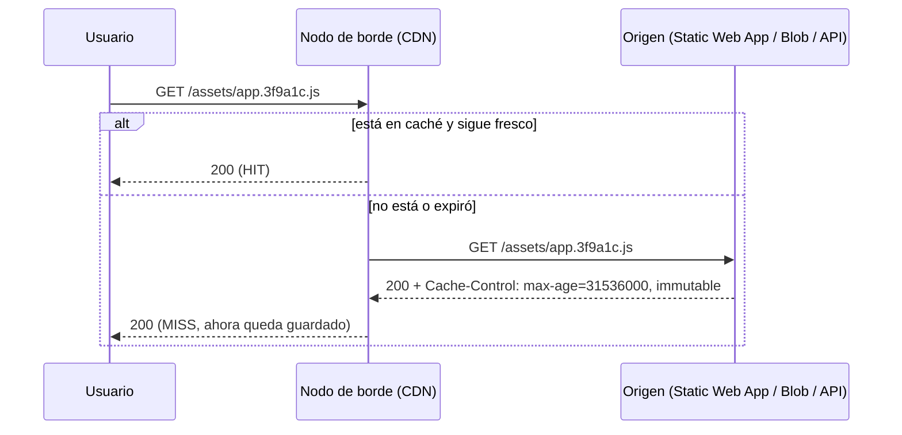

# CDN

Parte de: [[02-Fundamentos/01 Internet y web/_Índice Internet y web|Internet y web]]

> [!info] Cómo avanzar
> `progreso`: **pendiente** → **viendo** (estudiando) → **visto** (contestaste la autoevaluación sin abrir las respuestas) → **dominado** (hiciste el laboratorio o lo aplicaste de verdad).

## Contenido

### Qué es
Una **CDN** (Content Delivery Network) es una red de servidores de **borde** (edge) repartidos por el mundo que guardan copias del contenido cerca del usuario. Cuando alguien en Monterrey pide `app.js`, lo recibe de un nodo cercano en lugar de viajar hasta tu servidor de origen en otra región. Mejora tres cosas: **latencia** (menos distancia, menos RTT), **carga del origen** (la mayoría de las peticiones las responde la CDN) y **resistencia** ante picos de tráfico y ataques DDoS.

Ejemplos: Azure Front Door, Cloudflare, Akamai, Amazon CloudFront. Azure Static Web Apps ya distribuye los archivos estáticos globalmente.

### Cómo funciona


1. El DNS del dominio apunta a la CDN, que dirige al usuario al nodo más cercano.
2. El nodo busca el recurso en su caché usando una **clave de caché** (normalmente la URL; puede incluir query y ciertos headers).
3. Si lo tiene fresco, responde de inmediato (*hit*). Si no, lo pide al origen (*miss*), lo guarda según los headers de [[Caché HTTP (Cache-Control y ETag)]] y lo entrega.
4. Muchas CDN también terminan TLS, comprimen, aplican reglas de WAF y hacen de [[Proxy, proxy inverso y balanceador de carga|proxy inverso]] hacia tu API.

### Ejemplo
Itzamna.Clio (React + Vite) se publica detrás de una CDN. Vite ya genera nombres con **huella de contenido** (hash):

```text
dist/index.html
dist/assets/index-3f9a1c2b.js
dist/assets/index-8d71e0aa.css
```

La estrategia correcta de caché es:

| Archivo | Header | Por qué |
|---|---|---|
| `assets/*-<hash>.js/css` | `Cache-Control: public, max-age=31536000, immutable` | Si el contenido cambia, cambia el nombre; la versión vieja nunca se modifica |
| `index.html` | `Cache-Control: no-cache` | Siempre se revalida y así apunta a los nuevos nombres de archivo |
| Respuestas del API con datos del usuario | `Cache-Control: private, no-store` | Nunca deben quedar en una caché compartida |

En Azure Static Web Apps esto se configura en `staticwebapp.config.json`:

```json
{
  "routes": [
    { "route": "/assets/*", "headers": { "Cache-Control": "public, max-age=31536000, immutable" } },
    { "route": "/index.html", "headers": { "Cache-Control": "no-cache" } }
  ]
}
```

Así, cuando publicas una nueva versión desde Azure DevOps, los usuarios reciben el `index.html` nuevo (revalidado), que referencia `index-<hash nuevo>.js`; nadie se queda con el JS viejo y no tienes que **purgar** la CDN. La purga queda como último recurso para errores (y suele tardar en propagarse a todos los nodos).

### Cuándo usarlo y cuándo no
- **Sí**: archivos estáticos (JS, CSS, imágenes, fuentes, videos), descargas públicas, sitios con usuarios repartidos geográficamente, protección contra picos.
- **Sí, con cuidado**: respuestas de API públicas e iguales para todos (catálogo de productos) con `max-age` corto.
- **No**: respuestas personalizadas, con datos de usuario o que dependen de una cookie o del header `Authorization`. Márcalas `private` o `no-store`.
- Si todos tus usuarios están en la misma ciudad que tu servidor y el tráfico es bajo, la ganancia es menor; aun así, el borde gestionado (TLS, WAF) puede valer la pena.

### Errores comunes
- **Nombres fijos (`app.js`) con `max-age` largo**: los usuarios se quedan con la versión vieja. Usa huella de contenido.
- **Cachear `index.html` por mucho tiempo**: la app "no se actualiza". Dale `no-cache`.
- **Cachear datos privados** en la CDN: un usuario ve datos de otro. Revisa `Cache-Control` y `Vary`, y desactiva la caché en rutas `/api` salvo que sepas lo que haces.
- **Query strings que rompen la caché**: si la clave incluye parámetros de rastreo (`?utm_source=`), cada variación es un *miss*. Configura qué parámetros cuentan.
- **Olvidar que la CDN también tiene timeouts** hacia el origen: peticiones lentas terminan en `504`.

### Para profundizar
- [MDN: CDN (glosario)](https://developer.mozilla.org/en-US/docs/Glossary/CDN)
- [Cloudflare Learning: What is a CDN?](https://www.cloudflare.com/learning/cdn/what-is-a-cdn/)
- [Microsoft Learn: Caching with Azure Front Door](https://learn.microsoft.com/en-us/azure/frontdoor/front-door-caching)
- [Vite: Building for Production](https://vite.dev/guide/build)

## Autoevaluación

Contesta primero en voz alta o en papel; luego despliega la respuesta.

> [!question]- ¿Qué es una CDN y qué mejora?
> Una red de servidores de borde distribuidos que guardan copias del contenido cerca del usuario. Reduce latencia, carga del origen y ayuda contra picos y ataques DDoS.

> [!question]- Publicaste una nueva versión de `app.js` y los usuarios siguen recibiendo la vieja. ¿Cómo se evita?
> Nombres con huella de contenido (`app.3f9a1c.js`) y `Cache-Control: max-age` largo para esos archivos; el HTML con caché corta o `no-cache`. Purgar la CDN es el último recurso.

> [!question]- ¿Qué contenido no debe cachearse en una CDN compartida?
> Respuestas personalizadas o con datos de usuario (por ejemplo, las que dependen de una cookie o del header `Authorization`). Marcarlas `Cache-Control: private` o `no-store`.

