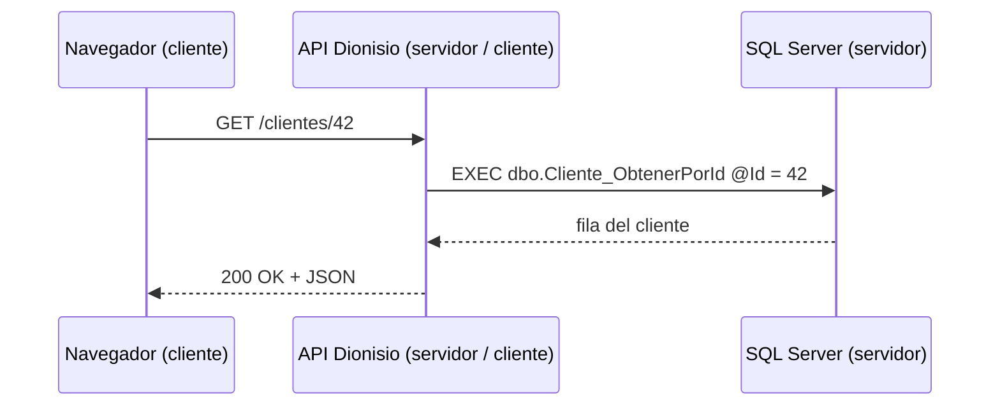

# Cliente y servidor

Parte de: [[02-Fundamentos/01 Internet y web/_Índice Internet y web|Internet y web]]

> [!info] Cómo avanzar
> `progreso`: **pendiente** → **viendo** (estudiando) → **visto** (contestaste la autoevaluación sin abrir las respuestas) → **dominado** (hiciste el laboratorio o lo aplicaste de verdad).

## Contenido

### Qué es
El modelo **cliente-servidor** describe cómo se reparten los papeles en una comunicación de red. El **cliente** es quien *inicia* la conversación: abre la conexión y manda una petición. El **servidor** es quien *espera* conexiones en una dirección y un puerto conocidos, procesa lo que le piden y responde. Casi todo lo que haces en la web (navegador contra un sitio, React contra tu API, tu API contra SQL Server) sigue este modelo.

Lo importante: **cliente y servidor son roles, no tipos de máquina**. Una laptop puede ser servidor (cuando corres `dotnet run`) y un servidor en Azure puede ser cliente (cuando llama a otra API o a la base de datos).

### Cómo funciona
1. El servidor arranca y se pone a **escuchar** en un puerto (Kestrel en `https://localhost:5001`, SQL Server en `1433`).
2. El cliente averigua a dónde conectarse: resuelve el nombre con [[DNS]] y obtiene una IP (ver [[Dirección IP y puertos]]).
3. El cliente abre una conexión ([[TCP y UDP|TCP]]) y, si es HTTPS, negocia [[TLS y certificados|TLS]].
4. Envía la petición (por ejemplo `GET /clientes/42`), el servidor la procesa y responde (`200 OK` con JSON).
5. La conexión se cierra o se reutiliza para la siguiente petición (keep-alive).



En este diagrama la API juega **dos roles a la vez**: es servidor frente al navegador y cliente frente a SQL Server.

El servidor normalmente no "recuerda" al cliente entre peticiones (HTTP es sin estado); si necesita saber quién es, el cliente lo dice en cada petición con una cookie o un token.

### Ejemplo
En Itzamna.Dionisio un controller recibe peticiones (rol servidor) y a la vez llama a un servicio externo de tipo de cambio (rol cliente) con `HttpClient`:

```csharp
// Program.cs: registramos un cliente HTTP con nombre y un timeout razonable
builder.Services.AddHttpClient("tipoCambio", c =>
{
    c.BaseAddress = new Uri("https://api.tipocambio.example/");
    c.Timeout = TimeSpan.FromSeconds(10);
});

[ApiController]
[Route("api/precios")]
public class PreciosController(IHttpClientFactory fabrica) : ControllerBase
{
    // Aquí la API es SERVIDOR: el navegador nos llama
    [HttpGet("{sku}")]
    public async Task<IActionResult> Obtener(string sku, CancellationToken ct)
    {
        // Aquí la API es CLIENTE: llamamos a otro servidor
        var http = fabrica.CreateClient("tipoCambio");
        var tc = await http.GetFromJsonAsync<decimal>("usd-mxn", ct);
        return Ok(new { sku, tipoCambio = tc });
    }
}
```

### Cuándo usarlo y cuándo no
- Es el modelo por defecto para web, APIs y bases de datos: un servidor central con la lógica y los datos, muchos clientes.
- La alternativa es **peer-to-peer** (cada nodo es cliente y servidor a la vez: BitTorrent, algunas llamadas WebRTC). Sirve cuando no quieres depender de un punto central, pero complica seguridad y coordinación.
- Para comunicación entre servicios donde el receptor puede estar caído, a veces conviene no llamar directo sino usar una cola (ver [[Mensajería y colas (conceptos)]]).

### Errores comunes
- **Culpar siempre al servidor.** Si "no responde", el problema puede estar en cualquier punto del camino: DNS que no resuelve, firewall o puerto cerrado, proxy corporativo, certificado inválido, un balanceador sin instancias sanas o un timeout del cliente demasiado corto. Revisa el camino completo (por ejemplo con `curl -v`).
- **Confiar en el cliente.** Todo lo que llega del cliente (headers, body, ids) puede ser manipulado. Las validaciones y la autorización viven en el servidor; las del front solo mejoran la experiencia.
- **Guardar estado de la conversación en memoria del servidor.** Funciona con una instancia y falla al escalar a varias detrás de un balanceador. Guarda el estado fuera (base de datos, Redis, cookie cifrada).
- **Crear un `HttpClient` nuevo por petición.** Agota sockets; usa `IHttpClientFactory` o un cliente reutilizado.

### Para profundizar
- [MDN: Visión general de HTTP](https://developer.mozilla.org/es/docs/Web/HTTP/Overview)
- [MDN: ¿Cómo funciona la web?](https://developer.mozilla.org/es/docs/Learn/Getting_started_with_the_web/How_the_Web_works)
- [Microsoft Learn: Make HTTP requests using IHttpClientFactory](https://learn.microsoft.com/en-us/aspnet/core/fundamentals/http-requests)

## Autoevaluación

Contesta primero en voz alta o en papel; luego despliega la respuesta.

> [!question]- ¿Qué distingue al cliente del servidor en una comunicación de red?
> El **cliente** inicia la petición; el **servidor** espera conexiones en un puerto y responde. Es un rol, no un tipo de máquina: un mismo proceso puede ser servidor para el navegador y cliente de una base de datos.

> [!question]- Tu API en ASP.NET Core llama a otra API externa. ¿Qué papel juega en cada conexión?
> Frente al navegador o app que la llama es **servidor**; frente a la API externa es **cliente** (por ejemplo con `HttpClient`).

> [!question]- Error común: "si el servidor no responde, es culpa del servidor". ¿Qué más puede fallar?
> DNS que no resuelve, firewall o puerto cerrado, proxy intermedio, certificado TLS inválido, timeout del cliente demasiado corto o un balanceador sin instancias sanas. Hay que revisar el camino completo.

## Práctica

- [[Lab 1 - DNS, TLS y tiempos de red con curl]]

