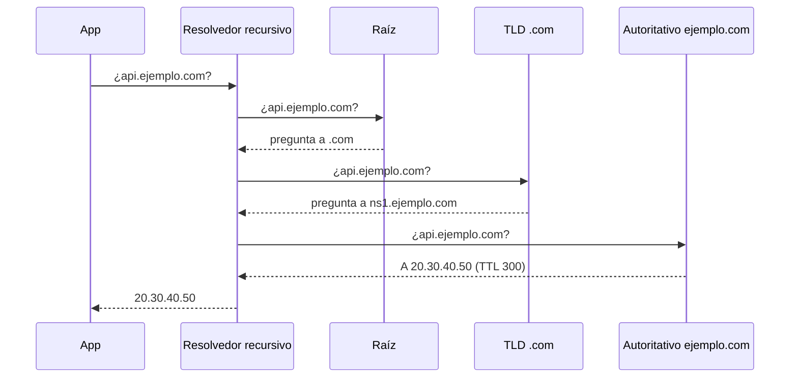

# DNS

Parte de: [[02-Fundamentos/01 Internet y web/_Índice Internet y web|Internet y web]]

> [!info] Cómo avanzar
> `progreso`: **pendiente** → **viendo** (estudiando) → **visto** (contestaste la autoevaluación sin abrir las respuestas) → **dominado** (hiciste el laboratorio o lo aplicaste de verdad).

## Contenido

### Qué es
El **DNS** (Domain Name System) es la "agenda" de internet: traduce nombres fáciles de recordar (`api.ejemplo.com`) en datos que las máquinas necesitan, sobre todo direcciones IP. También guarda otra información del dominio: servidores de correo, verificaciones de propiedad, alias. Sin DNS tendrías que conocer la IP de cada servicio, y esa IP no podría cambiar nunca.

### Cómo funciona
1. Tu app pide resolver `api.ejemplo.com`. Primero se revisan las cachés locales (navegador, sistema operativo).
2. Si no está, se pregunta a un **resolvedor recursivo** (el de tu proveedor de internet, 1.1.1.1, 8.8.8.8 o el DNS de Azure).
3. El resolvedor pregunta a un **servidor raíz**, que lo manda a los servidores del **TLD** (`.com`), que lo mandan al **servidor autoritativo** del dominio, que da la respuesta final.
4. La respuesta se guarda en caché durante su **TTL** (time to live, en segundos).



Tipos de registro más usados:

| Registro | Para qué sirve | Ejemplo |
|---|---|---|
| `A` | Nombre → IPv4 | `api` → `20.30.40.50` |
| `AAAA` | Nombre → IPv6 | `api` → `2001:db8::10` |
| `CNAME` | Alias hacia otro nombre | `www` → `dionisio.azurewebsites.net` |
| `MX` | Servidores de correo del dominio | `10 mail.ejemplo.com` |
| `TXT` | Texto libre: verificación de dominio, SPF, DKIM | `"v=spf1 include:..."` |
| `NS` / `SOA` | Quién es autoritativo y datos de la zona | obligatorios en el dominio raíz |

### Ejemplo
Vas a migrar Itzamna.Clio de un servidor viejo a Azure Static Web Apps. Plan:

1. Revisa el registro actual y su TTL (supongamos 86400 s = 1 día):
   ```bash
   nslookup -type=A clio.ejemplo.com
   dig clio.ejemplo.com A +noall +answer
   ```
2. Días antes de migrar, baja el TTL a 300 s (5 min) y espera a que venza el TTL viejo.
3. El día de la migración cambia el registro (normalmente un `CNAME` al host de Azure).
4. Verifica contra un resolvedor público, no solo contra tu caché local:
   ```bash
   dig @1.1.1.1 clio.ejemplo.com +short
   ```
5. Cuando todo esté estable, vuelve a subir el TTL.

Si cambias el registro sin bajar antes el TTL, algunos usuarios seguirán llegando al servidor viejo hasta un día después: sus resolvedores tienen la respuesta anterior en caché y la respetarán hasta que venza.

En .NET puedes resolver manualmente con `await Dns.GetHostAddressesAsync("api.ejemplo.com")`, útil para diagnosticar desde dentro de un contenedor.

### Cuándo usarlo y cuándo no
- Usa nombres DNS en cadenas de conexión y configuración, nunca IPs fijas.
- Para apuntar a servicios administrados (App Service, Front Door, Static Web Apps) usa `CNAME` en subdominios: si Azure cambia la IP, tú no haces nada.
- DNS **no** es un balanceador de carga fino: las cachés hacen que los cambios tarden y no detecta caídas por sí solo. Para eso usa un balanceador (ver [[Proxy, proxy inverso y balanceador de carga]]).

### Errores comunes
- **CNAME en el dominio raíz** (`ejemplo.com`): un CNAME no puede convivir con otros registros del mismo nombre, y el raíz necesita `SOA` y `NS`. Usa los registros tipo ALIAS/ANAME o el "CNAME flattening" que ofrecen algunos proveedores, o un registro `A`.
- **Olvidar el TTL antes de migrar**: lo explicado arriba. Bájalo con anticipación.
- **Probar solo desde tu máquina**: tu caché local puede engañarte. Limpia con `ipconfig /flushdns` y pregunta a un resolvedor externo.
- **Culpar a la app cuando es DNS**: un `HttpRequestException` con "No such host is known" es un problema de resolución, no de tu código.

### Para profundizar
- [MDN: What is a domain name?](https://developer.mozilla.org/en-US/docs/Learn/Common_questions/Web_mechanics/What_is_a_domain_name)
- [Cloudflare Learning: What is DNS?](https://www.cloudflare.com/learning/dns/what-is-dns/)
- [RFC 1034: Domain names - concepts and facilities](https://www.rfc-editor.org/rfc/rfc1034)
- [Microsoft Learn: What is Azure DNS?](https://learn.microsoft.com/en-us/azure/dns/dns-overview)

## Autoevaluación

Contesta primero en voz alta o en papel; luego despliega la respuesta.

> [!question]- ¿Qué hace el DNS?
> Traduce nombres (`api.ejemplo.com`) a datos como direcciones IP. El cliente pregunta a un resolvedor recursivo, que consulta raíz → TLD → servidor autoritativo y guarda la respuesta en caché según el **TTL**.

> [!question]- ¿Qué diferencia hay entre los registros A, AAAA, CNAME, MX y TXT?
> `A` → IPv4; `AAAA` → IPv6; `CNAME` → alias hacia otro nombre; `MX` → servidores de correo; `TXT` → texto libre (verificación de dominio, SPF, DKIM).

> [!question]- Cambiaste el registro A de tu dominio y algunos usuarios siguen llegando al servidor viejo. ¿Qué pasa?
> Las cachés DNS (resolvedores, sistema operativo, navegador) conservan la respuesta anterior hasta que vence el TTL. Antes de una migración conviene **bajar el TTL** con anticipación.

> [!question]- Error común: poner un CNAME en el dominio raíz (`ejemplo.com`). ¿Por qué es un problema?
> Un CNAME no puede convivir con otros registros del mismo nombre, y el raíz necesita `SOA` y `NS`. Se usan registros tipo ALIAS/ANAME o "CNAME flattening" que ofrecen algunos proveedores.

## Práctica

- [[Lab 1 - DNS, TLS y tiempos de red con curl]]

