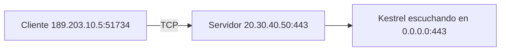

# Dirección IP y puertos

Parte de: [[02-Fundamentos/01 Internet y web/_Índice Internet y web|Internet y web]]

> [!info] Cómo avanzar
> `progreso`: **pendiente** → **viendo** (estudiando) → **visto** (contestaste la autoevaluación sin abrir las respuestas) → **dominado** (hiciste el laboratorio o lo aplicaste de verdad).

## Contenido

### Qué es
Una **dirección IP** identifica una interfaz de red dentro de una red: es "la dirección del edificio". Un **puerto** es un número de 0 a 65535 que identifica **qué proceso** dentro de esa máquina recibe el tráfico: es "el número de departamento". Con la IP llegas a la máquina; con el puerto llegas al programa correcto (Kestrel, SQL Server, SSH).

Hay dos versiones de IP: **IPv4** (`192.168.1.20`, 32 bits) e **IPv6** (`2001:db8::1`, 128 bits), que existe porque las direcciones IPv4 se agotaron.

### Cómo funciona
Cada conexión TCP queda identificada por cinco datos: protocolo, IP de origen, puerto de origen, IP de destino y puerto de destino. Por eso un servidor puede atender miles de clientes en el mismo puerto 443: cada cliente usa un puerto de origen distinto (efímero, asignado por su sistema operativo).

Puertos que debes reconocer de memoria:

| Servicio | Puerto por defecto |
|---|---|
| HTTP | 80 |
| HTTPS | 443 |
| SSH | 22 |
| SQL Server | 1433 |
| PostgreSQL | 5432 |
| DNS | 53 |

Los puertos menores a 1024 son "bien conocidos" y en Linux requieren privilegios para escucharlos; por eso las imágenes de contenedor de ASP.NET Core (desde .NET 8) escuchan por defecto en el **8080**.

Direcciones especiales:
- `127.0.0.1` / `::1` (**loopback**, `localhost`): solo la misma máquina puede conectarse.
- `0.0.0.0` / `[::]`: "todas las interfaces"; se usa al **escuchar** para aceptar conexiones desde fuera.
- Rangos privados (`10.0.0.0/8`, `172.16.0.0/12`, `192.168.0.0/16`): redes internas; para salir a internet pasan por NAT.



### Ejemplo
Ejecutas Itzamna.Dionisio en un contenedor y configuras Kestrel así:

```json
// appsettings.json
{
  "Kestrel": {
    "Endpoints": {
      "Http": { "Url": "http://127.0.0.1:5000" }
    }
  }
}
```

Publicas el puerto con `docker run -p 5000:5000 dionisio` y desde tu navegador en Windows no carga. ¿Por qué? Dentro del contenedor, `127.0.0.1` es el loopback **del contenedor**: Kestrel solo acepta conexiones que nazcan dentro de él, y el tráfico que llega desde el host entra por otra interfaz. La solución es escuchar en todas las interfaces:

```bash
docker run -p 5000:8080 -e ASPNETCORE_URLS=http://0.0.0.0:8080 dionisio
```

`ASPNETCORE_URLS` es la variable de entorno estándar de ASP.NET Core para indicar dónde escucha Kestrel.

Para ver qué proceso escucha en qué puerto en tu PC: `netstat -ano | findstr :5000` (Windows) o `ss -ltnp` (Linux).

### Cuándo usarlo y cuándo no
- Usa nombres (DNS) en la configuración, no IPs fijas: las IPs cambian al redeplegar o escalar.
- Usa puertos estándar en producción (443) para que firewalls y proxies no estorben; deja los puertos raros para desarrollo.
- No expongas a internet puertos de administración o de base de datos (22, 1433, 5432). Restríngelos por red privada, VPN o reglas de firewall.

### Errores comunes
- **Escuchar en loopback dentro de un contenedor o VM**: nadie de fuera entra. Escucha en `0.0.0.0` y publica el puerto.
- **"Address already in use"**: otro proceso ya ocupa el puerto (una instancia vieja de tu API). Búscalo con `netstat`/`ss` y ciérralo o cambia de puerto.
- **Olvidar el firewall o el grupo de seguridad de red**: el proceso escucha, pero el tráfico se bloquea antes de llegar. En Azure revisa el NSG o las restricciones de acceso del App Service.
- **Confundir la IP privada con la pública**: `192.168.x.x` solo funciona dentro de tu red local.

### Para profundizar
- [IANA: Service Name and Transport Protocol Port Number Registry](https://www.iana.org/assignments/service-names-port-numbers/service-names-port-numbers.xhtml)
- [Microsoft Learn: Configure endpoints for the ASP.NET Core Kestrel web server](https://learn.microsoft.com/en-us/aspnet/core/fundamentals/servers/kestrel/endpoints)
- [MDN: IP Address (glosario)](https://developer.mozilla.org/en-US/docs/Glossary/IP_Address)

## Autoevaluación

Contesta primero en voz alta o en papel; luego despliega la respuesta.

> [!question]- ¿Para qué sirve el puerto si ya tengo la dirección IP?
> La IP identifica la máquina (interfaz de red); el **puerto** identifica qué proceso o servicio dentro de ella recibe el tráfico. Una conexión TCP se identifica por IP y puerto de origen y destino más el protocolo.

> [!question]- ¿Qué puertos usan por defecto HTTP, HTTPS, SSH y SQL Server?
> HTTP `80`, HTTPS `443`, SSH `22`, SQL Server `1433`.

> [!question]- Tu app escucha en `127.0.0.1:5000` dentro de un contenedor y no puedes entrar desde fuera. ¿Por qué?
> `127.0.0.1` (loopback) solo acepta conexiones de la misma máquina o contenedor. Hay que escuchar en `0.0.0.0` (todas las interfaces) y publicar el puerto.

