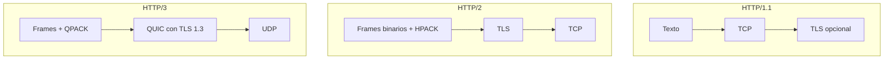

# HTTP 1.1, HTTP 2 y HTTP 3

Parte de: [[02-Fundamentos/01 Internet y web/_Índice Internet y web|Internet y web]]

> [!info] Cómo avanzar
> `progreso`: **pendiente** → **viendo** (estudiando) → **visto** (contestaste la autoevaluación sin abrir las respuestas) → **dominado** (hiciste el laboratorio o lo aplicaste de verdad).

## Contenido

### Qué es
HTTP ha tenido varias versiones de **transporte**, pero una sola **semántica**: los métodos (`GET`, `POST`…), los códigos de estado, los headers y el significado de cada uno son los mismos en HTTP/1.1, HTTP/2 y HTTP/3 (están definidos en el RFC 9110, separado de las versiones). Lo que cambia es **cómo** se codifican y transportan los mensajes. Por eso tu API no cambia su contrato al pasar de versión: cambia el rendimiento.

### Cómo funciona
#### HTTP/1.1 (texto sobre TCP)
- Mensajes en texto legible. Una conexión TCP atiende **una petición a la vez**: la siguiente espera a que termine la anterior (bloqueo de cabeza de línea a nivel de aplicación).
- Para paralelizar, los navegadores abren varias conexiones por origen (unas 6), y los desarrolladores inventaron trucos: concatenar JS, sprites, dominios extra.
- Headers repetidos y sin comprimir en cada petición.

#### HTTP/2 (binario y multiplexado sobre TCP)
- Los mensajes se dividen en **frames binarios** asignados a **streams**. Muchas peticiones viajan intercaladas por **una sola conexión** (multiplexación).
- Compresión de headers con **HPACK** (los headers repetidos casi no cuestan).
- Problema que queda: sigue sobre TCP. Si se pierde **un** paquete, TCP detiene la entrega de **todos** los streams hasta retransmitirlo (bloqueo de cabeza de línea a nivel de transporte).

#### HTTP/3 (sobre QUIC, que va sobre UDP)
- **QUIC** implementa en espacio de usuario lo que hacía TCP (confiabilidad, control de congestión) pero con **streams independientes**: un paquete perdido solo frena su stream.
- Integra **TLS 1.3** en el propio handshake: conexión cifrada en 1 RTT (0-RTT en reanudación).
- Las conexiones se identifican por un ID, no por IP y puerto, así que sobreviven a **cambios de red** (del wifi a datos móviles).
- Se usa UDP porque cambiar TCP requiere actualizar sistemas operativos y equipos de red en todo el mundo; UDP ya pasa por casi todos lados.



El cliente descubre que el servidor soporta HTTP/3 por el header `Alt-Svc` (o registros DNS HTTPS) y lo intenta en las siguientes conexiones; si UDP está bloqueado, vuelve a HTTP/2.

### Ejemplo
Kestrel (ASP.NET Core) soporta las tres versiones. En `appsettings.json`:

```json
{
  "Kestrel": {
    "Endpoints": {
      "Https": {
        "Url": "https://0.0.0.0:5001",
        "Protocols": "Http1AndHttp2AndHttp3"
      }
    }
  }
}
```

Y en el cliente puedes pedir una versión concreta:

```csharp
var req = new HttpRequestMessage(HttpMethod.Get, "https://api.ejemplo.com/v1/clientes")
{
    Version = HttpVersion.Version30,
    VersionPolicy = HttpVersionPolicy.RequestVersionOrLower // si no hay HTTP/3, baja de versión
};
var resp = await http.SendAsync(req);
Console.WriteLine(resp.Version); // 3.0, 2.0 o 1.1
```

Para revisar desde la terminal: `curl -sI --http2 https://ejemplo.com` (y `--http3` si tu curl lo soporta). En las DevTools del navegador activa la columna **Protocol** en la pestaña Network (`h2`, `h3`).

En Azure, normalmente el que habla HTTP/2 o HTTP/3 con el navegador es el borde (Front Door, CDN, App Service), y él habla con tu app por la versión que tenga configurada. gRPC exige HTTP/2 extremo a extremo (ver [[gRPC]]).

### Cuándo usarlo y cuándo no
- Habilita HTTP/2 siempre que puedas: es transparente y mejora páginas con muchos recursos.
- HTTP/3 brilla en redes móviles o con pérdida de paquetes; en redes de centro de datos la ganancia es menor. Requiere UDP abierto en firewalls.
- Con HTTP/2 ya no hace falta concatenar todo en un archivo ni repartir recursos en dominios extra; incluso empeora la caché.
- HTTP/1.1 sigue siendo necesario para clientes viejos y para el upgrade a WebSockets clásico (ver [[WebSockets]]).

### Errores comunes
- **Pensar que cambiar de versión cambia la API**: métodos, códigos y headers son iguales; no versionas tu API por esto.
- **Esperar HTTP/2 sin TLS en navegadores**: los navegadores solo usan HTTP/2 sobre HTTPS.
- **Firewalls que bloquean UDP 443**: HTTP/3 no conecta y hay una pequeña demora hasta caer a HTTP/2.
- **Mantener optimizaciones de HTTP/1.1** (domain sharding) que con HTTP/2 rompen la multiplexación en una sola conexión.

### Para profundizar
- [MDN: Evolution of HTTP](https://developer.mozilla.org/en-US/docs/Web/HTTP/Basics_of_HTTP/Evolution_of_HTTP)
- [RFC 9113: HTTP/2](https://www.rfc-editor.org/rfc/rfc9113)
- [RFC 9114: HTTP/3](https://www.rfc-editor.org/rfc/rfc9114)
- [Microsoft Learn: Use HTTP/3 with the ASP.NET Core Kestrel web server](https://learn.microsoft.com/en-us/aspnet/core/fundamentals/servers/kestrel/http3)

## Autoevaluación

Contesta primero en voz alta o en papel; luego despliega la respuesta.

> [!question]- ¿Qué problema principal resuelve HTTP/2 frente a HTTP/1.1?
> El bloqueo de cabeza de línea a nivel de aplicación: HTTP/2 **multiplexa** varias peticiones en una sola conexión TCP con frames binarios y comprime headers (HPACK). En HTTP/1.1 los navegadores abrían varias conexiones.

> [!question]- ¿Por qué HTTP/3 usa QUIC sobre UDP?
> En HTTP/2 un paquete TCP perdido detiene todos los streams. QUIC maneja cada stream de forma independiente, integra TLS 1.3 y reduce el tiempo de establecer conexión; además soporta migrar de red (wifi → datos).

> [!question]- ¿Cambia la semántica (métodos, códigos, headers) entre versiones?
> No. La semántica HTTP es la misma; cambia cómo se transporta y se codifica. Tu API no necesita cambiar su contrato.

