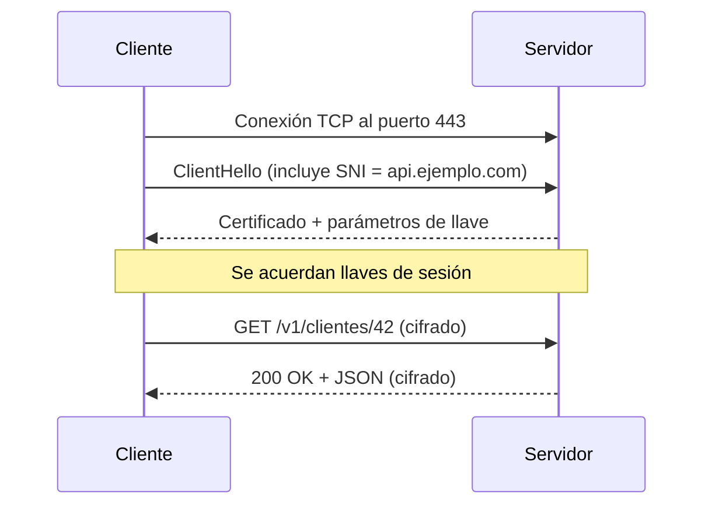

# HTTP vs HTTPS

Parte de: [[02-Fundamentos/01 Internet y web/_Índice Internet y web|Internet y web]]

> [!info] Cómo avanzar
> `progreso`: **pendiente** → **viendo** (estudiando) → **visto** (contestaste la autoevaluación sin abrir las respuestas) → **dominado** (hiciste el laboratorio o lo aplicaste de verdad).

## Contenido

### Qué es
**HTTP** es el protocolo con el que clientes y servidores web intercambian peticiones y respuestas. En texto plano, cualquiera en el camino (el wifi de la cafetería, un router comprometido, el proveedor de internet) puede **leer** y **modificar** el tráfico. **HTTPS** es exactamente el mismo HTTP pero viajando dentro de una conexión **TLS** (ver [[TLS y certificados]]), que agrega tres garantías:

1. **Confidencialidad**: el contenido va cifrado.
2. **Integridad**: si alguien altera un byte, se detecta.
3. **Autenticación del servidor**: el certificado prueba que hablas con `api.ejemplo.com` y no con un impostor.

Hoy HTTPS es obligatorio en la práctica: los navegadores marcan HTTP como "no seguro", muchas APIs del navegador (geolocalización, service workers, cookies `Secure`) exigen HTTPS y HTTP/2 y HTTP/3 en navegadores solo funcionan con TLS.

### Cómo funciona


¿Qué ve un observador en la red con HTTPS?
- **Visible**: la IP y el puerto de destino, el tamaño y el momento de los paquetes y, normalmente, el **nombre del host** (va en el SNI del handshake y en la consulta DNS, salvo que se usen DNS cifrado y Encrypted Client Hello).
- **Cifrado**: método, ruta, query string, headers (incluidas cookies y `Authorization`) y body.

#### HSTS
Si un usuario escribe `ejemplo.com` sin `https://`, la primera petición sale por HTTP y el servidor responde con una redirección a HTTPS. Un atacante en medio puede interceptar esa primera petición y mantener al usuario en HTTP (ataque **SSL stripping**). El header **`Strict-Transport-Security`** le dice al navegador: "durante `max-age` segundos, a este dominio solo entra por HTTPS", y el navegador deja de intentar HTTP. Existe además una lista de precarga (HSTS preload) integrada en los navegadores para cubrir hasta la primera visita.

```http
Strict-Transport-Security: max-age=31536000; includeSubDomains
```

### Ejemplo
En ASP.NET Core (Itzamna.Dionisio):

```csharp
var app = builder.Build();

if (!app.Environment.IsDevelopment())
{
    // HSTS solo fuera de desarrollo: el navegador lo recuerda y te puede estorbar en localhost
    app.UseHsts();
}
app.UseHttpsRedirection(); // HTTP -> HTTPS con redirección
app.MapControllers();
app.Run();
```

Para una **API** consumida por otros sistemas (no navegadores), la redirección HTTP→HTTPS no protege mucho: el cliente ya envió su token por HTTP antes de recibir el 307. Lo correcto es no escuchar HTTP en absoluto o responder con error, y documentar solo la URL `https://`.

Si la API está detrás de un proxy inverso que termina TLS (Azure Front Door, App Service), la app recibe HTTP internamente; configura los forwarded headers para que sepa que la petición original fue HTTPS (ver [[Proxy, proxy inverso y balanceador de carga]]).

### Cuándo usarlo y cuándo no
- **Siempre HTTPS** para cualquier cosa expuesta: sitios, APIs, webhooks, incluso entornos de pruebas accesibles desde internet.
- HTTP plano solo es aceptable dentro de una red privada controlada o entre un proxy y su backend en la misma red, y aun ahí cada vez más se cifra todo (zero trust).
- En desarrollo local usa el certificado de desarrollo de .NET (`dotnet dev-certs https --trust`) para que el entorno se parezca a producción.

### Errores comunes
- **Contenido mixto**: una página HTTPS que carga scripts o imágenes por HTTP. El navegador los bloquea o advierte. Usa siempre URLs `https://`.
- **Activar HSTS con `includeSubDomains` sin revisar**: si algún subdominio aún no tiene HTTPS, queda inaccesible durante todo el `max-age`. Empieza con un `max-age` corto.
- **Creer que HTTPS oculta todo**: el host y los volúmenes de tráfico siguen siendo visibles; y HTTPS no protege los datos una vez que llegan al servidor o a los logs.
- **Desactivar la validación de certificados para "que funcione"**: elimina la autenticación del servidor y abre la puerta a man-in-the-middle.

### Para profundizar
- [MDN: Strict-Transport-Security](https://developer.mozilla.org/en-US/docs/Web/HTTP/Headers/Strict-Transport-Security)
- [Microsoft Learn: Enforce HTTPS in ASP.NET Core](https://learn.microsoft.com/en-us/aspnet/core/security/enforcing-ssl)
- [RFC 6797: HTTP Strict Transport Security (HSTS)](https://www.rfc-editor.org/rfc/rfc6797)

## Autoevaluación

Contesta primero en voz alta o en papel; luego despliega la respuesta.

> [!question]- ¿Qué agrega HTTPS a HTTP?
> HTTPS es HTTP sobre **TLS**: cifrado (nadie en medio lee el tráfico), integridad (no lo modifican) y autenticación del servidor mediante su certificado.

> [!question]- ¿Qué partes de una petición HTTPS puede ver alguien en la red?
> La IP y el puerto de destino y, normalmente, el nombre del host (SNI en el handshake y la consulta DNS). Ruta, query, headers y body van cifrados.

> [!question]- ¿Qué es HSTS y qué problema resuelve?
> El header `Strict-Transport-Security` le indica al navegador que use solo HTTPS con ese dominio durante `max-age`. Evita que un atacante degrade la primera visita a HTTP (SSL stripping).

## Práctica

- [[Lab 1 - DNS, TLS y tiempos de red con curl]]

