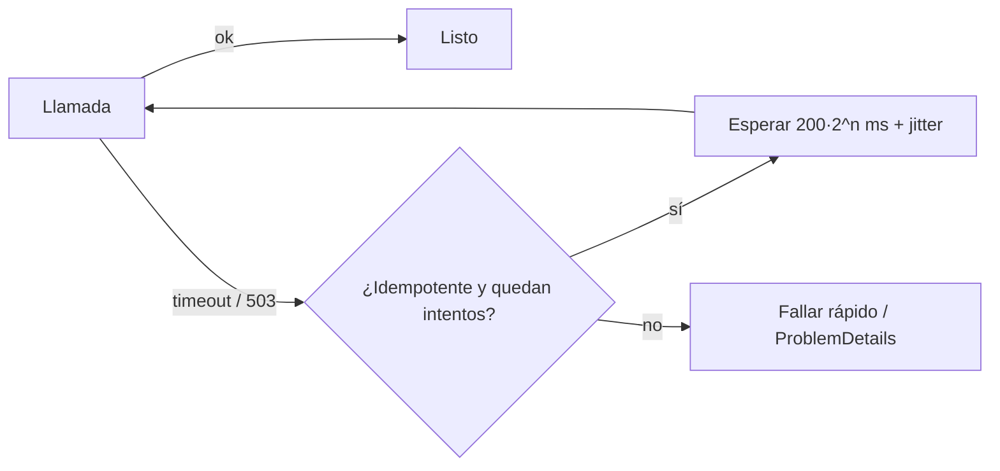

# Latencia, ancho de banda y timeouts

Parte de: [[02-Fundamentos/01 Internet y web/_Índice Internet y web|Internet y web]]

> [!info] Cómo avanzar
> `progreso`: **pendiente** → **viendo** (estudiando) → **visto** (contestaste la autoevaluación sin abrir las respuestas) → **dominado** (hiciste el laboratorio o lo aplicaste de verdad).

## Contenido

### Qué es
Tres conceptos que explican por qué algo "se siente lento" y cómo protegerte cuando otro servicio falla:

- **Latencia**: cuánto tarda un dato en llegar. Se mide casi siempre como **RTT** (round-trip time, ida y vuelta) en milisegundos. Depende de la distancia, los saltos de red y las colas.
- **Ancho de banda**: cuántos datos caben por segundo en el canal (Mbps). Es el tamaño de la tubería, no su velocidad.
- **Timeout**: el tiempo máximo que un cliente está dispuesto a esperar antes de rendirse. Sin timeouts, un servicio lento contagia su lentitud a todos los que lo llaman.

Una analogía: la latencia es lo que tarda un camión en ir de CDMX a Guadalajara; el ancho de banda es cuántos camiones caben en la carretera al mismo tiempo. Agregar carriles no hace que un camión llegue antes.

### Cómo funciona
#### Cuánto tarda una operación
Tiempo ≈ (número de viajes en serie × RTT) + (tamaño ÷ ancho de banda) + procesamiento.

- **Llamadas en serie**: 6 llamadas con 80 ms de RTT y 20 ms de procesamiento cada una tardan 6 × (80 + 20) = **600 ms**. En paralelo tardan lo que la más lenta, unos **100 ms** (si el cliente permite suficientes conexiones simultáneas).
- **Transferencias grandes**: aquí manda el ancho de banda. Ojo con las unidades: 1 byte = 8 bits. Un archivo de 50 MB son 400 Mb; con 100 Mbps tarda **4 s**, sin contar latencia.

Conclusión práctica: en APIs con muchas llamadas pequeñas el enemigo es la **latencia** (reduce viajes: agrupa, paraleliza, reutiliza conexiones); en descargas grandes es el **ancho de banda** (comprime, usa CDN).

#### Tipos de timeout en un cliente HTTP
1. **Conexión**: tiempo para resolver DNS y establecer TCP + TLS.
2. **Respuesta / lectura**: tiempo esperando datos del servidor.
3. **Total de la operación**: todo, incluidos los reintentos. Es el que realmente percibe el usuario.

En .NET `HttpClient.Timeout` es de **100 segundos** por defecto; casi nunca quieres esperar tanto.

#### Reintentos con backoff exponencial y jitter
Si una llamada falla por timeout, reintentar de inmediato y sin límite multiplica la carga sobre un servicio que ya está saturado (**tormenta de reintentos**). Lo correcto:
- Pocos reintentos (2 o 3) y **solo en operaciones idempotentes** (ver [[Métodos seguros e idempotentes]]).
- Espera creciente: con base 200 ms, 200, 400, 800, 1600… Antes del 4.º reintento ya esperaste 200 + 400 + 800 + 1600 = **3000 ms**.
- **Jitter** (aleatoriedad) para que miles de clientes no reintenten en el mismo instante.
- **Circuit breaker**: si la mayoría falla, deja de llamar un rato y falla rápido.



### Ejemplo
En Itzamna.Dionisio, con el paquete `Microsoft.Extensions.Http.Resilience` (basado en Polly):

```csharp
builder.Services.AddHttpClient("facturacion", c =>
{
    c.BaseAddress = new Uri("https://facturacion.example/");
})
.AddStandardResilienceHandler(o =>
{
    o.AttemptTimeout.Timeout = TimeSpan.FromSeconds(3);          // cada intento
    o.TotalRequestTimeout.Timeout = TimeSpan.FromSeconds(10);    // operación completa
    o.Retry.MaxRetryAttempts = 3;
    o.Retry.BackoffType = Polly.DelayBackoffType.Exponential;
    o.Retry.UseJitter = true;
    o.Retry.Delay = TimeSpan.FromMilliseconds(200);
});
```

El handler estándar ya incluye circuit breaker y, por defecto, reintenta ante errores transitorios **sin distinguir el método**; para no reintentar operaciones no idempotentes agrega `o.Retry.DisableForUnsafeHttpMethods()`. Pasa siempre el `CancellationToken` de la petición para no seguir trabajando cuando el usuario ya se fue.

Para medir: `curl -w "dns:%{time_namelookup} conexión:%{time_connect} tls:%{time_appconnect} primer_byte:%{time_starttransfer} total:%{time_total}\n" -o /dev/null -s https://api.ejemplo.com/health`.

### Cuándo usarlo y cuándo no
- Pon timeouts **siempre** en llamadas salientes (HTTP, SQL con `commandTimeout`, colas).
- Alinea los timeouts en cadena: el del cliente externo > el del proxy > el de la app > el de la base de datos. Si no, alguien corta antes y el trabajo sigue corriendo para nada.
- Reintentos solo ante errores transitorios (timeouts, `503`, `429` respetando `Retry-After`); nunca ante `400` o `404`.
- Para procesos largos no subas el timeout: usa un flujo asíncrono con `202 Accepted` (ver [[Códigos HTTP 2xx (éxito)]]).

### Errores comunes
- **Confundir Mb con MB**: los proveedores anuncian megabits; los archivos se miden en megabytes. Divide entre 8.
- **Dejar el timeout por defecto de 100 s**: los hilos y conexiones se acumulan esperando.
- **Reintentar inmediato y sin límite**: tormenta de reintentos. Usa backoff, jitter y un tope.
- **Reintentar `POST` no idempotentes**: cobros dobles. Usa una idempotency key (ver [[Idempotencia]]).
- **Llamadas en serie que podrían ir en paralelo**: usa `Task.WhenAll` cuando no dependen entre sí.

### Para profundizar
- [Microsoft Learn: Build resilient HTTP apps](https://learn.microsoft.com/en-us/dotnet/core/resilience/http-resilience)
- [MDN: Understanding latency](https://developer.mozilla.org/en-US/docs/Web/Performance/Understanding_latency)
- [Azure Architecture Center: Retry pattern](https://learn.microsoft.com/en-us/azure/architecture/patterns/retry)
- [Azure Architecture Center: Circuit Breaker pattern](https://learn.microsoft.com/en-us/azure/architecture/patterns/circuit-breaker)

## Ejercicios

Resuélvelos en papel o en la herramienta; la solución está plegada.

> [!question]- Una página hace 6 llamadas secuenciales a un API con RTT de 80 ms y 20 ms de procesamiento cada una. ¿Cuánto tarda como mínimo? ¿Y si las haces en paralelo?
> Secuencial: 6 × (80 + 20) = 600 ms. En paralelo: ≈ 100 ms (lo que tarda la más lenta), sin contar límites de conexiones.

> [!question]- ¿Cuánto tarda en descargarse un archivo de 50 MB con 100 Mbps de ancho de banda (ignorando latencia)?
> 50 MB = 400 Mb; 400 / 100 = **4 s**.

> [!question]- Con backoff exponencial base 200 ms (200, 400, 800…), ¿cuánto se espera en total antes del 4.º reintento?
> 200 + 400 + 800 + 1600 = **3000 ms** (sin jitter).

## Autoevaluación

Contesta primero en voz alta o en papel; luego despliega la respuesta.

> [!question]- ¿Qué diferencia hay entre latencia y ancho de banda?
> **Latencia**: cuánto tarda un dato en ir y volver (RTT, en ms). **Ancho de banda**: cuántos datos caben por segundo. Una API que hace 20 llamadas en serie sufre por latencia aunque sobre ancho de banda.

> [!question]- ¿Qué timeouts conviene distinguir en un cliente HTTP?
> Conexión (establecer TCP/TLS), lectura/respuesta y el tiempo total de la operación (incluyendo reintentos). En .NET `HttpClient.Timeout` es 100 s por defecto: casi siempre conviene bajarlo.

> [!question]- Error común: reintentar inmediatamente y sin límite cuando hay timeout. ¿Qué problema causa?
> Multiplica la carga sobre un servicio que ya está lento (tormenta de reintentos). Usa pocos reintentos con backoff exponencial y jitter, solo en operaciones idempotentes, y un circuit breaker.

## Práctica

- [[Lab 1 - DNS, TLS y tiempos de red con curl]]

