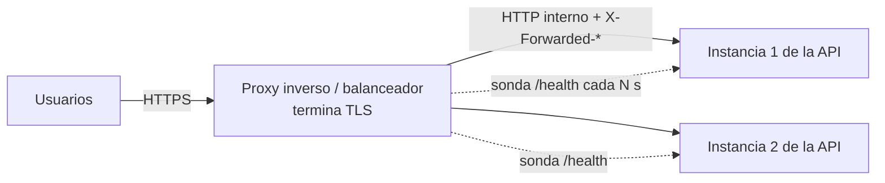

# Proxy, proxy inverso y balanceador de carga

Parte de: [[02-Fundamentos/01 Internet y web/_Índice Internet y web|Internet y web]]

> [!info] Cómo avanzar
> `progreso`: **pendiente** → **viendo** (estudiando) → **visto** (contestaste la autoevaluación sin abrir las respuestas) → **dominado** (hiciste el laboratorio o lo aplicaste de verdad).

## Contenido

### Qué es
Son intermediarios que se colocan entre clientes y servidores:

- **Proxy (forward proxy)**: actúa **a nombre del cliente**. Los equipos de una empresa salen a internet a través de él; sirve para filtrar, auditar o cachear. El servidor de destino ve la IP del proxy, no la del empleado.
- **Proxy inverso (reverse proxy)**: actúa **a nombre de los servidores**. Recibe el tráfico público y lo reenvía al backend correcto. El cliente cree que habla con el servidor final. Ejemplos: Nginx, YARP (en .NET), Azure Front Door, Application Gateway, API Management.
- **Balanceador de carga**: un tipo de proxy inverso (o equipo de red) que reparte las peticiones entre **varias instancias** de la misma app y saca de la rotación las que no están sanas.

Un proxy inverso suele encargarse de terminar TLS, comprimir, cachear, aplicar límites de tasa, enrutar por ruta (`/api` a un servicio, `/` a otro) y ocultar la topología interna.

### Cómo funciona


#### Headers reenviados
Como la conexión que recibe la app viene del proxy, la app ve la IP del proxy y, si el proxy terminó TLS, cree que la petición fue `http`. El proxy agrega:
- `X-Forwarded-For`: IP del cliente original (y de proxies intermedios).
- `X-Forwarded-Proto`: `https` si la petición original fue HTTPS.
- `X-Forwarded-Host`: el host original.
- O el header estándar `Forwarded` (RFC 7239).

La app solo debe creerlos si vienen de un proxy **de confianza**; si no, cualquiera podría falsificar su IP mandando el header.

#### Sondas de salud
El balanceador consulta periódicamente una ruta (por ejemplo `/health`) en cada instancia. Si falla varias veces seguidas, deja de mandarle tráfico. Si la sonda está mal configurada (ruta que no existe, que exige autenticación o que tarda), el balanceador **saca instancias sanas** y el servicio cae completo.

#### Sticky sessions
Algunos balanceadores pueden mandar siempre al mismo usuario a la misma instancia (afinidad por cookie). Parece cómodo si guardas sesión en memoria, pero reparte mal la carga, complica escalar y, si muere la instancia, esos usuarios pierden su sesión. Mejor diseñar la app **sin estado** y guardar el estado en una cookie cifrada, Redis o la base de datos.

### Ejemplo
Itzamna.Dionisio corre en dos instancias de App Service detrás de Front Door. En `Program.cs`:

```csharp
using Microsoft.AspNetCore.HttpOverrides;

builder.Services.Configure<ForwardedHeadersOptions>(o =>
{
    o.ForwardedHeaders = ForwardedHeaders.XForwardedFor | ForwardedHeaders.XForwardedProto;
    // Solo confiamos en la red interna del proxy (ejemplo; usa tus rangos reales).
    // En .NET 10 se usa KnownIPNetworks con System.Net.IPNetwork (KnownNetworks quedó obsoleto)
    o.KnownIPNetworks.Add(System.Net.IPNetwork.Parse("10.0.0.0/8"));
});
builder.Services.AddHealthChecks()
    .AddCheck("vivo", () => Microsoft.Extensions.Diagnostics.HealthChecks.HealthCheckResult.Healthy());

var app = builder.Build();
app.UseForwardedHeaders();      // primero, para que todo lo demás vea la IP y el esquema reales
app.UseHttpsRedirection();
app.MapHealthChecks("/health"); // sin autenticación y rápida
app.MapControllers();
app.Run();
```

Con esto `HttpContext.Connection.RemoteIpAddress` muestra la IP del usuario, `Request.Scheme` es `https` y `UseHttpsRedirection` ya no provoca ciclos de redirección. En App Service de Linux puede bastar la variable `ASPNETCORE_FORWARDEDHEADERS_ENABLED=true` (Pendiente de confirmar si aplica a tu plan y tipo de app).

Para un proxy inverso propio en .NET existe **YARP**, configurable desde `appsettings.json` con rutas y clusters.

### Cuándo usarlo y cuándo no
- **Proxy inverso**: casi siempre en producción, aunque sea el que ya incluye tu plataforma (App Service, Container Apps). Centraliza TLS, compresión, WAF y enrutamiento.
- **Balanceador**: en cuanto tengas más de una instancia o quieras despliegues sin caída.
- **API gateway** (API Management): cuando además necesitas productos, llaves, cuotas y transformación para terceros.
- **No** agregues capas de proxy "por si acaso": cada salto suma latencia, otro timeout que alinear y otro lugar donde fallar.

### Errores comunes
- **No procesar forwarded headers**: logs con la IP del proxy, URLs generadas con `http://`, ciclos de redirección `ERR_TOO_MANY_REDIRECTS`.
- **Confiar en `X-Forwarded-For` de cualquiera**: limita `KnownProxies`/`KnownNetworks`.
- **Sonda de salud pesada**: si `/health` consulta la base de datos con timeout largo, una lentitud de SQL saca todas las instancias. Separa *liveness* (¿el proceso vive?) de *readiness* (¿puede atender?).
- **Timeouts desalineados**: si el proxy corta a 30 s y la app tarda 60 s, verás `504` sin errores en los logs de la app.
- **Depender de sticky sessions** para estado en memoria.

### Para profundizar
- [Microsoft Learn: Configure ASP.NET Core to work with proxy servers and load balancers](https://learn.microsoft.com/en-us/aspnet/core/host-and-deploy/proxy-load-balancer)
- [YARP: documentación oficial](https://learn.microsoft.com/en-us/aspnet/core/fundamentals/servers/yarp/getting-started)
- [MDN: Proxy servers and tunneling](https://developer.mozilla.org/en-US/docs/Web/HTTP/Proxy_servers_and_tunneling)
- [Microsoft Learn: Health checks in ASP.NET Core](https://learn.microsoft.com/en-us/aspnet/core/host-and-deploy/health-checks)

## Autoevaluación

Contesta primero en voz alta o en papel; luego despliega la respuesta.

> [!question]- ¿Qué diferencia hay entre un proxy (forward) y un proxy inverso?
> El **proxy** actúa a nombre del cliente (salida corporativa, filtrado). El **proxy inverso** actúa a nombre de los servidores: recibe el tráfico público y lo reenvía al backend (Nginx, YARP, Azure Front Door).

> [!question]- Detrás de un proxy inverso tu app ve siempre la IP del proxy y `http`. ¿Cómo lo arreglas?
> El proxy agrega `X-Forwarded-For`, `X-Forwarded-Proto` (o `Forwarded`) y la app los procesa solo si vienen de proxies de confianza; en ASP.NET Core con `UseForwardedHeaders` y `KnownProxies`/`KnownNetworks`.

> [!question]- ¿Qué es una sonda de salud (health probe) en un balanceador y qué pasa si está mal configurada?
> Es una petición periódica (por ejemplo `/health`) para saber si una instancia puede recibir tráfico. Si apunta a una ruta que falla o tarda, el balanceador saca instancias sanas y el servicio cae completo.

> [!question]- ¿Qué son las sesiones "pegajosas" (sticky sessions) y por qué evitarlas?
> El balanceador manda al mismo usuario siempre a la misma instancia. Complica escalar y perder una instancia tira sesiones; mejor guardar el estado fuera (cookie cifrada, Redis).

