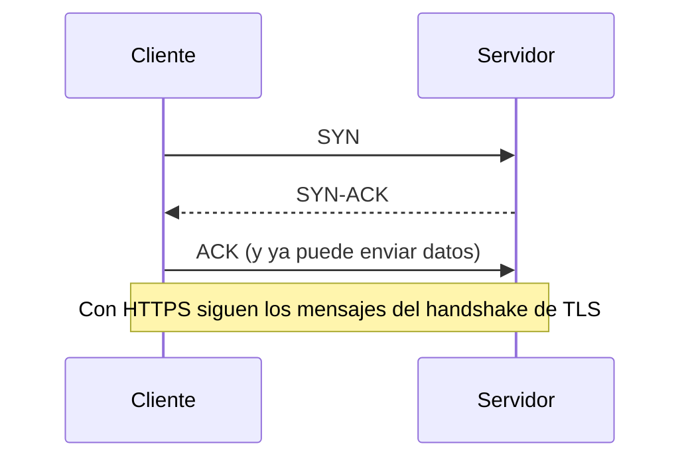

# TCP y UDP

Parte de: [[02-Fundamentos/01 Internet y web/_Índice Internet y web|Internet y web]]

> [!info] Cómo avanzar
> `progreso`: **pendiente** → **viendo** (estudiando) → **visto** (contestaste la autoevaluación sin abrir las respuestas) → **dominado** (hiciste el laboratorio o lo aplicaste de verdad).

## Contenido

### Qué es
**TCP** y **UDP** son los dos protocolos de transporte principales de internet: viajan encima de IP y debajo de protocolos de aplicación como HTTP, DNS o SQL Server (TDS).

- **TCP** (Transmission Control Protocol) es **orientado a conexión**: antes de mandar datos establece una conexión, numera los bytes, confirma lo que llega, retransmite lo que se pierde y entrega todo **en orden**. Además controla el flujo y la congestión para no saturar la red.
- **UDP** (User Datagram Protocol) manda **datagramas** sueltos, sin conexión ni garantías: pueden llegar desordenados, duplicados o no llegar. A cambio, tiene muy poca sobrecarga y latencia.

### Cómo funciona
TCP abre la conexión con el **three-way handshake**:



Ese intercambio cuesta **un viaje de ida y vuelta (RTT)** antes de mandar el primer byte útil. Si el servidor está a 80 ms de RTT, ya gastaste 80 ms; con TLS 1.3 se suma otro RTT. Por eso reutilizar conexiones (keep-alive, pool de conexiones) importa tanto: la segunda petición por la misma conexión se ahorra todo eso.

Si se pierde un segmento TCP, el receptor no entrega los datos siguientes a la aplicación hasta recibir el faltante (bloqueo de cabeza de línea). Esa es una de las razones de que HTTP/3 se mueva a QUIC (ver [[HTTP 1.1, HTTP 2 y HTTP 3]]).

UDP no tiene handshake: el primer paquete ya lleva datos. Si la aplicación necesita confiabilidad, la implementa ella misma.

| | TCP | UDP |
|---|---|---|
| Conexión | Sí (handshake) | No |
| Orden y entrega | Garantizados | Sin garantías |
| Sobrecarga | Mayor | Mínima |
| Usos típicos | HTTP/1.1 y HTTP/2, SQL Server, SSH, SMTP | DNS, voz y video en tiempo real, juegos, QUIC/HTTP 3 |

### Ejemplo
En .NET casi nunca usas TCP directamente; `HttpClient` y `SqlConnection` lo hacen por ti. Lo que sí controlas es la **reutilización de conexiones**:

```csharp
// Mal: un HttpClient por petición abre una conexión TCP+TLS nueva cada vez
// y deja sockets en TIME_WAIT
using var malo = new HttpClient();

// Bien: cliente compartido con pool de conexiones
var handler = new SocketsHttpHandler
{
    PooledConnectionLifetime = TimeSpan.FromMinutes(5), // renueva conexiones para respetar cambios de DNS
    ConnectTimeout = TimeSpan.FromSeconds(5)            // tiempo máximo para el handshake
};
var http = new HttpClient(handler);
```

Con SQL Server pasa lo mismo: ADO.NET mantiene un **pool** de conexiones; abrir y cerrar `SqlConnection` con `using` en cada consulta Dapper es correcto porque en realidad se toma y devuelve una conexión del pool.

Para ver conexiones TCP en tu máquina: `netstat -an` (Windows) o `ss -tan` (Linux).

### Cuándo usarlo y cuándo no
- **TCP**: cuando necesitas que todo llegue y en orden (APIs, bases de datos, transferencias de archivos). Es el valor por defecto.
- **UDP**: cuando llegar tarde es peor que perder un dato (una videollamada no quiere un cuadro de hace un segundo), en consultas cortas como DNS, o cuando el protocolo de arriba implementa su propia confiabilidad (QUIC).
- Como desarrollador web casi nunca eliges directamente; eliges el protocolo de aplicación y este define el transporte.

### Errores comunes
- **No reutilizar conexiones**: cada petición paga handshake TCP + TLS. Usa `IHttpClientFactory` o un `HttpClient` compartido.
- **Suponer que UDP "es más rápido" siempre**: sin control de congestión puedes saturar la red; además debes resolver pérdidas tú mismo.
- **Ignorar el RTT en arquitecturas con muchas llamadas**: diez llamadas secuenciales a otra región suman diez RTT (ver [[Latencia, ancho de banda y timeouts]]).
- **Confundir "conexión rechazada" con "timeout"**: rechazada (RST) significa que nadie escucha en ese puerto; timeout suele indicar firewall que descarta paquetes.

### Para profundizar
- [RFC 9293: Transmission Control Protocol (TCP)](https://www.rfc-editor.org/rfc/rfc9293)
- [RFC 768: User Datagram Protocol](https://www.rfc-editor.org/rfc/rfc768)
- [MDN: TCP (glosario)](https://developer.mozilla.org/en-US/docs/Glossary/TCP)

## Autoevaluación

Contesta primero en voz alta o en papel; luego despliega la respuesta.

> [!question]- ¿Cuál es la diferencia principal entre TCP y UDP?
> **TCP** es orientado a conexión: handshake, entrega ordenada, retransmisión y control de flujo. **UDP** envía datagramas sin conexión ni garantías: menos latencia y sobrecarga.

> [!question]- ¿Cuándo preferirías UDP?
> Cuando llegar tarde es peor que perder un paquete o la app maneja su propia confiabilidad: voz y video en tiempo real, juegos, DNS (consultas cortas) y QUIC/HTTP 3, que implementa confiabilidad encima de UDP.

> [!question]- ¿Qué es el three-way handshake y por qué afecta la latencia?
> `SYN` → `SYN-ACK` → `ACK`. Cuesta un viaje de ida y vuelta (RTT) antes de enviar datos; con TLS se suman más viajes. Por eso reutilizar conexiones (keep-alive, pool de `HttpClient`) es importante.

