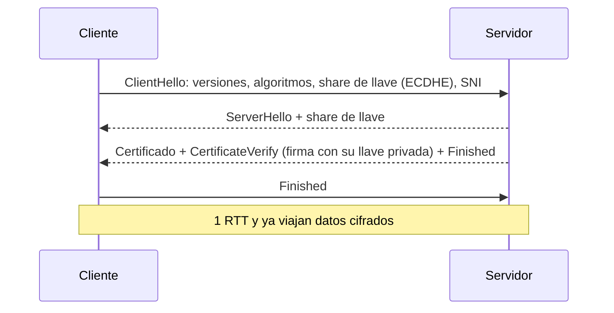

# TLS y certificados

Parte de: [[02-Fundamentos/01 Internet y web/_Índice Internet y web|Internet y web]]

> [!info] Cómo avanzar
> `progreso`: **pendiente** → **viendo** (estudiando) → **visto** (contestaste la autoevaluación sin abrir las respuestas) → **dominado** (hiciste el laboratorio o lo aplicaste de verdad).

## Contenido

### Qué es
**TLS** (Transport Layer Security) es el protocolo que cifra y autentica una conexión; es la "S" de HTTPS y también protege conexiones a SQL Server, correo y muchas otras. Un **certificado X.509** es el documento digital con el que un servidor demuestra su identidad: asocia un nombre (`api.ejemplo.com`) con una **llave pública**, y viene firmado por una **autoridad certificadora** (CA) en la que el cliente confía.

### Cómo funciona
#### Qué contiene un certificado
- **Sujeto** y, sobre todo, la extensión **SAN** (Subject Alternative Name) con los nombres válidos: `api.ejemplo.com`, `*.ejemplo.com`. Los navegadores validan contra el SAN, no contra el antiguo Common Name.
- La **llave pública** del servidor (la privada nunca sale del servidor).
- **Vigencia** (`notBefore` / `notAfter`).
- **Emisor** y la **firma** de la CA.

#### Cadena de confianza
El certificado del servidor lo firma una CA intermedia, y a esta la firma una CA raíz que ya viene instalada en el sistema operativo o el navegador. El cliente verifica cada firma de la cadena hasta llegar a una raíz de confianza, que la fecha sea válida, que el nombre coincida con el SAN y que no esté revocado. Por eso el servidor debe enviar también los certificados intermedios.

#### Handshake de TLS 1.3 (resumen)

Cliente y servidor generan llaves efímeras con Diffie-Hellman; de ahí sale la llave de sesión simétrica. El servidor firma el intercambio con su llave privada, probando que es dueño del certificado. Todo cuesta **1 RTT** (en reanudación puede haber 0-RTT, con riesgos de repetición). TLS 1.2 necesitaba 2 RTT.

### Ejemplo
Diagnosticar el certificado de un servicio:

```bash
openssl s_client -connect api.ejemplo.com:443 -servername api.ejemplo.com -showcerts </dev/null  # cadena, SAN y vigencia
curl -vI https://api.ejemplo.com   # muestra el handshake y errores de validación
```

En .NET el error típico al llamar a una API con un certificado mal configurado es `AuthenticationException: The remote certificate is invalid`. La tentación es esta:

```csharp
// NUNCA en producción: acepta cualquier certificado, incluso el de un atacante
var handler = new HttpClientHandler
{
    ServerCertificateCustomValidationCallback = (msg, cert, chain, errores) => true
};
```

Eso elimina la autenticación del servidor: cualquier intermediario puede presentar su propio certificado y leer o modificar el tráfico (man-in-the-middle). La solución correcta es arreglar el certificado del servidor (nombre en el SAN, intermedios completos, vigencia) o, si es una CA interna, instalar su raíz en el almacén de confianza.

Con SQL Server, desde `Microsoft.Data.SqlClient` 4.0 la conexión se cifra por defecto (`Encrypt=True`); `TrustServerCertificate=True` tiene el mismo problema que el callback anterior y solo debería usarse en desarrollo.

### Cuándo usarlo y cuándo no
- TLS siempre que haya red de por medio con datos sensibles.
- Certificados gratuitos y automáticos: Let's Encrypt (protocolo ACME) o los certificados administrados de Azure App Service y Front Door. La vigencia máxima de los certificados públicos se está reduciendo por acuerdo del CA/Browser Forum (Pendiente de confirmar las fechas exactas del calendario), así que **automatiza la renovación**.
- Para autenticar **clientes** (servicio a servicio) existe mTLS: el cliente también presenta certificado.
- Certificados autofirmados: solo en desarrollo o redes internas con la raíz distribuida a propósito.

### Errores comunes
- **`NET::ERR_CERT_COMMON_NAME_INVALID`**: el host al que entras no está en el SAN. Ejemplo típico: el certificado es para `www.ejemplo.com` y entraste a `ejemplo.com`, o entraste por IP.
- **Cadena incompleta**: funciona en tu navegador (que tenía el intermedio en caché) pero falla en `HttpClient` o en Linux. Configura el servidor para enviar los intermedios.
- **Certificado vencido**: causa caídas totales. Monitorea vigencias y automatiza.
- **Desactivar la validación** con `=> true` o `TrustServerCertificate=True` en producción.
- **Subir la llave privada al repositorio**: va en Azure Key Vault o en el almacén del servicio, nunca en Git.

### Para profundizar
- [RFC 8446: The Transport Layer Security (TLS) Protocol Version 1.3](https://www.rfc-editor.org/rfc/rfc8446)
- [MDN: Transport Layer Security](https://developer.mozilla.org/en-US/docs/Web/Security/Transport_Layer_Security)
- [Let's Encrypt: How It Works](https://letsencrypt.org/how-it-works/)

## Autoevaluación

Contesta primero en voz alta o en papel; luego despliega la respuesta.

> [!question]- ¿Qué contiene un certificado X.509 de servidor y quién lo avala?
> La llave pública, el nombre del sujeto y los nombres alternativos (SAN), vigencia, emisor y la firma de una **autoridad certificadora** (CA). El cliente valida la cadena hasta una CA raíz de confianza.

> [!question]- El navegador marca "NET::ERR_CERT_COMMON_NAME_INVALID". ¿Qué revisas?
> Que el host al que entras esté en el **SAN** del certificado (por ejemplo, el certificado es para `www.ejemplo.com` y entraste a `ejemplo.com`), y que no estés entrando por IP.

> [!question]- ¿Por qué no debes desactivar la validación de certificados en producción (`ServerCertificateCustomValidationCallback = (...) => true`)?
> Elimina la autenticación del servidor: cualquier intermediario puede presentar un certificado propio y leer o modificar el tráfico (man-in-the-middle).

> [!question]- ¿Qué pasa en el handshake de TLS 1.3, en resumen?
> Cliente y servidor acuerdan algoritmos e intercambian llaves (Diffie-Hellman efímero); el servidor presenta su certificado y prueba que tiene la llave privada. Toma 1 RTT (0-RTT en reanudación).

## Práctica

- [[Lab 1 - DNS, TLS y tiempos de red con curl]]

