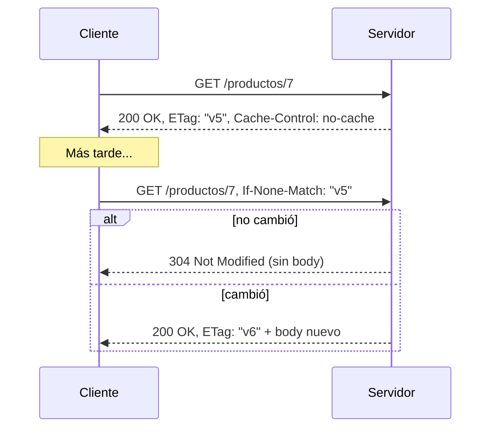

# Caché HTTP (Cache-Control y ETag)

Parte de: [[02-Fundamentos/02 HTTP/_Índice HTTP|HTTP]]

> [!info] Cómo avanzar
> `progreso`: **pendiente** → **viendo** (estudiando) → **visto** (contestaste la autoevaluación sin abrir las respuestas) → **dominado** (hiciste el laboratorio o lo aplicaste de verdad).

## Contenido

### Qué es
La **caché HTTP** permite reutilizar respuestas ya obtenidas en lugar de pedirlas otra vez al servidor. Puede vivir en el navegador (caché **privada**) o en intermediarios como una CDN o un proxy (caché **compartida**). El servidor controla qué se guarda, por cuánto tiempo y quién puede guardarlo mediante headers, sobre todo **`Cache-Control`**; y con validadores como **`ETag`** el cliente puede preguntar "¿cambió?" sin volver a descargar todo.

Bien usada reduce latencia, carga del servidor y costos. Mal usada muestra datos viejos o, peor, datos de un usuario a otro.

### Cómo funciona
#### Directivas de `Cache-Control` que debes dominar
| Directiva | Significado |
|---|---|
| `max-age=N` | La respuesta está **fresca** durante N segundos: se usa sin preguntar |
| `no-cache` | Se puede guardar, pero hay que **revalidar** con el servidor antes de cada uso |
| `no-store` | No guardar **nunca** (datos sensibles) |
| `private` | Solo la caché del navegador del usuario; no CDN ni proxies |
| `public` | También cachés compartidas, incluso si la petición tenía `Authorization` |
| `immutable` | El contenido nunca cambia mientras esté fresco (archivos con hash) |
| `s-maxage=N` | Como `max-age` pero solo para cachés compartidas |

Ojo: `no-cache` **no** significa "no guardar"; eso es `no-store`.

#### Revalidación con `ETag`
El `ETag` es un identificador de la versión de la representación (un hash o un número de versión).



Existe también `Last-Modified` / `If-Modified-Since`, basado en fechas (menos preciso).

#### `ETag` en escrituras: concurrencia optimista
El mismo `ETag` evita **actualizaciones perdidas**. Ana y Luis abren el producto 7 (versión `"v5"`). Luis guarda primero con `If-Match: "v5"` y la versión pasa a `"v6"`. Cuando Ana guarda con `If-Match: "v5"`, el servidor ve que ya no coincide y responde **`412 Precondition Failed`**; Ana recarga y decide. Si el servidor exige siempre la condición, responde `428 Precondition Required` a quien no la mande (ver [[Códigos HTTP 4xx (error del cliente)]]).

#### `Vary`
Indica qué headers de la petición cambian la respuesta (`Vary: Accept-Encoding`, `Vary: Accept-Language`). La caché guarda una copia por cada combinación.

### Ejemplo
En Itzamna.Dionisio la tabla `Producto` tiene una columna `rowversion` que SQL Server cambia en cada actualización. La usamos como ETag:

```csharp
[HttpGet("{id:int}")]
public async Task<IActionResult> Obtener(int id, [FromServices] IObtenerProducto consulta, CancellationToken ct)
{
    var p = await consulta.EjecutarAsync(id, ct);  // Dapper + Producto_ObtenerPorId.sql
    if (p is null) return NotFound();

    var etag = $"\"{Convert.ToBase64String(p.Version)}\"";
    if (Request.Headers.IfNoneMatch == etag) return StatusCode(StatusCodes.Status304NotModified);

    Response.Headers.ETag = etag;
    Response.Headers.CacheControl = "private, no-cache"; // dato de negocio: revalidar siempre
    return Ok(p);
}

[HttpPut("{id:int}")]
public async Task<IActionResult> Actualizar(int id, ProductoDto dto, [FromServices] IActualizarProducto cmd, CancellationToken ct)
{
    var ifMatch = Request.Headers.IfMatch.ToString();
    if (string.IsNullOrEmpty(ifMatch)) return StatusCode(StatusCodes.Status428PreconditionRequired);

    var version = Convert.FromBase64String(ifMatch.Trim('"'));
    var filas = await cmd.EjecutarAsync(id, dto, version, ct); // UPDATE ... WHERE Id=@Id AND Version=@Version
    return filas == 0 ? StatusCode(StatusCodes.Status412PreconditionFailed) : NoContent();
}
```

El `UPDATE` con `WHERE Version = @Version` es lo que hace atómica la comprobación: si otro cambió el registro, afecta 0 filas.

Para archivos estáticos con hash (Vite): `Cache-Control: public, max-age=31536000, immutable` (ver [[CDN]]).

### Cuándo usarlo y cuándo no
- **`max-age` largo + `immutable`**: archivos con huella de contenido.
- **`no-cache` + `ETag`**: datos que cambian pero se leen mucho (catálogos, configuraciones).
- **`private`**: cualquier respuesta personalizada.
- **`no-store`**: datos sensibles (estados de cuenta, tokens, información médica).
- No cachees respuestas a `POST` ni dependas de la caché para la consistencia: es una optimización.
- En ASP.NET Core también existen el *response caching* y el *output caching* (caché en el servidor); son cosas distintas a los headers que guían al cliente.

### Errores comunes
- **Datos de un usuario aparecen a otro**: una respuesta personalizada se guardó en una caché compartida. Faltó `Cache-Control: private` (o `no-store`) o `Vary` con el header relevante.
- **Confundir `no-cache` con `no-store`**.
- **ETag que no cambia** cuando cambia el contenido (por ejemplo, calculado solo con el id): el cliente nunca ve la versión nueva.
- **Ignorar `If-Match`** en escrituras: actualizaciones perdidas silenciosas.
- **No mandar ningún header**: cada navegador y proxy aplica heurísticas propias y el comportamiento se vuelve impredecible.

### Para profundizar
- [MDN: HTTP caching](https://developer.mozilla.org/en-US/docs/Web/HTTP/Caching)
- [MDN: Cache-Control](https://developer.mozilla.org/en-US/docs/Web/HTTP/Headers/Cache-Control)
- [RFC 9111: HTTP Caching](https://www.rfc-editor.org/rfc/rfc9111)
- [MDN: ETag](https://developer.mozilla.org/en-US/docs/Web/HTTP/Headers/ETag)

## Autoevaluación

Contesta primero en voz alta o en papel; luego despliega la respuesta.

> [!question]- ¿Qué significan `max-age`, `no-cache`, `no-store`, `private` y `public` en `Cache-Control`?
> `max-age=N`: fresca por N segundos. `no-cache`: se puede guardar pero hay que **revalidar** antes de usar. `no-store`: no guardar nunca. `private`: solo la caché del navegador. `public`: también cachés compartidas (CDN).

> [!question]- ¿Cómo funciona la revalidación con `ETag`?
> El servidor envía `ETag: "v5"`. Después el cliente pide con `If-None-Match: "v5"`; si no cambió, el servidor responde `304 Not Modified` sin body.

> [!question]- ¿Para qué sirve el `ETag` en escrituras?
> Para concurrencia optimista: el cliente envía `If-Match: "v5"` en el `PUT`; si otro ya lo cambió, el servidor responde `412 Precondition Failed` y se evita la actualización perdida.

> [!question]- Error común: datos de un usuario aparecen a otro. ¿Qué header faltó?
> La respuesta personalizada se cacheó en una caché compartida. Faltó `Cache-Control: private` (o `no-store`), o `Vary` con el header relevante.

## Práctica

- [[Lab 2 - Caché, redirecciones y compresión con curl]]

