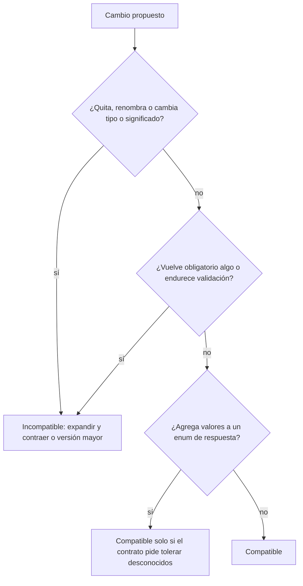

# Compatibilidad hacia atrás y cambios incompatibles en APIs

Parte de: [[02-Fundamentos/02 HTTP/_Índice HTTP|HTTP]]

> [!info] Cómo avanzar
> `progreso`: **pendiente** → **viendo** (estudiando) → **visto** (contestaste la autoevaluación sin abrir las respuestas) → **dominado** (hiciste el laboratorio o lo aplicaste de verdad).

## Contenido

### Qué es
Un cambio es **compatible hacia atrás** (backward compatible) cuando los clientes que ya existen siguen funcionando sin modificar nada después de que lo despliegas. Un **cambio incompatible** (breaking change) obliga a los clientes a cambiar su código; si lo despliegas sin coordinar, los rompes. En cuanto tu API tiene consumidores que no controlas (otra área, un proveedor, una app móvil que la gente no actualiza), esta distinción decide si puedes desplegar en cualquier momento o necesitas una nueva versión (ver [[Versionado de APIs]]).

### Cómo funciona
Piensa siempre desde el cliente: ¿qué asume su código?

#### Normalmente compatibles
- Agregar un **endpoint** nuevo.
- Agregar un campo **opcional** a la petición (con un valor por defecto que conserve el comportamiento anterior).
- Agregar un campo a la **respuesta**, *si* los clientes ignoran campos desconocidos (`System.Text.Json` lo hace por defecto).
- Aceptar más formatos o valores de entrada.
- Relajar una validación (aceptar cadenas más largas).

#### Incompatibles
- Quitar o **renombrar** un campo, endpoint o parámetro.
- Cambiar el **tipo** (`"total": "150.00"` → `150.00`) o el formato (fecha local → UTC).
- Volver **obligatorio** algo que era opcional, o endurecer una validación.
- Cambiar el **significado** de un campo o el código de estado de un caso.
- Cambiar la forma de los errores, la paginación o la autenticación.

#### Zona gris: enums
Agregar un valor a un enum de la **respuesta** (`estado: "enRevision"`) parece inofensivo, pero un cliente con `switch` exhaustivo o que deserializa a un enum estricto puede fallar. Documenta desde el inicio que los enums pueden crecer y pide a los clientes tolerar valores desconocidos.



#### Expandir y contraer
Para hacer un cambio incompatible sin romper a nadie: 1) **expandir**: agrega lo nuevo junto a lo viejo; 2) **migrar**: avisa y espera a que los clientes se muevan; 3) **contraer**: retira lo viejo en la siguiente versión mayor.

#### Ley de Postel (principio de robustez)
"Sé estricto en lo que envías y tolerante en lo que aceptas." Aplicada a APIs: el servidor genera respuestas exactas y el cliente ignora lo que no conoce. Su límite: si el servidor es demasiado tolerante (acepta campos mal escritos, tipos ambiguos), los clientes empiezan a depender de esos comportamientos no documentados y luego no puedes corregirlos sin romperlos. Valida lo importante.

### Ejemplo
En Itzamna.Dionisio quieres renombrar `nombre` a `nombreCompleto` en `ClienteDto`. Renombrar directo es incompatible. Expandir:

```csharp
public sealed record ClienteDto(int Id, string NombreCompleto, string Email)
{
    // Se mantiene mientras haya clientes que lo lean; se quita en v2
    [Obsolete("Usa NombreCompleto. Se retira en v2.")]
    public string Nombre => NombreCompleto;
}
```

La respuesta lleva ambos campos. En la documentación OpenAPI se marca `nombre` como `deprecated`, y en el pipeline de Azure DevOps se compara el OpenAPI generado contra el publicado para detectar cambios accidentales (ver [[Contract-first y diseño de contratos]]).

Para el SQL: si el procedimiento `Cliente_Obtener` cambia una columna, haz lo mismo: agrega la nueva, deja la vieja hasta que no la use nadie.

### Cuándo usarlo y cuándo no
- Diseña **siempre** pensando en compatibilidad cuando hay consumidores externos o despliegues independientes (front y back por separado).
- Si front y API se despliegan juntos y nadie más consume la API, puedes ser más flexible, pero cuidado con usuarios que tienen la SPA vieja abierta en el navegador.
- Cuando acumulas muchos cambios incompatibles necesarios, planea una versión mayor en lugar de parches infinitos.

### Errores comunes
- **Renombrar propiedades en C# sin darte cuenta** de que cambian el JSON público (en code-first). Fija los nombres con `[JsonPropertyName]` o compara contratos en CI.
- **Cambiar la serialización global** (camelCase → PascalCase, enums como número → texto) en una actualización "técnica".
- **Endurecer validaciones** con FluentValidation (por ejemplo, RFC obligatorio) sin avisar: los clientes que antes funcionaban reciben `400`.
- **Asumir que agregar campos siempre es seguro**: clientes con deserialización estricta o validación de esquema cerrado pueden fallar.
- **No comunicar**: ningún cambio incompatible debe sorprender a un consumidor.

### Para profundizar
- [Microsoft REST API Guidelines](https://github.com/microsoft/api-guidelines/blob/vNext/azure/Guidelines.md)
- [Google AIP-180: Backwards compatibility](https://google.aip.dev/180)
- [RFC 9413: Maintaining Robust Protocols](https://www.rfc-editor.org/rfc/rfc9413)

## Autoevaluación

Contesta primero en voz alta o en papel; luego despliega la respuesta.

> [!question]- ¿Qué cambios son compatibles hacia atrás?
> Agregar endpoints, agregar campos **opcionales** a la petición, agregar campos a la respuesta (si los clientes ignoran desconocidos) y aceptar más formatos.

> [!question]- Clasifica: renombrar `nombre` a `nombreCompleto` en la respuesta.
> **Incompatible**: los clientes que leen `nombre` se rompen. Alternativa: agregar `nombreCompleto`, mantener `nombre` marcado como obsoleto y retirarlo en la siguiente versión mayor.

> [!question]- ¿Agregar un valor nuevo a un enum de la respuesta es seguro?
> No siempre: clientes que hacen `switch` exhaustivo o deserializan a un enum estricto pueden fallar. Documenta que el enum puede crecer y pide a los clientes tolerar valores desconocidos.

> [!question]- ¿Qué es la ley de Postel aplicada a APIs y su límite?
> "Sé estricto en lo que envías y tolerante en lo que aceptas". Ayuda a la compatibilidad, pero ser demasiado tolerante crea dependencias en comportamientos no documentados; valida lo importante.

