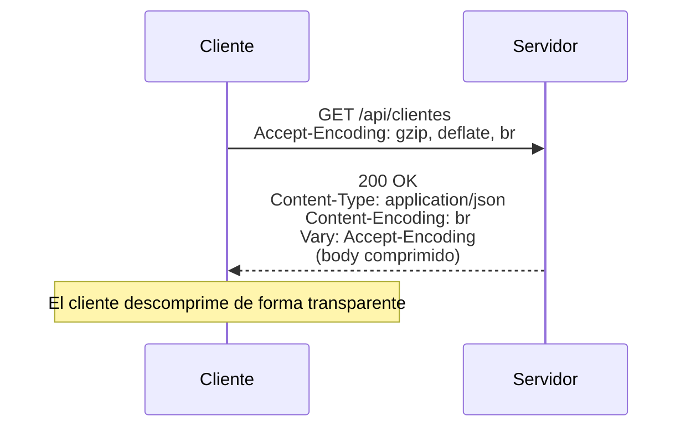

# Compresión HTTP

Parte de: [[02-Fundamentos/02 HTTP/_Índice HTTP|HTTP]]

> [!info] Cómo avanzar
> `progreso`: **pendiente** → **viendo** (estudiando) → **visto** (contestaste la autoevaluación sin abrir las respuestas) → **dominado** (hiciste el laboratorio o lo aplicaste de verdad).

## Contenido

### Qué es
La **compresión HTTP** reduce el tamaño del body de las respuestas (y a veces de las peticiones) antes de enviarlo por la red. El cliente anuncia qué algoritmos entiende, el servidor elige uno, comprime y avisa cuál usó. Un JSON o un bundle de JavaScript suelen reducirse a una fracción de su tamaño, lo que mejora tiempos de carga sobre todo en redes móviles. Los algoritmos habituales son **gzip** y **Brotli** (`br`); también existe **zstd** en navegadores recientes (Pendiente de confirmar el soporte exacto por navegador).

### Cómo funciona


1. **Negociación**: el cliente envía `Accept-Encoding` con los algoritmos que soporta.
2. El servidor (o el proxy, o la CDN) comprime con uno de ellos y lo indica en **`Content-Encoding`**.
3. Agrega **`Vary: Accept-Encoding`** para que las cachés guarden una copia por algoritmo y no entreguen Brotli a un cliente que no lo entiende.
4. El cliente descomprime. Navegadores y `HttpClient` (si lo configuras) lo hacen solos.

No confundas `Content-Encoding` (compresión de la representación) con `Transfer-Encoding: chunked` (cómo se trocea el envío en HTTP/1.1).

#### Qué comprimir y qué no
- **Sí**: texto (JSON, HTML, CSS, JS, SVG, XML, CSV).
- **No**: formatos **ya comprimidos** (JPEG, PNG, WebP, MP4, ZIP, PDF en muchos casos, XLSX, que ya es un ZIP): gastas CPU sin ganar nada y a veces el resultado crece. Tampoco respuestas **muy pequeñas** (alrededor de 1 KB o menos): la ganancia no compensa.

#### Riesgo: BREACH
Si una respuesta comprimida mezcla un **secreto** (un token CSRF, por ejemplo) con **texto que el atacante controla** (un parámetro reflejado), el atacante puede probar muchas variantes y observar el **tamaño** comprimido: cuando su texto coincide con parte del secreto, la compresión es mejor y la respuesta pesa menos. Así adivina el secreto byte a byte aunque vaya cifrado con TLS. Mitigaciones: no reflejar entrada del usuario junto a secretos, enmascarar los tokens por respuesta (ASP.NET Core lo hace con sus tokens antiforgery) o no comprimir esas respuestas.

### Ejemplo
En Itzamna.Dionisio, si la API no está detrás de un proxy que ya comprima:

```csharp
using Microsoft.AspNetCore.ResponseCompression;
using System.IO.Compression;

builder.Services.AddResponseCompression(o =>
{
    o.EnableForHttps = true; // desactivado por defecto por el riesgo BREACH; evalúa tus respuestas
    o.Providers.Add<BrotliCompressionProvider>();
    o.Providers.Add<GzipCompressionProvider>();
});
builder.Services.Configure<BrotliCompressionProviderOptions>(o => o.Level = CompressionLevel.Fastest);

var app = builder.Build();
app.UseResponseCompression(); // antes de los middlewares que escriben la respuesta
app.MapControllers();
```

En la práctica, en Azure suele ser mejor que comprima el borde (Front Door, App Service, la CDN) y dejar a la app libre de ese trabajo de CPU. Para los archivos de Vite puedes precomprimir en el build (archivos `.br`, `.gz`) y que el servidor estático los sirva sin gastar CPU en cada petición.

Comprueba con curl:

```bash
curl -s -H "Accept-Encoding: br, gzip" -D - -o /dev/null https://api.ejemplo.com/v1/clientes
```

En la salida busca `Content-Encoding` y `Vary`.

En un cliente .NET que llama a otra API: `new HttpClientHandler { AutomaticDecompression = DecompressionMethods.All }`.

### Cuándo usarlo y cuándo no
- Activa la compresión para respuestas de texto medianas o grandes: casi siempre conviene.
- Prefiere comprimir en un solo lugar (proxy o CDN) para no comprimir dos veces ni gastar CPU de la app.
- Usa Brotli para estáticos precomprimidos (mejor relación) y un nivel rápido para respuestas dinámicas.
- Evita comprimir respuestas que reflejan entrada del usuario junto a secretos.

### Errores comunes
- **Comprimir imágenes, videos o ZIP**: CPU desperdiciada.
- **Olvidar `Vary: Accept-Encoding`**: una caché puede servir contenido comprimido a un cliente que no lo soporta.
- **Doble compresión** (la app y el proxy), o un proxy que descomprime y recomprime.
- **Medir mal**: compara el tamaño transferido en DevTools (columna *Transferred* frente a *Size*), no solo el tamaño del recurso.
- **Activar compresión en HTTPS sin pensar en BREACH** para páginas con tokens y datos reflejados.

### Para profundizar
- [MDN: Compression in HTTP](https://developer.mozilla.org/en-US/docs/Web/HTTP/Compression)
- [MDN: Accept-Encoding](https://developer.mozilla.org/en-US/docs/Web/HTTP/Headers/Accept-Encoding)
- [Microsoft Learn: Response compression in ASP.NET Core](https://learn.microsoft.com/en-us/aspnet/core/performance/response-compression)

## Autoevaluación

Contesta primero en voz alta o en papel; luego despliega la respuesta.

> [!question]- ¿Cómo se negocia la compresión?
> El cliente envía `Accept-Encoding: gzip, br`; el servidor comprime y responde `Content-Encoding: br` (o gzip) y `Vary: Accept-Encoding`.

> [!question]- ¿Qué no vale la pena comprimir?
> Formatos ya comprimidos (JPEG, PNG, MP4, ZIP) y respuestas muy pequeñas (menos de ~1 KB): se gasta CPU sin ganar nada.

> [!question]- ¿Por qué comprimir respuestas que mezclan secretos con datos que el usuario controla puede ser un riesgo?
> Ataques como BREACH miden el tamaño comprimido para adivinar secretos (por ejemplo tokens CSRF) reflejados en la misma respuesta. Mitigación: no reflejar entrada junto a secretos o enmascararlos por respuesta.

## Práctica

- [[Lab 2 - Caché, redirecciones y compresión con curl]]

