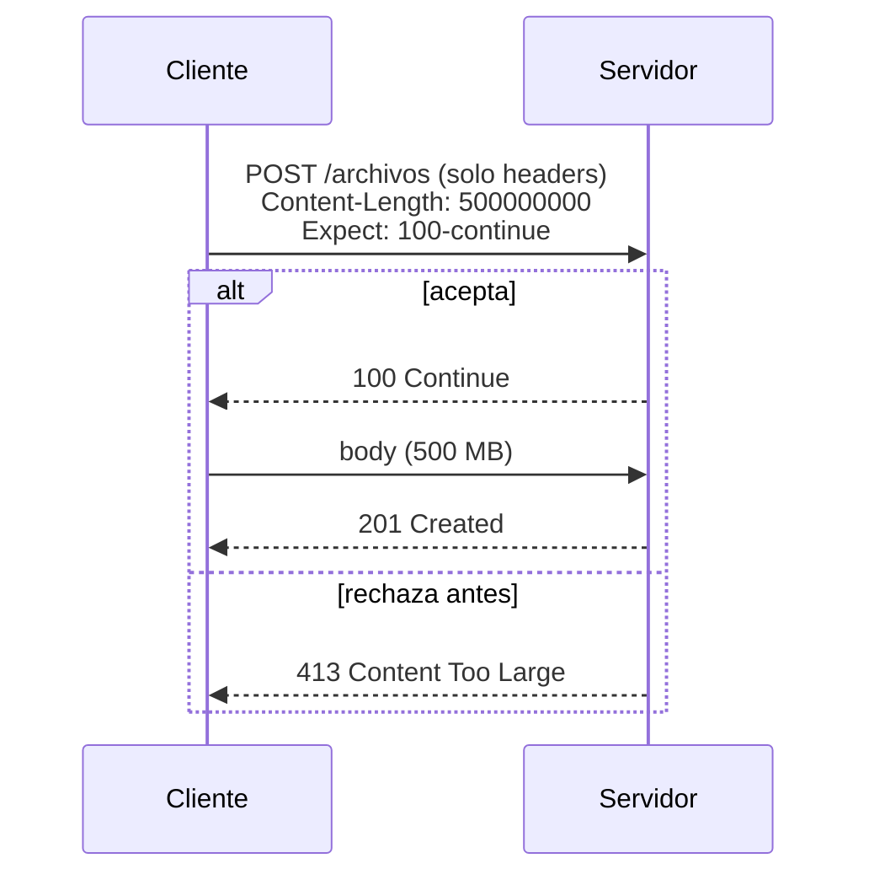

# Códigos HTTP 1xx (informativos)

Parte de: [[Códigos de estado HTTP]]

> [!info] Cómo avanzar
> `progreso`: **pendiente** → **viendo** (estudiando) → **visto** (contestaste la autoevaluación sin abrir las respuestas) → **dominado** (hiciste el laboratorio o lo aplicaste de verdad).

## Contenido

### Qué es
Los códigos **1xx** son **respuestas provisionales**: el servidor le dice algo al cliente *antes* de la respuesta final, por la misma petición. Después de un 1xx siempre llega otra respuesta (2xx, 3xx, 4xx o 5xx). Como desarrollador de APIs casi nunca los escribes a mano, pero aparecen en situaciones concretas que conviene reconocer: subir archivos grandes, abrir WebSockets y acelerar la carga de páginas.

### Cómo funciona
| Código | Nombre | Cuándo aparece |
|---|---|---|
| `100` | Continue | El cliente preguntó con `Expect: 100-continue` si puede mandar el body |
| `101` | Switching Protocols | El servidor acepta cambiar de protocolo (WebSocket sobre HTTP/1.1) |
| `103` | Early Hints | El servidor sugiere recursos para precargar mientras prepara la respuesta |

(El `102 Processing` de WebDAV está en desuso.)

#### `100 Continue`
Sirve para no desperdiciar una subida grande. El cliente manda primero solo los headers con `Expect: 100-continue`. Si el servidor responde `100 Continue`, el cliente envía el body; si el servidor ya sabe que la va a rechazar (archivo demasiado grande → `413 Content Too Large`, sin autenticación → `401`), responde el error de inmediato y el cliente se ahorra subir cientos de MB.



#### `101 Switching Protocols`
Es el que ves al abrir un **WebSocket** sobre HTTP/1.1: el cliente envía un `GET` con `Upgrade: websocket` y `Connection: Upgrade`; el servidor acepta con `101` y, desde ese momento, la conexión TCP deja de hablar HTTP y transporta frames de WebSocket (ver [[WebSockets]]). En HTTP/2 los WebSockets usan otro mecanismo (`CONNECT` extendido), sin 101.

#### `103 Early Hints`
Mientras el servidor calcula la página (consulta a base de datos, por ejemplo), envía un `103` con headers `Link` para que el navegador empiece a descargar CSS o fuentes:

```http
HTTP/1.1 103 Early Hints
Link: </assets/index-8d71e0aa.css>; rel=preload; as=style

HTTP/1.1 200 OK
Content-Type: text/html
...
```

Es útil sobre todo en páginas renderizadas en el servidor; en una SPA servida desde CDN aporta menos.

### Ejemplo
En las DevTools del navegador, al conectarte al hub de [[SignalR]] de Ocelotl.Hermes, en la pestaña **Network** filtra por **WS**: verás la petición de negociación y luego una con estado **101 Switching Protocols**. Si en lugar de 101 ves 200 o 404, el proxy no está dejando pasar el upgrade o la ruta del hub es incorrecta.

Con `HttpClient` en .NET, `Expect: 100-continue` se controla así:

```csharp
using var contenido = new StreamContent(File.OpenRead("respaldo.zip"));
var req = new HttpRequestMessage(HttpMethod.Post, "https://api.ejemplo.com/v1/respaldos") { Content = contenido };
req.Headers.ExpectContinue = true; // pide permiso antes de mandar el body
var resp = await http.SendAsync(req);
```

Con curl, al subir con `-T` o datos grandes, curl agrega `Expect: 100-continue` automáticamente en HTTP/1.1 y lo verás con `-v`.

### Cuándo usarlo y cuándo no
- **`100-continue`**: subidas grandes donde es probable un rechazo temprano (autenticación, tamaño). Para bodies pequeños solo agrega un viaje de ida y vuelta.
- **`101`**: no lo programas tú; lo gestiona el framework al aceptar un WebSocket.
- **`103`**: cuando tu servidor tarda en generar HTML y tiene recursos críticos conocidos; requiere soporte del servidor o la CDN.
- Recuerda que el cliente siempre debe esperar una respuesta final después de un 1xx.

### Errores comunes
- **Proxies que no soportan el upgrade**: WebSocket no conecta y no aparece el 101. Revisa la configuración del proxy o del balanceador.
- **Servidores que ignoran `Expect`** y no responden 100: algunos clientes esperan un tiempo y luego envían el body igual, lo que agrega una demora inexplicable.
- **Pensar que un 1xx es la respuesta final** al registrar métricas o escribir pruebas.
- **Esperar 101 en HTTP/2**: allí los WebSockets funcionan distinto.

### Para profundizar
- [MDN: 100 Continue](https://developer.mozilla.org/en-US/docs/Web/HTTP/Status/100)
- [MDN: 101 Switching Protocols](https://developer.mozilla.org/en-US/docs/Web/HTTP/Status/101)
- [MDN: 103 Early Hints](https://developer.mozilla.org/en-US/docs/Web/HTTP/Status/103)
- [RFC 9110, sección 15.2: Informational 1xx](https://www.rfc-editor.org/rfc/rfc9110#section-15.2)

## Autoevaluación

Contesta primero en voz alta o en papel; luego despliega la respuesta.

> [!question]- ¿Qué son los códigos 1xx?
> Respuestas provisionales antes de la final. Por ejemplo `100 Continue`, `101 Switching Protocols` y `103 Early Hints`.

> [!question]- ¿Cuándo ves `101 Switching Protocols`?
> Al abrir un **WebSocket** sobre HTTP/1.1: el cliente pide `Upgrade: websocket` y el servidor acepta con 101.

> [!question]- ¿Para qué sirve `Expect: 100-continue`?
> El cliente pregunta antes de enviar un body grande; si el servidor responde `100 Continue` lo manda, y si responde un error (por ejemplo 413 o 401) se ahorra la subida.

