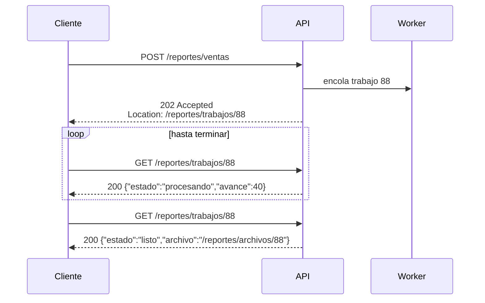

# Códigos HTTP 2xx (éxito)

Parte de: [[Códigos de estado HTTP]]

> [!info] Cómo avanzar
> `progreso`: **pendiente** → **viendo** (estudiando) → **visto** (contestaste la autoevaluación sin abrir las respuestas) → **dominado** (hiciste el laboratorio o lo aplicaste de verdad).

## Contenido

### Qué es
Los códigos **2xx** indican que la petición se recibió, se entendió y se aceptó. Pero "éxito" tiene matices importantes para el cliente: ¿hay cuerpo que leer?, ¿se creó algo nuevo y dónde está?, ¿ya terminó o apenas empezó? Elegir bien entre 200, 201, 202 y 204 hace que el front y otros sistemas sepan qué hacer sin leer el body.

### Cómo funciona
| Código | Nombre | Úsalo cuando… | Detalles |
|---|---|---|---|
| `200` | OK | La operación terminó y devuelves un cuerpo | Respuesta típica de `GET`, o de `PUT`/`PATCH` que devuelve el recurso |
| `201` | Created | Se **creó** un recurso | Incluye `Location` con la URL del nuevo recurso y, opcionalmente, el recurso en el body |
| `202` | Accepted | Aceptaste el trabajo pero se procesará **después** | Devuelve dónde consultar el estado |
| `204` | No Content | Éxito **sin cuerpo** | Típico de `DELETE` o de `PUT` que no devuelve nada |
| `206` | Partial Content | Respondes solo un **rango** del recurso | Respuesta a un header `Range` |

#### `202` para procesos largos
Si un reporte tarda 5 minutos, no mantengas la petición abierta (los proxies cortan a los 30–240 s y el usuario se queda esperando). El patrón es:



El cliente consulta el recurso de estado con polling o recibe el aviso por [[Server-Sent Events (SSE)]], [[SignalR]] o un [[Webhooks|webhook]].

#### `206 Partial Content`
El cliente pide `Range: bytes=0-1048575` (el primer MB) y el servidor responde `206` con `Content-Range: bytes 0-1048575/52428800`. Se usa para **descargas reanudables** y **streaming de video** (el reproductor salta al minuto 10 pidiendo ese rango). El servidor anuncia que lo soporta con `Accept-Ranges: bytes`.

### Ejemplo
En Wee.Reporteria con controllers:

```csharp
[ApiController]
[Route("api/reportes")]
public class ReportesController(IColaReportes cola, IConsultarTrabajo consulta) : ControllerBase
{
    [HttpPost("ventas")]
    public async Task<IActionResult> Solicitar(SolicitudReporteDto dto, CancellationToken ct)
    {
        var id = await cola.EncolarAsync(dto, ct);                 // guarda el trabajo y lo manda a una cola
        return AcceptedAtAction(nameof(Estado), new { id }, new { id, estado = "pendiente" }); // 202 + Location
    }

    [HttpGet("trabajos/{id:guid}")]
    public async Task<IActionResult> Estado(Guid id, CancellationToken ct)
    {
        var t = await consulta.EjecutarAsync(id, ct);
        return t is null ? NotFound() : Ok(t);                       // 200 con estado y avance
    }

    [HttpGet("archivos/{id:guid}")]
    public IActionResult Descargar(Guid id)
    {
        var ruta = Path.Combine("/datos/reportes", $"{id}.xlsx");
        // enableRangeProcessing permite 206 para descargas reanudables
        return PhysicalFile(ruta, "application/vnd.openxmlformats-officedocument.spreadsheetml.sheet",
                            "ventas.xlsx", enableRangeProcessing: true);
    }

    [HttpDelete("trabajos/{id:guid}")]
    public IActionResult Cancelar(Guid id) => NoContent();           // 204
}
```

Para crear: `return CreatedAtAction(nameof(Obtener), new { id = nuevo.Id }, nuevo);` produce `201` con `Location` calculado.

### Cuándo usarlo y cuándo no
- **201** solo si realmente se creó algo identificable; si el `POST` ejecuta una acción sin recurso nuevo, `200` o `204`.
- **202** cuando el trabajo es asíncrono; no lo uses si ya terminaste (el cliente pensará que debe esperar).
- **204** cuando no hay nada útil que devolver; recuerda que **no puede llevar body**.
- **200** con body cuando devolver el recurso actualizado le ahorra al cliente otra llamada.

### Errores comunes
- **`200` en todo**, incluso al crear: el cliente no sabe dónde quedó el recurso. Usa `201` + `Location`.
- **`204` con body**: algunos clientes lo ignoran y otros fallan. Si quieres devolver algo, usa `200`.
- **Procesos largos síncronos** que acaban en `504` del proxy: usa `202`.
- **`202` sin forma de consultar el estado**: el cliente no tiene cómo saber cuándo terminó.
- **Usar `200` para errores** con un body `{"ok": false}` (ver [[Códigos de estado HTTP]]).

### Para profundizar
- [MDN: 201 Created](https://developer.mozilla.org/en-US/docs/Web/HTTP/Status/201)
- [MDN: 202 Accepted](https://developer.mozilla.org/en-US/docs/Web/HTTP/Status/202)
- [MDN: HTTP range requests](https://developer.mozilla.org/en-US/docs/Web/HTTP/Range_requests)
- [Azure Architecture Center: Asynchronous Request-Reply pattern](https://learn.microsoft.com/en-us/azure/architecture/patterns/async-request-reply)

## Autoevaluación

Contesta primero en voz alta o en papel; luego despliega la respuesta.

> [!question]- ¿Qué diferencia hay entre 200, 201, 202 y 204?
> `200 OK` éxito con cuerpo; `201 Created` se creó un recurso (con `Location`); `202 Accepted` se aceptó para procesar después; `204 No Content` éxito sin cuerpo.

> [!question]- Un endpoint lanza un reporte que tarda 5 minutos. ¿Qué respondes?
> `202 Accepted` con un `Location` a un recurso de estado (`/reportes/trabajos/88`) que el cliente consulta hasta que termine.

> [!question]- ¿Qué es `206 Partial Content`?
> Respuesta a una petición con header `Range` (descargas reanudables, streaming de video): solo se envía el fragmento pedido.

