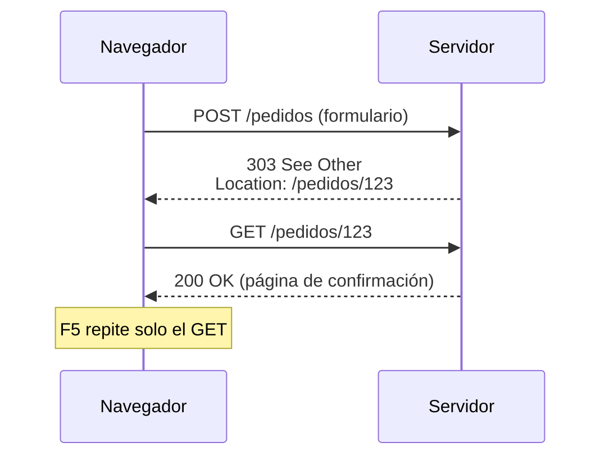

# Códigos HTTP 3xx (redirección)

Parte de: [[Códigos de estado HTTP]]

> [!info] Cómo avanzar
> `progreso`: **pendiente** → **viendo** (estudiando) → **visto** (contestaste la autoevaluación sin abrir las respuestas) → **dominado** (hiciste el laboratorio o lo aplicaste de verdad).

## Contenido

### Qué es
Los códigos **3xx** le dicen al cliente que, para completar la petición, debe hacer algo más: normalmente ir a **otra URL** (indicada en el header `Location`) o usar **su copia en caché** (`304`). Los navegadores siguen las redirecciones automáticamente; `HttpClient` también, hasta un límite. La diferencia entre los códigos está en dos preguntas: ¿el cambio es **permanente o temporal**? y ¿se debe **conservar el método y el body**?

### Cómo funciona
| Código | Permanente | Conserva método y body | Uso típico |
|---|---|---|---|
| `301` Moved Permanently | Sí | No garantizado (los clientes suelen cambiar `POST` a `GET`) | URL cambió para siempre (slug renombrado, dominio nuevo) |
| `302` Found | No | No garantizado | Redirección temporal histórica (login) |
| `303` See Other | No | No: el siguiente es siempre `GET` | Después de procesar un formulario |
| `307` Temporary Redirect | No | **Sí** | Temporal, conservando `POST` y su body |
| `308` Permanent Redirect | Sí | **Sí** | Permanente, conservando método (APIs) |
| `304` Not Modified | — | — | Tu caché sigue vigente, no hay body |

`301` y `308` son **permanentes**: navegadores y buscadores actualizan sus enlaces y pueden cachear la redirección. `302` y `307` son **temporales**: se seguirá preguntando a la URL original.

#### `304 Not Modified`
No es una redirección a otra URL: es la respuesta a un **GET condicional**. El cliente manda `If-None-Match: "v5"` (o `If-Modified-Since`) y, si el recurso no cambió, el servidor responde `304` **sin cuerpo**; el cliente usa lo que tenía. Ver [[Caché HTTP (Cache-Control y ETag)]].

#### Patrón POST/Redirect/GET
Si un formulario hace `POST /pedidos` y el servidor responde `200` con HTML, al recargar la página el navegador pregunta "¿reenviar el formulario?" y puede duplicar el pedido. Con PRG el servidor procesa el `POST` y responde **`303 See Other`** con `Location: /pedidos/123`; el navegador hace `GET` a esa URL. Al recargar se repite el `GET`, que es inofensivo.



### Ejemplo
En ASP.NET Core con controllers:

```csharp
// Slug renombrado: permanente
[HttpGet("/articulos/{slug}")]
public async Task<IActionResult> Articulo(string slug, [FromServices] IBuscarArticulo buscar, CancellationToken ct)
{
    var a = await buscar.EjecutarAsync(slug, ct);
    if (a is null) return NotFound();
    if (a.SlugActual != slug)
        return RedirectPermanent($"/articulos/{a.SlugActual}");       // 301
    return Ok(a);
}

// Endpoint de API movido conservando el método: 308
[HttpPost("/v1/pagos")]
public IActionResult PagosViejo() => RedirectPermanentPreserveMethod("/v2/pagos"); // 308

// PRG después de un formulario
[HttpPost("/pedidos")]
public IActionResult CrearDesdeFormulario([FromForm] PedidoForm f)
{
    var id = 123; // ... guardar
    Response.Headers.Location = $"/pedidos/{id}";
    return StatusCode(StatusCodes.Status303SeeOther);
}
```

Métodos útiles: `Redirect` (302), `RedirectPermanent` (301), `RedirectPreserveMethod` (307), `RedirectPermanentPreserveMethod` (308), `LocalRedirect` (valida que el destino sea local). Ver también [[Redirecciones]] para slugs, open redirect y ciclos detrás de un proxy.

### Cuándo usarlo y cuándo no
- **Páginas web**: `301` para cambios definitivos de URL (cuida el SEO), `302`/`303` para flujos temporales y PRG.
- **APIs**: prefiere `307`/`308` porque garantizan que `POST`, `PUT` y su body se conservan. Aun así, muchos clientes de APIs no siguen redirecciones con body; para mover una API, mejor versionar y avisar.
- No uses redirecciones para "ocultar" errores: si el recurso no existe, `404`.

### Errores comunes
- **Usar `301` para algo temporal**: los navegadores la cachean y no puedes deshacerla fácilmente.
- **Usar `301`/`302` para redirigir un `POST` de API**: el cliente lo convierte en `GET` y se pierde el body.
- **Cadenas de redirecciones** (A → B → C): cada salto cuesta un RTT; apunta directo al destino final.
- **Ciclos** (`ERR_TOO_MANY_REDIRECTS`), típicos detrás de un proxy que termina TLS si la app no procesa `X-Forwarded-Proto`.
- **Redirigir a cualquier URL que venga en un parámetro** (open redirect).

### Para profundizar
- [MDN: Redirections in HTTP](https://developer.mozilla.org/en-US/docs/Web/HTTP/Redirections)
- [MDN: 304 Not Modified](https://developer.mozilla.org/en-US/docs/Web/HTTP/Status/304)
- [RFC 9110, sección 15.4: Redirection 3xx](https://www.rfc-editor.org/rfc/rfc9110#section-15.4)

## Autoevaluación

Contesta primero en voz alta o en papel; luego despliega la respuesta.

> [!question]- ¿Qué diferencia hay entre 301, 302, 307 y 308?
> `301` y `308` son **permanentes**; `302` y `307` **temporales**. `307`/`308` obligan a conservar el método y el body; con `301`/`302` los clientes suelen cambiar `POST` a `GET`.

> [!question]- ¿Qué significa `304 Not Modified`?
> Respuesta a un GET condicional (`If-None-Match`, `If-Modified-Since`): tu copia en caché sigue vigente y no se envía cuerpo.

> [!question]- ¿Qué es el patrón POST/Redirect/GET y qué código usa?
> Tras procesar un formulario con `POST`, el servidor responde `303 See Other` hacia una página de resultado; al recargar, el navegador repite el `GET`, no el `POST`.

## Práctica

- [[Lab 2 - Caché, redirecciones y compresión con curl]]

