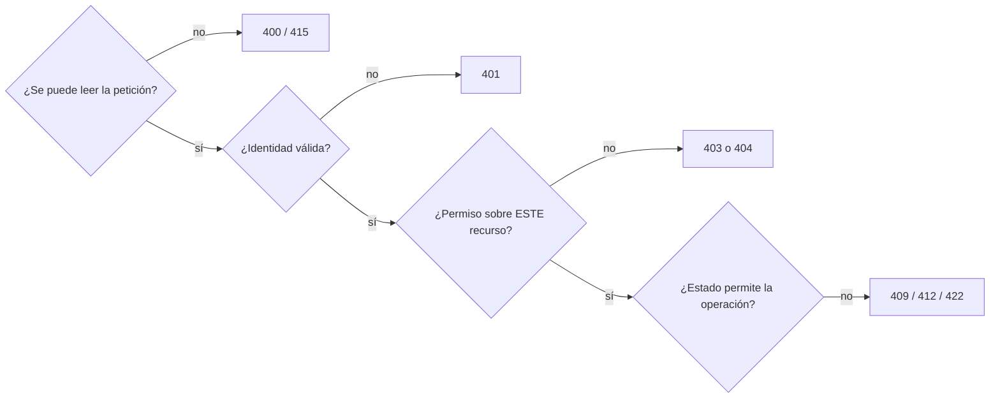

# Códigos HTTP 4xx (error del cliente)

Parte de: [[Códigos de estado HTTP]]

> [!info] Cómo avanzar
> `progreso`: **pendiente** → **viendo** (estudiando) → **visto** (contestaste la autoevaluación sin abrir las respuestas) → **dominado** (hiciste el laboratorio o lo aplicaste de verdad).

## Contenido

### Qué es
Los códigos **4xx** dicen "el problema está en la petición": el cliente debe **cambiar algo** antes de reintentar (corregir datos, autenticarse, esperar, pedir otra cosa). Repetir exactamente la misma petición normalmente dará el mismo error (salvo `429` y `408`). Son el lenguaje principal con el que tu API le explica a los consumidores qué hicieron mal, así que conviene usar el código preciso y acompañarlo de un body [[ProblemDetails]] con un `codigo` estable.

### Cómo funciona
| Código | Nombre | Cuándo |
|---|---|---|
| `400` | Bad Request | Petición mal formada o inválida (JSON roto, tipo incorrecto, validación) |
| `401` | Unauthorized | No autenticado o token inválido/expirado; incluye `WWW-Authenticate` |
| `403` | Forbidden | Autenticado pero sin permiso |
| `404` | Not Found | El recurso no existe (o no quieres revelar que existe) |
| `405` | Method Not Allowed | La ruta existe pero no con ese método; incluye `Allow` |
| `406` | Not Acceptable | No puedes producir ningún formato de `Accept` |
| `409` | Conflict | Choca con el estado actual: duplicado, transición inválida |
| `412` | Precondition Failed | La condición enviada (`If-Match`) no se cumple |
| `413` | Content Too Large | Body demasiado grande |
| `415` | Unsupported Media Type | El `Content-Type` del body no se acepta |
| `422` | Unprocessable Content | Sintaxis válida pero viola reglas de negocio |
| `428` | Precondition Required | El servidor exige mandar una condición (`If-Match`) |
| `429` | Too Many Requests | Superaste el límite de tasa; idealmente con `Retry-After` |

#### 404, 409 y 429
- **`404`**: `GET /clientes/999` y el cliente 999 no existe.
- **`409`**: intentas registrar un RFC que ya existe, o cancelar un pedido ya entregado. El recurso existe, pero la operación choca con su estado.
- **`429`**: el cliente mandó demasiadas peticiones; `Retry-After: 30` le dice cuánto esperar (ver [[Rate limiting]]).

#### 412 frente a 428 (concurrencia optimista)
- **`412 Precondition Failed`**: el cliente envió `If-Match: "v3"` pero el recurso ya va en `"v4"` porque otro lo modificó. Se rechaza para evitar una actualización perdida.
- **`428 Precondition Required`**: el cliente **no envió** `If-Match` y tu API lo exige para ese recurso.

#### 404 en lugar de 403
Si un cliente pide `GET /pedidos/5512` y ese pedido es de otra empresa, responder `403` confirma que el pedido existe (y permite enumerar ids). Responder `404` no revela nada. Es habitual en APIs multiempresa.

#### 415
Mandaste `Content-Type: text/plain` (o ninguno) a un endpoint que espera `application/json`. En ASP.NET Core lo produce `[Consumes]` o el propio model binding.



### Ejemplo
En Itzamna.Dionisio, cancelar un pedido:

```csharp
[HttpPost("{id:int}/cancelacion")]
public async Task<IActionResult> Cancelar(int id, [FromServices] ICancelarPedido cmd, CancellationToken ct)
{
    var empresaId = User.FindFirstValue("empresa_id");
    var r = await cmd.EjecutarAsync(id, empresaId!, ct); // EXEC dbo.Pedido_Cancelar

    return r switch
    {
        ResultadoCancelacion.NoExisteOAjeno => NotFound(),  // 404 también si es de otra empresa
        ResultadoCancelacion.YaEntregado => Problem(statusCode: 409, title: "El pedido ya fue entregado",
            extensions: new Dictionary<string, object?> { ["codigo"] = "PEDIDO_YA_ENTREGADO" }),
        _ => NoContent()
    };
}
```

El front (Itzamna.Clio) decide por `status` y por `codigo`, no por el texto del título.

### Cuándo usarlo y cuándo no
- Usa 4xx solo cuando el cliente pueda hacer algo distinto; si falló tu base de datos, es `5xx`.
- No hace falta usar todos: 400, 401, 403, 404, 409, 429 y (si haces concurrencia optimista) 412/428 cubren casi todo.
- Sé consistente con 400 frente a 422 en toda la API.

### Errores comunes
- **Confundir 401 y 403**: un `401` a un usuario autenticado sin permiso hace que el front lo mande a iniciar sesión en bucle.
- **`404` para rutas que sí existen pero con el método equivocado**: es `405` con `Allow`.
- **`400` genérico sin detalle**: el cliente no sabe qué corregir. Incluye errores por campo.
- **`409` sin explicar el conflicto**: añade `codigo` y un `detail` útil.
- **Revelar existencia con 403** en recursos multiempresa.

### Para profundizar
- [MDN: HTTP response status codes - Client error responses](https://developer.mozilla.org/en-US/docs/Web/HTTP/Status#client_error_responses)
- [RFC 9110, sección 15.5: Client Error 4xx](https://www.rfc-editor.org/rfc/rfc9110#section-15.5)
- [RFC 6585: Additional HTTP Status Codes (428, 429)](https://www.rfc-editor.org/rfc/rfc6585)

## Autoevaluación

Contesta primero en voz alta o en papel; luego despliega la respuesta.

> [!question]- ¿Cuándo devolver 404, 409 y 429?
> `404 Not Found`: el recurso no existe. `409 Conflict`: choca con el estado actual (duplicado, versión desactualizada). `429 Too Many Requests`: se superó el límite, idealmente con `Retry-After`.

> [!question]- ¿Qué diferencia hay entre `412 Precondition Failed` y `428 Precondition Required`?
> `412`: la condición enviada (`If-Match: "v3"`) no se cumple porque el recurso cambió. `428`: el servidor exige mandar una condición para evitar actualizaciones perdidas.

> [!question]- ¿Por qué a veces se responde 404 en lugar de 403?
> Para no revelar que el recurso existe a quien no tiene permiso (por ejemplo, el pedido de otro cliente).

> [!question]- ¿Qué indica `415 Unsupported Media Type`?
> El `Content-Type` del body no es uno que el endpoint acepte (por ejemplo enviaste `text/plain` a un endpoint que espera `application/json`).

## Práctica

- [[Lab 1 - Peticiones HTTP con curl y archivos .http]]

