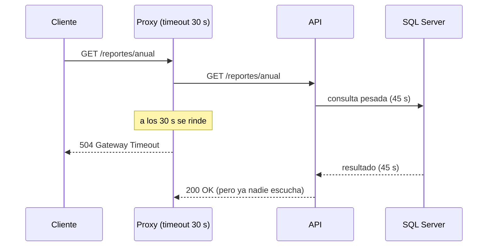

# Códigos HTTP 5xx (error del servidor)

Parte de: [[Códigos de estado HTTP]]

> [!info] Cómo avanzar
> `progreso`: **pendiente** → **viendo** (estudiando) → **visto** (contestaste la autoevaluación sin abrir las respuestas) → **dominado** (hiciste el laboratorio o lo aplicaste de verdad).

## Contenido

### Qué es
Los códigos **5xx** dicen "la petición podía ser válida, pero el servidor (o algo detrás de él) no pudo atenderla". El cliente no hizo nada mal, así que a veces tiene sentido **reintentar** más tarde (con cuidado, ver [[Latencia, ancho de banda y timeouts]]). Son la señal principal para alertas y monitoreo: un aumento de 5xx casi siempre significa un incidente.

### Cómo funciona
| Código | Nombre | Quién lo genera normalmente | Significado |
|---|---|---|---|
| `500` | Internal Server Error | Tu app | Excepción no controlada o error inesperado |
| `501` | Not Implemented | Servidor | No soporta la funcionalidad pedida (raro en APIs) |
| `502` | Bad Gateway | Proxy / balanceador | El backend respondió algo inválido o cerró la conexión |
| `503` | Service Unavailable | App o proxy | Sobrecarga, mantenimiento o sin instancias sanas; idealmente con `Retry-After` |
| `504` | Gateway Timeout | Proxy / balanceador | El backend no respondió a tiempo |

La clave para diagnosticar es saber **quién** generó el código: un `500` suele venir de tu app; `502` y `504` casi siempre los genera un **intermediario** (App Service, Front Door, Application Gateway, Nginx) hablando de tu app.



#### Muchos 504 sin errores en la app
Exactamente el diagrama anterior: la app **tarda más que el timeout del proxy**. La petición sigue corriendo (y quizá termina bien) en la app, por eso sus logs no muestran errores; pero el proxy ya cortó. Qué revisar:
- Consultas lentas (plan de ejecución, índices faltantes, bloqueos).
- **Timeouts alineados**: el de la app y el de SQL (`commandTimeout`) deben ser menores que el del proxy, y pasar el `CancellationToken` para abandonar el trabajo.
- Si el proceso es largo por naturaleza, cambiar a un flujo asíncrono con `202 Accepted` (ver [[Códigos HTTP 2xx (éxito)]]).

#### `503` bien usado
Durante un mantenimiento o cuando un límite de concurrencia se llena, responde `503` con `Retry-After`. Los clientes y balanceadores entienden que es temporal.

### Ejemplo
En Itzamna.Dionisio, manejo global de errores con ProblemDetails y sin filtrar detalles:

```csharp
builder.Services.AddProblemDetails(o =>
{
    o.CustomizeProblemDetails = ctx =>
    {
        // traceId para buscar en Application Insights; nada de stack traces
        ctx.ProblemDetails.Extensions["traceId"] = ctx.HttpContext.TraceIdentifier;
        ctx.ProblemDetails.Extensions.TryAdd("codigo", "ERROR_INTERNO");
    };
});

var app = builder.Build();
app.UseExceptionHandler(); // convierte excepciones no controladas en 500 application/problem+json
app.UseStatusCodePages();  // da formato ProblemDetails a respuestas de error sin body
```

Respuesta en producción:

```json
{
  "type": "https://tools.ietf.org/html/rfc9110#section-15.6.1",
  "title": "An error occurred while processing your request.",
  "status": 500,
  "traceId": "00-4bf92f3577b34da6a3ce929d0e0e4736-00f067aa0ba902b7-01",
  "codigo": "ERROR_INTERNO"
}
```

El detalle de la excepción va al **log** (con el mismo `traceId`), nunca al cliente.

### Cuándo usarlo y cuándo no
- `500` solo para lo inesperado; si conoces el caso (validación, no existe, conflicto), usa un 4xx.
- `503` cuando sabes que es temporal y puedes decir cuándo reintentar.
- No respondas 5xx por errores del cliente: provocas reintentos inútiles y alertas falsas.
- Reintenta automáticamente 502/503/504 solo en operaciones idempotentes y con backoff.

### Errores comunes
- **Incluir en el 500 stack traces, cadenas SQL, rutas de archivos o nombres de servidores**: es información valiosa para un atacante. Solo mensaje genérico y `traceId`.
- **Tragar excepciones y devolver 200**: el monitoreo nunca se entera.
- **Timeouts desalineados** que convierten consultas lentas en 504 misteriosos.
- **Health checks que dependen de todo**: una base de datos lenta saca todas las instancias y el balanceador responde 503 a todo el mundo.
- **No correlacionar**: sin `traceId` o `traceparent` es muy difícil unir el 500 que vio el usuario con el log del servidor.

### Para profundizar
- [MDN: HTTP response status codes - Server error responses](https://developer.mozilla.org/en-US/docs/Web/HTTP/Status#server_error_responses)
- [Microsoft Learn: Handle errors in ASP.NET Core APIs](https://learn.microsoft.com/en-us/aspnet/core/web-api/handle-errors)
- [Microsoft Learn: Troubleshoot HTTP 502 and 503 errors in Azure App Service](https://learn.microsoft.com/en-us/azure/app-service/troubleshoot-http-502-http-503)
- [RFC 9110, sección 15.6: Server Error 5xx](https://www.rfc-editor.org/rfc/rfc9110#section-15.6)

## Autoevaluación

Contesta primero en voz alta o en papel; luego despliega la respuesta.

> [!question]- ¿Qué indican 500, 502, 503 y 504?
> `500` error no controlado en la app; `502 Bad Gateway` el proxy recibió una respuesta inválida del backend; `503 Service Unavailable` sobrecarga o mantenimiento (con `Retry-After`); `504 Gateway Timeout` el proxy se cansó de esperar al backend.

> [!question]- Ves muchos 504 en el balanceador pero los logs de la app no muestran errores. ¿Qué piensas?
> La app tarda más que el timeout del proxy: la petición sigue corriendo (o termina bien) en la app, pero el proxy ya cortó. Revisa consultas lentas, timeouts alineados y si conviene un flujo asíncrono con 202.

> [!question]- ¿Qué no debe incluir la respuesta de un 500 en producción?
> Stack traces, cadenas SQL o detalles internos. Solo un mensaje genérico y un identificador de correlación (`traceId`) para buscar en los logs.

