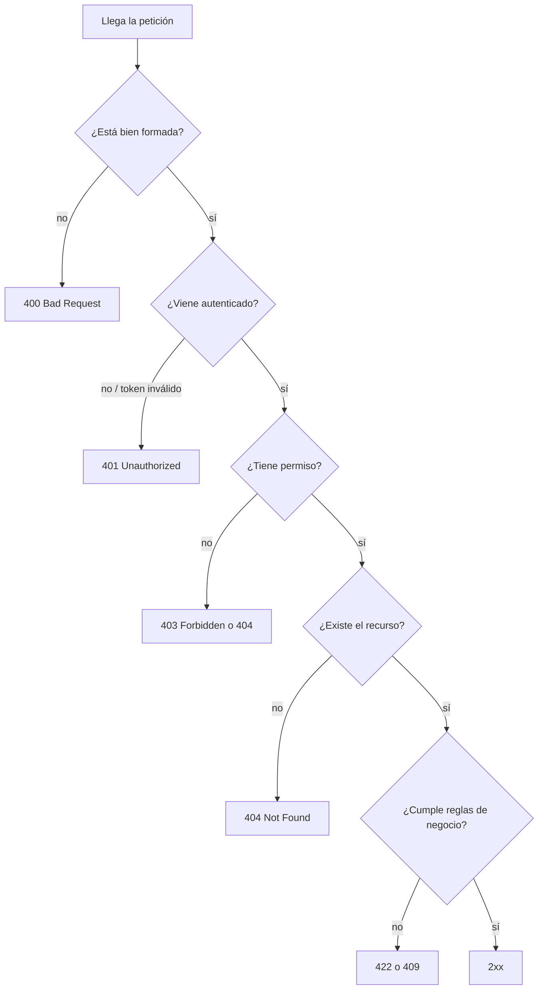

# Códigos de estado HTTP

Parte de: [[02-Fundamentos/02 HTTP/_Índice HTTP|HTTP]]

> [!info] Cómo avanzar
> `progreso`: **pendiente** → **viendo** (estudiando) → **visto** (contestaste la autoevaluación sin abrir las respuestas) → **dominado** (hiciste el laboratorio o lo aplicaste de verdad).

## Contenido

### Qué es
Cada respuesta HTTP lleva un **código de estado** de tres dígitos que resume qué pasó con la petición. Es lo primero que leen clientes, navegadores, proxies, cachés, herramientas de monitoreo y políticas de reintento, **antes** de mirar el body. Usarlos bien hace que tu API sea predecible: un cliente sabe si reintentar, si pedir login, si corregir datos o si mostrar "no existe" sin parsear mensajes de texto.

### Cómo funciona
El primer dígito define la **familia**:

| Familia | Significado | Ejemplos | Detalle |
|---|---|---|---|
| `1xx` | Informativo, respuesta provisional | 100, 101, 103 | [[Códigos HTTP 1xx (informativos)]] |
| `2xx` | Éxito | 200, 201, 202, 204 | [[Códigos HTTP 2xx (éxito)]] |
| `3xx` | Redirección o usa tu caché | 301, 302, 304, 307, 308 | [[Códigos HTTP 3xx (redirección)]] |
| `4xx` | Error del **cliente**: corrige la petición | 400, 401, 403, 404, 409, 422, 429 | [[Códigos HTTP 4xx (error del cliente)]] |
| `5xx` | Error del **servidor**: no es culpa de quien llama | 500, 502, 503, 504 | [[Códigos HTTP 5xx (error del servidor)]] |

Los clientes que no conocen un código específico lo tratan como el `x00` de su familia: un `418` desconocido se interpreta como `400`.



#### Dos dudas clásicas
- **400 o 422**: `400 Bad Request` cuando la petición está **mal formada** (JSON inválido, tipo incorrecto, falta un campo obligatorio a nivel de sintaxis). `422 Unprocessable Content` cuando es sintácticamente válida pero **viola reglas** (la fecha de fin es anterior a la de inicio, el saldo no alcanza). Muchas APIs usan solo `400` con [[ProblemDetails]] para todo error de validación; lo importante es **ser consistente** y documentarlo.
- **401 o 403**: `401 Unauthorized` (en realidad significa "no autenticado") cuando no te identificaste o tu token es inválido o expiró; debe incluir el header `WWW-Authenticate`. `403 Forbidden` cuando el servidor **sabe quién eres** pero no tienes permiso.

### Ejemplo
En Itzamna.Dionisio, con controllers, ProblemDetails y la regla de incluir `codigo`:

```csharp
[HttpPost]
public async Task<IActionResult> Crear(CrearPedidoDto dto, [FromServices] IValidator<CrearPedidoDto> validador,
                                       [FromServices] ICrearPedido cmd, CancellationToken ct)
{
    var r = await validador.ValidateAsync(dto, ct);              // FluentValidation
    if (!r.IsValid)
    {
        foreach (var e in r.Errors) ModelState.AddModelError(e.PropertyName, e.ErrorMessage);
        return ValidationProblem(ModelState);                        // 400 con errores por campo
    }

    var resultado = await cmd.EjecutarAsync(dto, ct);
    if (resultado.SinExistencia)
        return Problem(statusCode: 422, title: "Sin existencia suficiente",
                       extensions: new Dictionary<string, object?> { ["codigo"] = "PEDIDO_SIN_EXISTENCIA" });

    return CreatedAtAction(nameof(Obtener), new { id = resultado.Id }, resultado); // 201 + Location
}
```

En `Program.cs`, `builder.Services.AddProblemDetails()` y `app.UseExceptionHandler()` hacen que los errores no controlados salgan como `500` en formato `application/problem+json` sin detalles internos.

### Cuándo usarlo y cuándo no
- Usa el código **más específico que tus clientes vayan a aprovechar**; no hace falta usar los 60 códigos registrados.
- Un conjunto razonable para una API: 200, 201, 202, 204, 304, 400, 401, 403, 404, 409, 412, 415, 422 (opcional), 429, 500, 503.
- Acompaña los errores con un body [[ProblemDetails]] que tenga un `codigo` estable para que el cliente decida por código de negocio, no por texto.

### Errores comunes
- **`200 OK` con `{"error": "no encontrado"}`**: rompe clientes, monitoreo, cachés y reintentos, que se basan en el código. El error parece éxito: no hay alertas y la caché puede guardarlo.
- **`500` para errores de validación**: el cliente cree que es culpa del servidor y quizá reintenta en vano.
- **`401` cuando debería ser `403`** (o viceversa): un `401` hace que el front mande al usuario a iniciar sesión otra vez aunque ya esté autenticado.
- **Mezclar criterios** entre endpoints (unos usan 400, otros 422 para lo mismo).
- **Filtrar detalles internos** en el body de un 500 (stack traces, SQL).

### Para profundizar
- [MDN: HTTP response status codes](https://developer.mozilla.org/en-US/docs/Web/HTTP/Status)
- [RFC 9110, sección 15: Status Codes](https://www.rfc-editor.org/rfc/rfc9110#section-15)
- [IANA: HTTP Status Code Registry](https://www.iana.org/assignments/http-status-codes/http-status-codes.xhtml)

## Subtemas

- [[Códigos HTTP 1xx (informativos)]]
- [[Códigos HTTP 2xx (éxito)]]
- [[Códigos HTTP 3xx (redirección)]]
- [[Códigos HTTP 4xx (error del cliente)]]
- [[Códigos HTTP 5xx (error del servidor)]]

## Autoevaluación

Contesta primero en voz alta o en papel; luego despliega la respuesta.

> [!question]- ¿Qué indica cada familia de códigos?
> `1xx` informativo, `2xx` éxito, `3xx` redirección, `4xx` error del cliente, `5xx` error del servidor.

> [!question]- ¿Cuándo usar 400 y cuándo 422?
> `400 Bad Request`: la petición está mal formada (JSON inválido, tipo incorrecto). `422 Unprocessable Content`: es válida sintácticamente pero viola reglas de negocio o validación. Muchas APIs usan solo `400` con [[ProblemDetails]]; lo importante es ser consistente.

> [!question]- Error común: devolver `200 OK` con `{"error": "no encontrado"}`. ¿Qué rompe?
> Clientes, monitoreo, cachés y reintentos se basan en el código. Con `200` el error parece éxito: no hay alertas y la caché puede guardarlo.

> [!question]- ¿401 o 403?
> `401 Unauthorized`: no te identificaste o el token es inválido (debe incluir `WWW-Authenticate`). `403 Forbidden`: sé quién eres, pero no tienes permiso.

## Práctica

- [[Lab 1 - Peticiones HTTP con curl y archivos .http]]

## Progreso de los subtemas

```base
filters:
  and:
    - file.inFolder("02-Fundamentos/02 HTTP/Códigos de estado HTTP")
    - file.name != "Códigos de estado HTTP"
views:
  - type: table
    name: Progreso
    order:
      - file.name
      - progreso
      - nivel
```
