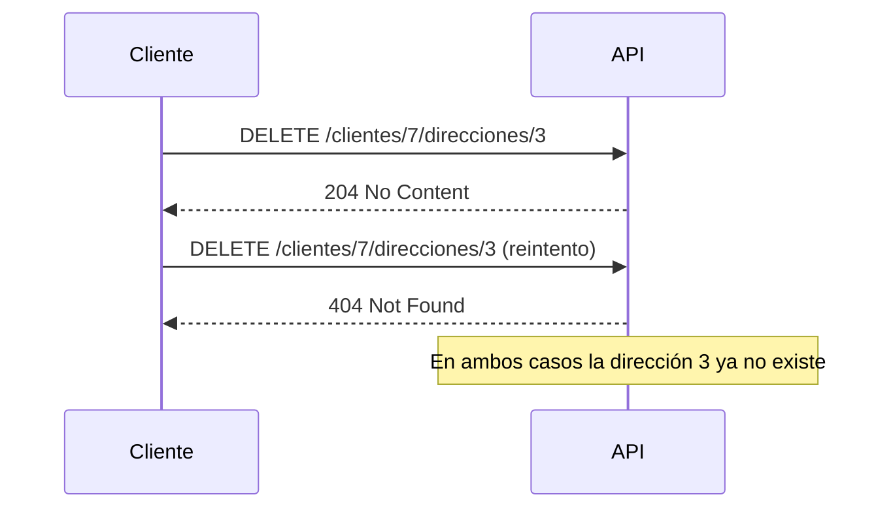

# DELETE

Parte de: [[02-Fundamentos/02 HTTP/_Índice HTTP|HTTP]]

> [!info] Cómo avanzar
> `progreso`: **pendiente** → **viendo** (estudiando) → **visto** (contestaste la autoevaluación sin abrir las respuestas) → **dominado** (hiciste el laboratorio o lo aplicaste de verdad).

## Contenido

### Qué es
`DELETE` pide **eliminar** el recurso identificado por la URL. Después de un `DELETE` exitoso, un `GET` a esa misma URL debería responder `404` (o `410 Gone`). Es **idempotente**: borrar algo que ya está borrado deja el servidor en el mismo estado, aunque la respuesta pueda ser distinta.

"Eliminar" desde el punto de vista HTTP no obliga a borrar físicamente la fila: el servidor puede archivarla, marcarla como inactiva o borrarla de verdad. Lo que importa es que, para el cliente, el recurso deja de estar disponible en esa URL.

### Cómo funciona
```http
DELETE /api/clientes/7/direcciones/3 HTTP/1.1
Authorization: Bearer eyJhbGciOi...
If-Match: "v4"
```

Respuestas habituales:

| Situación | Código |
|---|---|
| Se borró y no hay nada que devolver | **`204 No Content`** (lo más común) |
| Se borró y devuelves algo útil (resumen, recurso archivado) | `200 OK` con body |
| El borrado se hará después (proceso largo, colas) | `202 Accepted` |
| No existe | `404 Not Found` |
| No se puede borrar por su estado o por dependencias | `409 Conflict` |
| Versión desactualizada | `412 Precondition Failed` |

#### ¿Es idempotente si la segunda vez devuelve 404?
Sí. La idempotencia se refiere al **estado del servidor**, no al código de respuesta. Después de una llamada o de diez, el recurso no existe. La primera respuesta es `204` y las siguientes `404`; ambas son correctas. Algunas APIs prefieren responder `204` también en las repeticiones para simplificar los reintentos; cualquiera de las dos opciones es válida si la documentas.



#### Borrado lógico (soft delete)
En lugar de `DELETE FROM`, se marca el registro: `Eliminado = 1`, `FechaBaja = SYSUTCDATETIME()`, `EliminadoPor = @UsuarioId`. Ventajas: auditoría, posibilidad de restaurar, no romper referencias históricas (facturas que apuntan a un cliente). Lo que hay que cuidar:
- **Filtrarlo en todas las consultas**. En EF Core se usan filtros globales; con Dapper y SQL en archivos, cada consulta debe incluir `WHERE Eliminado = 0` (o usar una vista).
- **Índices únicos**: si el email es único y el cliente se borra lógicamente, nadie más puede registrarse con ese email. Usa un índice único **filtrado** (`WHERE Eliminado = 0`).
- **Obligaciones legales**: la normativa de protección de datos personales puede exigir borrar o anonimizar de verdad cuando el titular lo solicita (en México, la ley de protección de datos en posesión de particulares; Pendiente de confirmar los plazos y requisitos vigentes con el área legal).

### Ejemplo
En Itzamna.Dionisio:

```csharp
[HttpDelete("{id:int}")]
public async Task<IActionResult> Eliminar(int id, [FromServices] IEliminarCliente cmd, CancellationToken ct)
{
    var usuario = User.FindFirstValue(ClaimTypes.NameIdentifier)!;
    var r = await cmd.EjecutarAsync(id, usuario, ct);
    return r switch
    {
        Eliminacion.NoExiste => NotFound(),
        Eliminacion.TienePedidosAbiertos => Problem(statusCode: 409, title: "El cliente tiene pedidos abiertos",
            extensions: new Dictionary<string, object?> { ["codigo"] = "CLIENTE_CON_PEDIDOS" }),
        _ => NoContent()
    };
}
```

```sql
-- EliminarCliente.sql (borrado lógico)
UPDATE dbo.Cliente
SET Eliminado = 1, FechaBaja = SYSUTCDATETIME(), EliminadoPor = @Usuario
WHERE Id = @Id AND Eliminado = 0;
SELECT @@ROWCOUNT;

-- Índice único que ignora los eliminados
CREATE UNIQUE INDEX UX_Cliente_Email_Activos ON dbo.Cliente(Email) WHERE Eliminado = 0;
```

### Cuándo usarlo y cuándo no
- **`DELETE`** para quitar recursos que el cliente identifica por URL.
- **Borrado lógico** cuando necesitas auditoría o historial; **borrado físico** para datos temporales o cuando la ley lo exige.
- Para "cancelar" algo que conserva su historia (un pedido), quizá no es un `DELETE` sino un cambio de estado (`POST /pedidos/9/cancelacion` o `PATCH`).
- Borrados masivos (`DELETE /clientes?inactivos=true`) son peligrosos; considera un recurso de proceso (`POST /depuraciones`) con confirmación y `202`.

### Errores comunes
- **Mandar body en un `DELETE`**: igual que en `GET`, muchos intermediarios lo descartan. Si necesitas datos, van en la ruta o la query.
- **Olvidar el filtro de borrado lógico** en una consulta: "clientes fantasma" en los reportes.
- **Índice único sin filtrar** con borrado lógico.
- **Responder `500`** al intentar borrar algo con dependencias (violación de llave foránea): es un `409` con explicación.
- **No autorizar por recurso**: verifica que el recurso pertenece a quien lo borra.

### Para profundizar
- [MDN: DELETE](https://developer.mozilla.org/en-US/docs/Web/HTTP/Methods/DELETE)
- [RFC 9110, sección 9.3.5: DELETE](https://www.rfc-editor.org/rfc/rfc9110#section-9.3.5)
- [Microsoft Learn: Create filtered indexes (SQL Server)](https://learn.microsoft.com/en-us/sql/relational-databases/indexes/create-filtered-indexes)

## Autoevaluación

Contesta primero en voz alta o en papel; luego despliega la respuesta.

> [!question]- ¿Qué devuelve un `DELETE` exitoso?
> `204 No Content` (lo más común), `200 OK` con un cuerpo descriptivo o `202 Accepted` si el borrado es asíncrono.

> [!question]- ¿`DELETE` es idempotente si la segunda vez devuelve 404?
> Sí. La idempotencia se refiere al **estado del servidor**, no al código de respuesta: después de una o de diez llamadas el recurso no existe.

> [!question]- ¿Qué es un borrado lógico (soft delete) y qué cuidar?
> Marcar el registro como eliminado (`eliminado = 1`, `fecha_baja`) en vez de borrarlo. Hay que filtrarlo en todas las consultas (filtros globales en EF Core) y considerar índices únicos y obligaciones legales de borrado real.

## Práctica

- [[Lab 1 - Peticiones HTTP con curl y archivos .http]]

