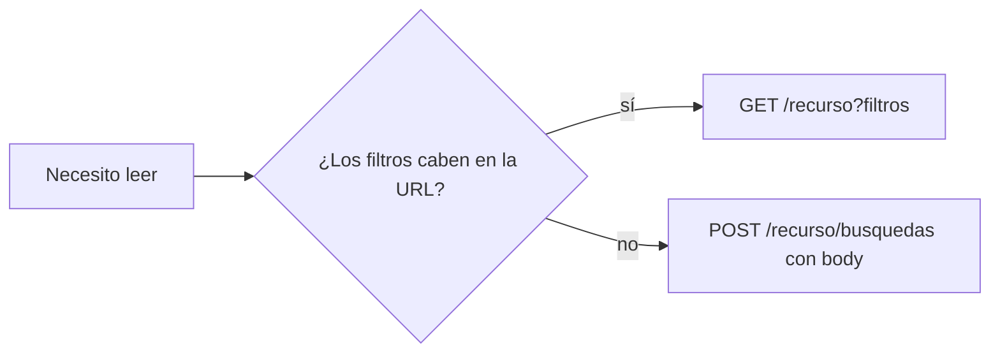

# GET

Parte de: [[02-Fundamentos/02 HTTP/_Índice HTTP|HTTP]]

> [!info] Cómo avanzar
> `progreso`: **pendiente** → **viendo** (estudiando) → **visto** (contestaste la autoevaluación sin abrir las respuestas) → **dominado** (hiciste el laboratorio o lo aplicaste de verdad).

## Contenido

### Qué es
`GET` es el método HTTP para **leer**: pide la representación actual del recurso identificado por la URL. Es el método más usado de la web (cada página, imagen o llamada de consulta a tu API) y tiene tres propiedades que todo el ecosistema aprovecha:

- **Seguro**: el cliente no pide cambiar nada en el servidor.
- **Idempotente**: repetirlo deja el servidor igual (ver [[Métodos seguros e idempotentes]]).
- **Cacheable**: navegadores, CDN y proxies pueden guardar la respuesta (ver [[Caché HTTP (Cache-Control y ETag)]]).

### Cómo funciona
Los datos de entrada van en la **ruta** (qué recurso) y en la **query string** (filtros, orden, paginación), nunca en el body:

```http
GET /api/clientes?estado=activo&page=2&size=20 HTTP/1.1
Host: api.ejemplo.com
Accept: application/json
Authorization: Bearer eyJhbGciOi...
```

```http
HTTP/1.1 200 OK
Content-Type: application/json; charset=utf-8
ETag: "a81f"
Cache-Control: private, no-cache

{"items":[{"id":42,"nombre":"Ana López"}],"page":2,"size":20,"total":134}
```

Como `GET` es seguro, muchos actores lo ejecutan **sin que el usuario lo pida**: el navegador precarga enlaces, los rastreadores siguen links, las vistas previas de chat abren URLs, los proxies reintentan. Todo eso está bien precisamente porque se asume que `GET` no cambia nada.

#### ¿Y el body en un GET?
La especificación dice que un body en `GET` **no tiene semántica definida**. En la práctica, muchos proxies, CDN, librerías (incluido `fetch` del navegador, que lo prohíbe) y servidores lo descartan o rechazan. Si tus filtros no caben en la URL, crea un recurso de búsqueda: `POST /clientes/busquedas` con los filtros en el body (pierdes la caché HTTP, ganas espacio). Existe además una propuesta del método `QUERY` para este caso (Pendiente de confirmar su estado de estandarización).



### Ejemplo
En Itzamna.Dionisio, con vertical slice y una interfaz por consulta:

```csharp
// Features/Clientes/Listar/ListarClientesController.cs
[ApiController]
[Route("api/clientes")]
public class ListarClientesController(IListarClientes consulta) : ControllerBase
{
    [HttpGet]
    public async Task<ActionResult<Pagina<ClienteResumen>>> Listar(
        [FromQuery] string? estado, [FromQuery] int page = 1, [FromQuery] int size = 20,
        CancellationToken ct = default)
    {
        size = Math.Clamp(size, 1, 100); // nunca confíes en el tamaño que pide el cliente
        return Ok(await consulta.EjecutarAsync(estado, page, size, ct));
    }

    [HttpGet("{id:int}")]
    public async Task<ActionResult<ClienteDetalle>> Obtener(int id, [FromServices] IObtenerCliente obtener, CancellationToken ct)
        => await obtener.EjecutarAsync(id, ct) is { } c ? Ok(c) : NotFound();
}
```

```sql
-- Features/Clientes/Listar/ListarClientes.sql
SELECT Id, Nombre, Estado
FROM dbo.Cliente
WHERE (@Estado IS NULL OR Estado = @Estado)
ORDER BY Nombre, Id
OFFSET (@Page - 1) * @Size ROWS FETCH NEXT @Size ROWS ONLY;
```

Y desde el front:

```ts
const resp = await fetch(`/api/clientes?${new URLSearchParams({ estado: "activo", page: "2" })}`);
if (!resp.ok) throw new Error(`Error ${resp.status}`);
const pagina = await resp.json();
```

### Cuándo usarlo y cuándo no
- **Sí**: cualquier lectura, listados, búsquedas con filtros razonables, descargas.
- **No**: nada que cambie estado (crear, borrar, marcar como leído, enviar correos). Aunque "solo actualice un contador", piensa si te importa que un rastreador lo dispare.
- **No** para datos sensibles en la query (contraseñas, tokens): quedan en logs e historial (ver [[Parámetros de ruta, query string y body]]).

### Errores comunes
- **`GET /usuarios/5/eliminar`**: un prefetcher, un rastreador o un `` en un sitio malicioso (CSRF) lo ejecutan sin querer. Las acciones que cambian estado no van en `GET`.
- **Mandar body en un `GET`**: funciona en tu Postman y falla detrás de la CDN.
- **Listados sin límite**: `GET /clientes` que devuelve 200,000 filas. Pagina siempre (ver [[Paginación, filtrado y ordenamiento]]).
- **No enviar headers de caché**: cada intermediario aplica sus propias heurísticas.
- **Devolver `200` con lista vacía cuando el recurso padre no existe**: `GET /clientes/999/pedidos` debería ser `404` si el cliente 999 no existe.

### Para profundizar
- [MDN: GET](https://developer.mozilla.org/en-US/docs/Web/HTTP/Methods/GET)
- [RFC 9110, sección 9.3.1: GET](https://www.rfc-editor.org/rfc/rfc9110#section-9.3.1)
- [Microsoft Learn: Create web APIs with ASP.NET Core](https://learn.microsoft.com/en-us/aspnet/core/web-api/)

## Autoevaluación

Contesta primero en voz alta o en papel; luego despliega la respuesta.

> [!question]- ¿Qué características tiene `GET`?
> Es **seguro** (no debe cambiar estado), **idempotente** y **cacheable**. Los parámetros van en la ruta o la query.

> [!question]- ¿Por qué no debes mandar un body en un `GET`?
> Su semántica no está definida: muchos proxies, CDN y librerías lo descartan o rechazan. Si los filtros son muy grandes, usa `POST` a un recurso de búsqueda (`POST /clientes/busquedas`).

> [!question]- Error común: un enlace `GET /usuarios/5/eliminar`. ¿Qué riesgo tiene?
> Prefetchers, rastreadores o un `` malicioso (CSRF) pueden ejecutarlo sin querer. Las acciones que cambian estado no van en `GET`.

## Práctica

- [[Lab 1 - Peticiones HTTP con curl y archivos .http]]

