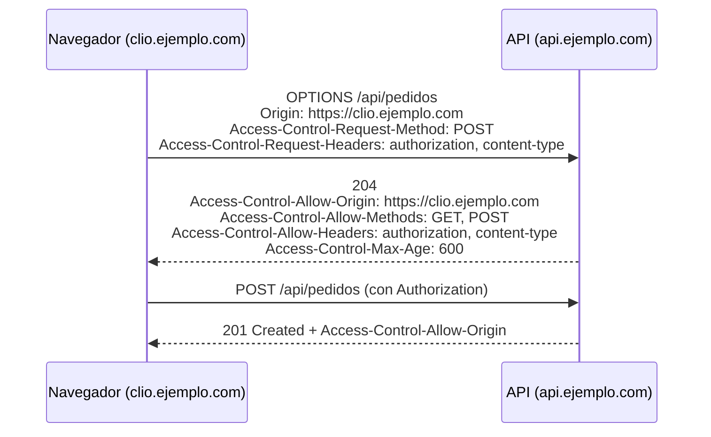

# HEAD y OPTIONS

Parte de: [[02-Fundamentos/02 HTTP/_Índice HTTP|HTTP]]

> [!info] Cómo avanzar
> `progreso`: **pendiente** → **viendo** (estudiando) → **visto** (contestaste la autoevaluación sin abrir las respuestas) → **dominado** (hiciste el laboratorio o lo aplicaste de verdad).

## Contenido

### Qué es
Dos métodos HTTP "de servicio" que casi no escribes a mano pero que aparecen constantemente:

- **`HEAD`** es igual que `GET` pero **sin body**: el servidor responde solo los headers que daría a un `GET`. Sirve para preguntar "¿existe?, ¿cuánto pesa?, ¿cambió?" sin descargar el contenido.
- **`OPTIONS`** pregunta qué opciones de comunicación tiene un recurso. Su uso más importante hoy es el **preflight de CORS**, que el navegador envía automáticamente antes de ciertas peticiones a otro origen.

Ambos son **seguros** e **idempotentes**.

### Cómo funciona
#### HEAD
```http
HEAD /archivos/respaldo-2026-10.zip HTTP/1.1

HTTP/1.1 200 OK
Content-Length: 524288000
ETag: "9c1e"
Last-Modified: Sat, 31 Oct 2026 23:59:00 GMT
Accept-Ranges: bytes
```

Usos: verificar que un archivo existe antes de descargarlo, conocer su tamaño para mostrar una barra de progreso, comprobar si cambió (`ETag`, `Last-Modified`), monitoreo ligero de enlaces.

#### OPTIONS y el preflight de CORS
Cuando el JavaScript de `https://clio.ejemplo.com` llama a `https://api.ejemplo.com` (otro origen), el navegador aplica CORS. Si la petición **no es "simple"** (por ejemplo usa `Content-Type: application/json`, un método como `PUT`/`DELETE` o un header como `Authorization`), primero envía un `OPTIONS`:



Puntos clave:
- El preflight lo envía **el navegador**, no tu código; no lo verás en `fetch`, solo en DevTools.
- El preflight **no lleva credenciales**: ni el header `Authorization` ni (en el caso general) cookies. Por eso **no puede exigir autenticación**.
- `Access-Control-Max-Age` permite cachear la respuesta del preflight y evitar repetirlo en cada llamada.
- Fuera de CORS, `OPTIONS` puede responder el header `Allow` con los métodos permitidos.

#### Preflight que falla con 401
Si tu API exige autenticación en todas las rutas y el middleware de autenticación/autorización corre **antes** que CORS, el `OPTIONS` llega sin token, recibe `401` sin headers CORS y el navegador bloquea la petición real con un error de CORS (aunque el problema real es el orden). En ASP.NET Core, `UseCors` debe ir **antes** de `UseAuthentication` y `UseAuthorization`; así el middleware de CORS responde el preflight directamente.

### Ejemplo
`Program.cs` de Itzamna.Dionisio para que Itzamna.Clio (Vite en desarrollo y Static Web Apps en producción) pueda llamarla:

```csharp
builder.Services.AddCors(o => o.AddPolicy("clio", p => p
    .WithOrigins("http://localhost:5173", "https://clio.ejemplo.com") // nunca "*" con credenciales
    .WithMethods("GET", "POST", "PUT", "PATCH", "DELETE")
    .WithHeaders("Authorization", "Content-Type", "Idempotency-Key", "If-Match")
    .WithExposedHeaders("ETag", "Location")       // para que el JS pueda leerlos
    .SetPreflightMaxAge(TimeSpan.FromMinutes(10))));

var app = builder.Build();
app.UseRouting();
app.UseCors("clio");        // ANTES de autenticación
app.UseAuthentication();
app.UseAuthorization();
app.MapControllers();
app.Run();
```

Para probar `HEAD` desde la terminal: `curl -I https://api.ejemplo.com/archivos/respaldo.zip` (`-I` hace `HEAD`). Para simular un preflight:

```bash
curl -i -X OPTIONS https://api.ejemplo.com/api/pedidos \
  -H "Origin: https://clio.ejemplo.com" \
  -H "Access-Control-Request-Method: POST" \
  -H "Access-Control-Request-Headers: authorization, content-type"
```

Si quieres soportar `HEAD` en un endpoint, decláralo explícitamente junto al `GET` (`[HttpGet, HttpHead]`) y compruébalo con `curl -I`; Kestrel se encarga de no enviar el body en la respuesta a `HEAD`.

### Cuándo usarlo y cuándo no
- **`HEAD`**: comprobaciones baratas de existencia, tamaño o versión; enlaces de descarga grandes.
- **`OPTIONS`**: lo maneja el middleware de CORS; casi nunca necesitas un endpoint propio.
- Si front y API comparten origen (por ejemplo, la API detrás del mismo dominio con un proxy en `/api`), no hay CORS ni preflight: menos latencia y menos configuración.

### Errores comunes
- **Orden de middlewares** que hace que el preflight reciba `401`.
- **`AllowAnyOrigin` junto con credenciales**: no está permitido por la especificación y además es inseguro.
- **Olvidar headers propios** (`Idempotency-Key`, `If-Match`) en `WithHeaders`: el preflight los rechaza.
- **No exponer headers** que el front necesita leer (`ETag`, `Location`): `fetch` no los ve.
- **Implementar `HEAD` con lógica distinta a `GET`**: los headers deben ser los mismos que daría el `GET`.

### Para profundizar
- [MDN: Cross-Origin Resource Sharing (CORS)](https://developer.mozilla.org/en-US/docs/Web/HTTP/CORS)
- [MDN: OPTIONS](https://developer.mozilla.org/en-US/docs/Web/HTTP/Methods/OPTIONS)
- [MDN: HEAD](https://developer.mozilla.org/en-US/docs/Web/HTTP/Methods/HEAD)
- [Microsoft Learn: Enable Cross-Origin Requests (CORS) in ASP.NET Core](https://learn.microsoft.com/en-us/aspnet/core/security/cors)

## Autoevaluación

Contesta primero en voz alta o en papel; luego despliega la respuesta.

> [!question]- ¿Para qué sirve `HEAD`?
> Igual que `GET` pero sin body: obtener headers (`Content-Length`, `ETag`, `Last-Modified`) para saber si un recurso existe o cambió sin descargarlo.

> [!question]- ¿Quién envía un `OPTIONS` y cuándo?
> El navegador lo envía como **preflight de CORS** antes de peticiones "no simples" a otro origen (por ejemplo con `Content-Type: application/json` o un header `Authorization`). También sirve para descubrir métodos permitidos (`Allow`).

> [!question]- Tu API exige autenticación en todas las rutas y el preflight falla con 401. ¿Por qué?
> El navegador **no** envía credenciales en el preflight. La respuesta a `OPTIONS` debe resolverse antes de la autenticación (en ASP.NET Core, `UseCors` antes de `UseAuthentication`).

## Práctica

- [[Lab 1 - Peticiones HTTP con curl y archivos .http]]

