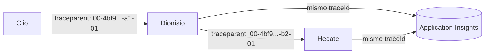

# Headers HTTP

Parte de: [[02-Fundamentos/02 HTTP/_Índice HTTP|HTTP]]

> [!info] Cómo avanzar
> `progreso`: **pendiente** → **viendo** (estudiando) → **visto** (contestaste la autoevaluación sin abrir las respuestas) → **dominado** (hiciste el laboratorio o lo aplicaste de verdad).

## Contenido

### Qué es
Los **headers** (encabezados) son **metadatos clave-valor** que acompañan a cada petición y respuesta HTTP. No son el contenido en sí, sino información sobre él y sobre la comunicación: qué formato tiene el body, quién eres, qué idioma prefieres, cuánto tiempo se puede cachear, a dónde redirigir. Gran parte del comportamiento de HTTP (caché, autenticación, CORS, compresión, seguridad) se controla con headers.

### Cómo funciona
Cada header es una línea `Nombre: valor` después de la línea de petición o de estado:

```http
POST /api/pedidos HTTP/1.1
Host: api.ejemplo.com
Content-Type: application/json
Accept: application/json
Authorization: Bearer eyJhbGciOi...
traceparent: 00-4bf92f3577b34da6a3ce929d0e0e4736-00f067aa0ba902b7-01
```

#### Clasificación práctica
| Grupo | Ejemplos | Para qué |
|---|---|---|
| De **petición** | `Accept`, `Accept-Language`, `Authorization`, `User-Agent`, `If-None-Match`, `Origin` | El cliente describe qué quiere y quién es |
| De **respuesta** | `Location`, `Set-Cookie`, `Retry-After`, `WWW-Authenticate`, `Allow` | El servidor da instrucciones o contexto |
| De **representación** | `Content-Type`, `Content-Encoding`, `Content-Length`, `Content-Language`, `ETag` | Describen el body (van en ambos sentidos) |
| De **caché** | `Cache-Control`, `Vary`, `Expires`, `Age` | Ver [[Caché HTTP (Cache-Control y ETag)]] |
| De **seguridad** | `Strict-Transport-Security`, `Content-Security-Policy`, `X-Content-Type-Options` | Protegen al navegador |
| De **CORS** | `Access-Control-Allow-Origin`, `Access-Control-Allow-Headers` | Ver [[HEAD y OPTIONS]] |

#### Mayúsculas y minúsculas
Los **nombres** de headers **no distinguen mayúsculas**: `Content-Type`, `content-type` y `CONTENT-TYPE` son el mismo. En HTTP/2 y HTTP/3 se transmiten siempre en minúsculas. Los **valores**, en cambio, pueden distinguirlas (un token, un ETag).

#### Headers de seguridad recomendados para una app web
- `Strict-Transport-Security: max-age=31536000; includeSubDomains`: solo HTTPS (ver [[HTTP vs HTTPS]]).
- `Content-Security-Policy`: de dónde se pueden cargar scripts, estilos, imágenes; mitiga XSS. Incluye `frame-ancestors 'none'` para impedir que te incrusten en un iframe (clickjacking).
- `X-Content-Type-Options: nosniff`: el navegador no "adivina" el tipo de un archivo.
- `Referrer-Policy: strict-origin-when-cross-origin`: limita qué URL se filtra en `Referer`.

#### Correlación y trazas
En una arquitectura con varios servicios (Clio → Dionisio → Hecate → SQL), un mismo clic genera varias peticiones. Un header de correlación permite unir todos los logs de esa operación:
- `X-Correlation-Id`: convención antigua y no estándar.
- **`traceparent`**: estándar **W3C Trace Context** (`versión-traceId-spanId-flags`). Lo usan OpenTelemetry y Application Insights; `HttpClient` en .NET lo propaga automáticamente cuando hay una actividad en curso.



### Ejemplo
Leer y escribir headers en un controller y agregar headers de seguridad globales:

```csharp
// Middleware simple de headers de seguridad (para la API y la SPA si la sirve ASP.NET Core)
app.Use(async (ctx, next) =>
{
    var h = ctx.Response.Headers;
    h.XContentTypeOptions = "nosniff";
    h["Referrer-Policy"] = "strict-origin-when-cross-origin";
    h.ContentSecurityPolicy = "default-src 'self'; frame-ancestors 'none'";
    await next();
});

[HttpGet("{id:int}")]
public IActionResult Obtener(int id)
{
    var idioma = Request.Headers.AcceptLanguage.ToString();      // "es-MX,es;q=0.9"
    var traceId = System.Diagnostics.Activity.Current?.TraceId.ToString();
    Response.Headers["X-Trace-Id"] = traceId;                     // útil para soporte
    return Ok(new { id, idioma });
}
```

Para inspeccionar: `curl -sI https://api.ejemplo.com/health` o la pestaña **Network → Headers** en las DevTools.

### Cuándo usarlo y cuándo no
- **Headers** para metadatos transversales: autenticación, formato, caché, versiones, idempotencia (`Idempotency-Key`), concurrencia (`If-Match`), trazas.
- **Body** para los datos de negocio. No metas objetos JSON en headers.
- Antes de inventar un header propio busca si existe uno estándar. Si inventas, no uses el prefijo `X-` (está desaconsejado desde el RFC 6648) y documéntalo en el contrato OpenAPI.

### Errores comunes
- **Comparar nombres de header con mayúsculas exactas** en código propio: usa comparaciones insensibles (ASP.NET Core ya lo hace).
- **Datos sensibles en headers personalizados que se registran en logs** (tokens, datos personales). Revisa qué loguea tu proxy.
- **Headers demasiado grandes** (cookies o tokens enormes): los servidores tienen límites y responden `431 Request Header Fields Too Large`.
- **Olvidar exponer headers por CORS** (`ETag`, `Location`): el front no puede leerlos.
- **No propagar la traza** a llamadas salientes hechas fuera de `HttpClient`, o romper la cadena creando clientes sin instrumentación.

### Para profundizar
- [MDN: HTTP headers](https://developer.mozilla.org/en-US/docs/Web/HTTP/Headers)
- [W3C Trace Context](https://www.w3.org/TR/trace-context/)
- [OWASP Secure Headers Project](https://owasp.org/www-project-secure-headers/)
- [RFC 9110, sección 5: Fields](https://www.rfc-editor.org/rfc/rfc9110#section-5)

## Autoevaluación

Contesta primero en voz alta o en papel; luego despliega la respuesta.

> [!question]- ¿Qué son los headers y en qué grupos se pueden clasificar?
> Metadatos clave-valor de la petición o respuesta. Hay de petición (`Accept`, `Authorization`, `User-Agent`), de respuesta (`Location`, `Set-Cookie`, `Retry-After`) y de representación (`Content-Type`, `Content-Encoding`, `Content-Length`).

> [!question]- ¿Los nombres de headers distinguen mayúsculas?
> No. `Content-Type` y `content-type` son el mismo header; en HTTP/2 y 3 se transmiten en minúsculas.

> [!question]- ¿Qué headers de seguridad conviene enviar en una app web?
> `Strict-Transport-Security`, `Content-Security-Policy`, `X-Content-Type-Options: nosniff`, `Referrer-Policy` y control de framing (`frame-ancestors` en CSP).

> [!question]- ¿Para qué sirve un header como `X-Correlation-Id` o `traceparent`?
> Para rastrear una misma operación a través de varios servicios y logs. `traceparent` es el estándar de W3C Trace Context que usan OpenTelemetry y Application Insights.

## Práctica

- [[Lab 1 - Peticiones HTTP con curl y archivos .http]]

