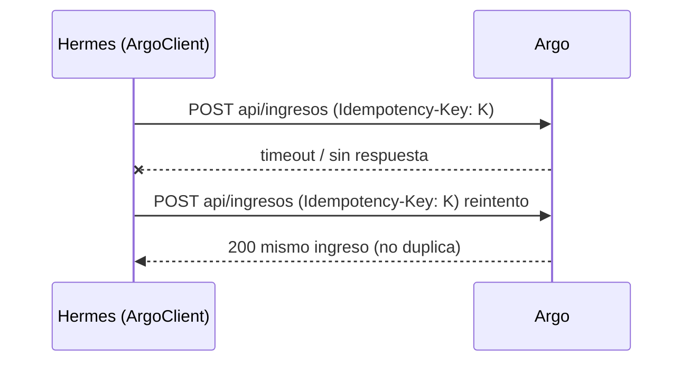

---
proyecto:
  - Ocelotl.Hermes
  - Ocelotl.Iris
  - Itzamna.Dionisio
  - Pochteca.Nomisma
proyectos:
  - "[[Ocelotl.Hermes]]"
  - "[[Ocelotl.Iris]]"
  - "[[Itzamna.Dionisio]]"
  - "[[Pochteca.Nomisma]]"
tipo: patron
nivel: intermedio
estado: completo
tags:
  - conocimiento
  - patron
  - idempotencia
progreso: pendiente
area: Fundamentos
contenido: completo
---
# Idempotencia

> Una operación es idempotente si hacerla una vez o varias veces deja el sistema en el mismo estado; es lo que permite reintentar sin miedo.

## Qué es y qué problema resuelve
En sistemas con red, robots y usuarios que hacen doble clic, **las operaciones se repiten**: un reintento tras un timeout, un evento reenviado por el outbox, un botón pulsado dos veces. Si la operación no es idempotente, la repetición duplica datos (dos ingresos, dos egresos) o produce errores falsos ("ya estaba conectado"). La idempotencia hace que repetir sea seguro.

## Cómo funciona por dentro
Técnicas habituales:
- **Por diseño**: la operación describe un estado final ("que esté conectado"), no un cambio ("conéctalo otra vez").
- **Llave de idempotencia**: el cliente manda un id único por intención (`Idempotency-Key`) y el servidor recuerda la respuesta para ese id.
- **Deduplicación por id del mensaje**: el receptor ignora un `eventoId` ya procesado (patrón Inbox).
- **Upsert / restricciones únicas** en la base: `INSERT ... ON CONFLICT DO UPDATE` o `INSERT OR IGNORE`.
- **En el cliente**: impedir el doble envío mientras hay una petición en curso.

En HTTP, `GET`, `PUT` y `DELETE` se definen idempotentes; `POST` no lo es salvo que se diseñe así.



## Cuándo usarla y cuándo no
Imprescindible en todo lo que se reintenta automáticamente (outbox, clientes HTTP con reintento) y en acciones físicas o de dinero. Menos crítico en lecturas puras, que ya son idempotentes.

### Ventajas
- Reintentos seguros → sistema robusto ante cortes.
- Habilita la entrega "al menos una vez" del [[Patrón Outbox]].
- Mejor experiencia: repetir no produce errores sin sentido.

### Desventajas
- Hay que guardar llaves o ids procesados (y decidir cuánto tiempo).
- Diseñar el "estado final" a veces exige más reglas (qué campo gana en un conflicto).
- Fácil creer que algo es idempotente cuando solo lo es parcialmente.

## Alternativas
| Alternativa | En qué se diferencia |
|---|---|
| Entrega "exactamente una vez" | Muy costosa o imposible entre sistemas; en la práctica es "al menos una vez" + deduplicar. |
| "A lo sumo una vez" (no reintentar) | Sin duplicados, pero se pierden mensajes. |
| Bloqueos / transacciones distribuidas | Coordinan en vez de tolerar la repetición; complejas y frágiles. |

## Cómo se usó en Ocelotl
**[[Ocelotl.Hermes]]**
- **Conectar / Desconectar idempotentes** ([[Conexión de robots]]). `RowaRobotGateway.ConectarAsync` devuelve la conexión existente con `YaEstabaConectado: true`, y `Desconectar` no es error si no estaba conectado (`Ocelotl.Hermes/src/Ocelotl.Hermes.Application/Features/Conexion/Desconectar.cs`):

```csharp
/// <summary>Cierra la conexión con un robot. Es idempotente: desconectar dos veces no es error.</summary>
public static class Desconectar
{
    public sealed record Command(string IpAddress);

    public sealed record Result(string RobotId, bool EstabaConectado, DateTimeOffset FechaDesconexion);
```

Iris lo aprovecha: `Mensajes.Conectado(RobotId, isYaConectado)` muestra "ya estaba conectado" en vez de un error.

- **`Idempotency-Key` hacia [[Argo]]** al registrar un ingreso ([[Ingresos]]). El contrato del README de Hermes: `POST api/ingresos` (header `Idempotency-Key`). En `Ocelotl.Hermes/src/Ocelotl.Hermes.Infrastructure/Argo/ArgoClient.cs`:

```csharp
// La misma llave en el reintento permite que Argo no duplique el ingreso.
var idempotencia = Guid.NewGuid().ToString();

for (var intento = 0; ; intento++)
{
    using var peticion = Peticion(HttpMethod.Post, "api/ingresos");
    peticion.Headers.Add("Idempotency-Key", idempotencia);
```

La llave se genera **por llamada** y se reutiliza solo en el reintento interno (uno, a los 500 ms, si Argo no está disponible). Un segundo envío desde Iris genera otra llave: contra el doble clic protege Iris (ver abajo). Que Argo realmente respete la llave es pendiente de confirmar (Argo aún no existe; hoy se usa el Argo simulado). Prueba: `Registrar_manda_usuario_y_llave_de_idempotencia_y_reintenta_con_la_misma` en `tests/Ocelotl.Hermes.Integration.Tests/ArgoClientTests.cs`.

- **`eventoId` en el outbox** ([[Sincronización con Argo]]): cada fila de `outbox` tiene `id` = `Guid.CreateVersion7()`, enviado como `EventoId`. "Argo debe deduplicar por `eventoId` (entrega 'al menos una vez')". Ver [[Patrón Outbox]].

- **Upserts en SQLite** ([[Trazabilidad por caja]], [[Historial de salidas]]). `EgresoRepositorio.RegistrarAsync` usa `ON CONFLICT (robot_id, orden) DO UPDATE` ("Si ya existía (misma orden y robot), no lo duplica") y conserva la primera receta con `COALESCE(egresos.receta, excluded.receta)`; `RegistrarCajasAsync` usa `ON CONFLICT (caja_guid)` y "gana la última" orden. `CajaRepositorio.AutorizarAsync` también hace upsert por `caja_guid`. Así, reprocesar un evento en las reacciones `TrazarCajas`/`TrazarEgresos` no duplica filas (ver [[Eventos de dominio y reacciones]]).

- **Esquema y arranque**: `EsquemaBaseDatos` "es idempotente y corre al arrancar" (`CREATE TABLE IF NOT EXISTS`, `INSERT OR IGNORE INTO version_esquema`); la migración v4 se aplica una sola vez comprobando `version_esquema`. `SembrarUsuarioInicialAsync` también se comporta como idempotente (comentario en `IdentidadTests.cs`).

**[[Ocelotl.Iris]]**
- **`isEnviando` evita el doble envío** (regla del README: "un booleano `isEnviando` evita el doble envío"). Cada acción empieza con retorno temprano, p. ej. `if (Estado.Conexion.isEnviando) return` en `configuracion.handlers.js` y `if (Estado.Registro.isEnviando) return` en `ingresos.handlers.js`; además `fnUiButton` se deshabilita con `isCargando` (ver [[Componentes controlados]]).
- **No repetir la orden en [[Dispensar]]**: Iris recuerda las últimas 20 órdenes de la sesión y rechaza la misma orden en el mismo robot (`Ocelotl.Iris/src/features/dispensar/dispensar.handlers.js`):

```js
export async function fnDispensar() {
    if (Estado.isEnviando) return

    const { Errores, ErroresLineas, isValido } = fnValidar()
    if (!isValido) return fnActualizar({ Errores, ErroresLineas, Error: Mensajes.RevisaCampos })

    const Orden = Estado.Orden.trim()
    const isRepetida = Ordenes.some((Item) => Item.RobotId == Estado.RobotId && Item.Orden == Orden)
    if (isRepetida) return fnActualizar({ Errores: { ...Errores, Orden: Mensajes.OrdenRepetida(Orden) } })
```

Límites: la lista vive en memoria (se pierde al reiniciar Iris y solo guarda 20). En Hermes, `Dispensar` no rechaza una orden repetida: manda la orden al robot y el egreso se fusiona por `(robot_id, orden)`. Qué hace el robot BD Rowa con un id de orden repetido es pendiente de confirmar en el manual del SDK ([[SDK BD Rowa y WWKS2]]).


## Cómo se usó en Itzamna
En [[Itzamna.Dionisio]] no hay `Idempotency-Key` ni deduplicación por id de mensaje. Lo que sí hay, encontrado en el código:

- **Subida de medios deduplicada por contenido** ([[Biblioteca de medios]]). `UploadMediaHandler` calcula el SHA-256 del archivo y, si el creador ya tiene uno igual (no borrado), lo devuelve con `Reused = true` en vez de crear otro; el controller responde `200 OK` en lugar de `201 Created`. Repetir la misma subida no duplica archivos ni consume cuota (`Itzamna.Dionisio/src/Itzamna.Dionisio.Application/Features/Media/MediaFeatures.cs`):
```csharp
var sha = await HashAsync(command.TempFilePath, ct);
var existing = await db.MediaAssets.FirstOrDefaultAsync(a => a.Sha256 == sha, ct);
if (existing is not null) return existing.ToDto(storage, reused: true);

// Cuotas de espacio: protegen el costo de Blob Storage. Un archivo repetido no cuenta (se reutiliza arriba).
```
  (Hay índice `(CreatorId, Sha256)`, no único.)
- **"Asegurar" en vez de "crear"**: `GET /api/me` (`EnsureCreatorHandler`) crea creador + portfolio solo la primera vez; las siguientes devuelve los existentes ([[Perfil del creador]]).
- **Seed idempotente**: `JatzSeeder.SeedAsync` sale si ya existe el sujeto del demo o el slug `jatz`; por eso producción puede correrlo en cada arranque ("Producción: … aquí solo se siembra el demo (idempotente)", `Program.cs`).
- **Migraciones idempotentes**: el pipeline genera `dotnet ef migrations script --idempotent`, que "solo aplica migraciones pendientes"; reintentar el despliegue no rompe el esquema ([[Azure Pipelines]], [[Entity Framework Core]]).
- **Operaciones de estado final**: los `PUT` de módulos (`/api/portfolio/hero`, `about`, …) reemplazan el contenido; `PUT .../order` recibe la lista completa de ids; `restore` mueve el puntero a una versión; `unpublish` pone el estado en `Unpublished`. Repetirlas deja lo mismo ([[Módulos del portfolio]], [[Publicación y versiones]]).

Lo que **no** es idempotente:
- `POST /api/portfolio/publish`: cada llamada crea una versión nueva (v3, v4…) aunque el borrador no haya cambiado.
- `POST` de colecciones sin `Id` (p. ej. guardar una red social nueva): un doble clic crea dos elementos. La protección, si existe, está en el Studio (ver las partes Front).

> [!note] Pendiente de confirmar
> Dos `GET /api/me` simultáneos en el primer acceso podrían intentar crear dos creadores; el índice único de `HecateSubject` evitaría el duplicado, pero la segunda petición terminaría en 500 (la `DbUpdateException` no está mapeada). Dos subidas simultáneas del mismo archivo sí podrían crear dos assets (el índice por SHA no es único). No probado.


## Cómo se usó en Pochteca.Nomisma
Tres capas contra el doble cobro y el doble procesamiento en [[Pochteca.Nomisma]]:
1. **Idempotency-Key hacia Stripe**: `"{ordenId}:{numeroIntento}:{livemode}"` al crear la sesión de Checkout; si se repite la petición, Stripe regresa la misma sesión ([[Stripe Checkout - Back]]).
2. **Reglas antes de cobrar**: orden ya pagada → 409 `orden_ya_pagada`; sesión vigente → se reutiliza.
3. **UNIQUE en la base**: `uq_sesiones_checkout_una_orden_exitosa` y `uq_sesiones_checkout_idempotency`; si choca, 409 `duplicado`.

Webhooks: **inbox** con UNIQUE (livemode, stripe_event_id); un evento repetido responde 200 sin reprocesar ([[Webhooks]], [[Webhook Stripe Connect - Back]]).

## Errores comunes y buenas prácticas
- **Generar una llave nueva en cada reintento**: anula la protección. La llave se crea una vez por intención.
- **Confiar solo en el cliente** (`isEnviando`): protege del doble clic, no de reintentos de red ni de otra PC.
- **Upsert que pisa datos valiosos**: decidir campo por campo quién gana (`COALESCE` para conservar la receta).
- **Tratar "ya estaba" como error**: devolver éxito con un indicador (`YaEstabaConectado`, `EstabaConectado`).
- Deduplicar por un id estable del mensaje, no por el contenido.
- Documentar en la interfaz qué pasa con un duplicado (como hace `IEgresoRepositorio`).

## Qué estudiar después
- [[Patrón Outbox]]
- [[Repository]] y [[SQLite]] (UPSERT, restricciones únicas)
- [[Eventos de dominio y reacciones]]
- Patrón Inbox (deduplicación en el receptor)
- Reintentos con backoff y *jitter*

## Documentación oficial
- https://www.rfc-editor.org/rfc/rfc9110#name-idempotent-methods
- https://datatracker.ietf.org/doc/draft-ietf-httpapi-idempotency-key-header/
- https://www.sqlite.org/lang_upsert.html

## Autoevaluación

Contesta primero en voz alta o en papel; luego despliega la respuesta.

> [!question]- ¿Qué es una operación idempotente?
> Una que, ejecutada una o varias veces con la misma entrada, deja el sistema en el mismo estado. `PUT` y `DELETE` lo son por diseño; `POST` no.

> [!question]- ¿Cómo funciona una idempotency key en un `POST /pagos`?
> El cliente genera un identificador único (GUID) por intención de pago y lo envía en `Idempotency-Key`. El servidor guarda la clave con el resultado; si llega otra vez, devuelve la misma respuesta sin volver a cobrar.

> [!question]- Llega la misma idempotency key con un body distinto. ¿Qué haces?
> Rechazar con un error (por ejemplo `422` o `409`): la clave ya está ligada a otra petición. Por eso se guarda un hash del body junto con la clave.

> [!question]- Dos peticiones con la misma clave llegan al mismo tiempo. ¿Qué cuidar?
> Que solo una se procese: reservar la clave de forma atómica (índice único o lock) y que la segunda espere o reciba `409` hasta que la primera termine.

