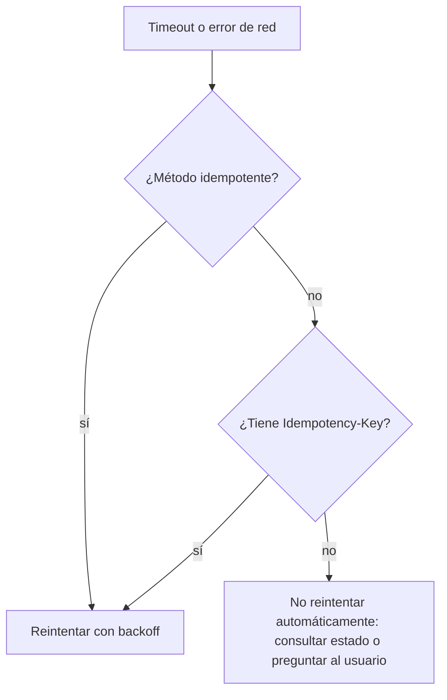

# Métodos seguros e idempotentes

Parte de: [[02-Fundamentos/02 HTTP/_Índice HTTP|HTTP]]

> [!info] Cómo avanzar
> `progreso`: **pendiente** → **viendo** (estudiando) → **visto** (contestaste la autoevaluación sin abrir las respuestas) → **dominado** (hiciste el laboratorio o lo aplicaste de verdad).

## Contenido

### Qué es
Dos propiedades que la especificación de HTTP asigna a cada método y que todo el ecosistema (navegadores, proxies, CDN, librerías de reintentos) usa para decidir qué puede hacer **sin preguntarte**:

- Un método es **seguro** si el cliente **no pide cambiar** el estado del servidor: solo lee. `GET`, `HEAD`, `OPTIONS` (y `TRACE`).
- Un método es **idempotente** si **repetir la misma petición** deja el servidor en el mismo estado que hacerla una sola vez. Todos los seguros lo son, y además `PUT` y `DELETE`.

Ojo: son **promesas del contrato**. HTTP no te impide escribir un `GET` que borra datos; pero si lo haces, rompes lo que el resto del mundo asume.

### Cómo funciona
| Método | Seguro | Idempotente | Cacheable |
|---|---|---|---|
| `GET` | Sí | Sí | Sí |
| `HEAD` | Sí | Sí | Sí |
| `OPTIONS` | Sí | Sí | No |
| `POST` | No | **No** | Raramente |
| `PUT` | No | Sí | No |
| `PATCH` | No | **No** (en general) | No |
| `DELETE` | No | Sí | No |

#### Idempotencia se mide en el estado, no en la respuesta
- `DELETE /clientes/7` dos veces: la primera responde `204`, la segunda `404`. Sigue siendo idempotente porque el estado final es el mismo: el cliente 7 no existe.
- `PUT /clientes/7` con el mismo body dos veces: mismo estado final.
- `POST /pedidos` dos veces: dos pedidos. No idempotente.
- `PATCH` con `{"estado":"cancelado"}` es idempotente en la práctica; con "agrega una etiqueta al final" no lo es (ver [[PATCH]]).

Efectos secundarios que no cambian el recurso (logs, métricas, un contador de visitas) no rompen la seguridad ni la idempotencia en términos prácticos.

#### Por qué importa para los reintentos
Imagina que mandas una petición y hay un **timeout**. No sabes si:
1. la petición nunca llegó,
2. llegó y se procesó, pero la respuesta se perdió, o
3. se está procesando todavía.

Si la operación es **idempotente**, reintentar es seguro en los tres casos: en el peor, haces lo mismo dos veces con el mismo resultado. Si **no** lo es, reintentar puede duplicar el efecto (dos cargos, dos pedidos). Por eso Polly, el resilience handler de .NET, los proxies y los navegadores reintentan `GET`/`PUT`/`DELETE` y evitan reintentar `POST` automáticamente.



Para hacer idempotente un `POST` se usa una **idempotency key** (ver [[Idempotencia]] y [[POST]]).

### Ejemplo
Política de reintentos en Itzamna.Dionisio que solo reintenta métodos idempotentes:

```csharp
builder.Services.AddHttpClient("inventario", c => c.BaseAddress = new Uri("https://inventario.example/"))
    .AddStandardResilienceHandler(o =>
    {
        o.Retry.MaxRetryAttempts = 3;
        o.Retry.ShouldHandle = args =>
        {
            // El método se toma del contexto, así también se evalúa cuando hubo excepción y no hay respuesta
            var metodo = args.Context.GetRequestMessage()?.Method;
            bool idempotente = metodo == HttpMethod.Get || metodo == HttpMethod.Put
                            || metodo == HttpMethod.Delete || metodo == HttpMethod.Head;
            bool transitorio = args.Outcome.Exception is HttpRequestException
                            || (int?)args.Outcome.Result?.StatusCode is 408 or 429 or >= 500;
            return ValueTask.FromResult(idempotente && transitorio);
        };
    });
```

Una alternativa más corta del mismo paquete es `o.Retry.DisableForUnsafeHttpMethods()`, que desactiva los reintentos para `POST`, `PATCH`, `PUT`, `DELETE` y `CONNECT`. Ojo: es más conservadora que la tabla de arriba, porque también excluye `PUT` y `DELETE` (que son idempotentes en teoría, pero en la práctica muchas implementaciones no lo garantizan).

Y en el diseño de la API: el endpoint para marcar una notificación como leída es `PUT /notificaciones/15/lectura` (estado absoluto, idempotente), no `POST /notificaciones/15/marcar-leida` ni, peor, `GET`.

### Cuándo usarlo y cuándo no
- Al **diseñar**: elige el método cuya semántica coincida con lo que hace el endpoint. Si una operación debe ser reintentable, diséñala idempotente (estados absolutos, `PUT`, o `POST` con llave).
- Al **consumir**: configura reintentos solo para métodos idempotentes o con llave.
- Al **revisar código**: un `GET` que cambia datos es un defecto de seguridad, no una cuestión de estilo.

### Errores comunes
- **Creer que idempotente significa "misma respuesta"**: es "mismo estado".
- **`GET` con efectos** (marcar como leído, borrar, enviar correo).
- **Reintentar `POST` sin llave** y duplicar operaciones.
- **`PUT` implementado con operaciones relativas** ("suma 1"), que rompe su promesa de idempotencia.
- **Pensar que "seguro" significa "protegido"**: es un término técnico de HTTP (solo lectura), no de seguridad informática.

### Para profundizar
- [MDN: Safe (glosario HTTP)](https://developer.mozilla.org/en-US/docs/Glossary/Safe/HTTP)
- [MDN: Idempotent (glosario)](https://developer.mozilla.org/en-US/docs/Glossary/Idempotent)
- [RFC 9110, sección 9.2: Common Method Properties](https://www.rfc-editor.org/rfc/rfc9110#section-9.2)

## Autoevaluación

Contesta primero en voz alta o en papel; luego despliega la respuesta.

> [!question]- ¿Qué significa que un método sea **seguro** y que sea **idempotente**?
> **Seguro**: el cliente no pide cambiar estado (`GET`, `HEAD`, `OPTIONS`). **Idempotente**: repetir la misma petición deja el servidor igual que hacerla una vez (los seguros, más `PUT` y `DELETE`).

> [!question]- Clasifica `GET`, `POST`, `PUT`, `PATCH`, `DELETE`.
> | Método | Seguro | Idempotente |
> |---|---|---|
> | GET | Sí | Sí |
> | POST | No | No |
> | PUT | No | Sí |
> | PATCH | No | No (en general) |
> | DELETE | No | Sí |

> [!question]- ¿Por qué importa la idempotencia para los reintentos?
> Si un timeout deja la duda de si la petición se procesó, solo es seguro reintentar automáticamente una operación idempotente. Por eso clientes como Polly o los proxies reintentan `GET`/`PUT` pero no `POST`.

## Práctica

- [[Lab 1 - Peticiones HTTP con curl y archivos .http]]

