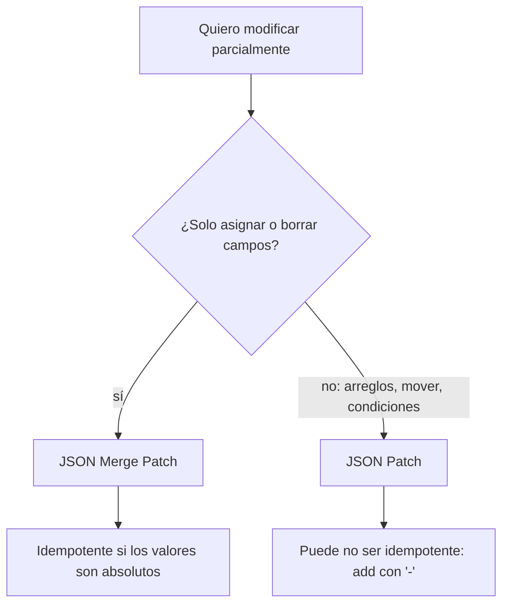

# PATCH

Parte de: [[02-Fundamentos/02 HTTP/_Índice HTTP|HTTP]]

> [!info] Cómo avanzar
> `progreso`: **pendiente** → **viendo** (estudiando) → **visto** (contestaste la autoevaluación sin abrir las respuestas) → **dominado** (hiciste el laboratorio o lo aplicaste de verdad).

## Contenido

### Qué es
`PATCH` aplica una **modificación parcial** a un recurso existente. En lugar de mandar el recurso completo (como en [[PUT]]), mandas un documento que **describe los cambios**. Es ideal para cambiar uno o dos campos de un recurso grande, o para transiciones como "cambiar el estado del pedido".

A diferencia de `PUT`, `PATCH` **no es idempotente por definición**: depende de cómo esté escrito el documento de cambios.

### Cómo funciona
El formato del body lo indica el `Content-Type`. Hay dos formatos estándar:

#### JSON Merge Patch (RFC 7396)
`Content-Type: application/merge-patch+json`. Mandas un objeto con **solo los campos a cambiar**; un valor `null` significa **borrar** el campo.

```http
PATCH /api/clientes/7
Content-Type: application/merge-patch+json

{"email": "nuevo@correo.mx", "telefono": null}
```

Resultado: cambia el email, borra el teléfono, todo lo demás queda igual. Es simple e intuitivo; su limitación es que no puede expresar "poner este campo en `null`" distinto de "borrarlo", ni operar sobre elementos de arreglos (reemplaza el arreglo completo).

#### JSON Patch (RFC 6902)
`Content-Type: application/json-patch+json`. Mandas una **lista de operaciones**: `add`, `remove`, `replace`, `move`, `copy`, `test`, cada una con un `path` (JSON Pointer).

```http
PATCH /api/clientes/7
Content-Type: application/json-patch+json

[
  { "op": "test",    "path": "/version", "value": 12 },
  { "op": "replace", "path": "/email",   "value": "nuevo@correo.mx" },
  { "op": "add",     "path": "/etiquetas/-", "value": "vip" }
]
```

La operación `test` hace que todo el parche falle si la condición no se cumple (útil para concurrencia). Las operaciones se aplican en orden y de forma atómica: o se aplican todas o ninguna.

#### Cuándo no es idempotente
Un `PATCH` que expresa **operaciones relativas** cambia el resultado cada vez que se repite:
- `{"op":"add","path":"/etiquetas/-","value":"vip"}` agrega "vip" **al final** cada vez: repetirlo tres veces deja tres "vip".
- "Incrementar saldo en 10".

En cambio, un Merge Patch con valores absolutos (`{"estado":"cancelado"}`) sí lo es en la práctica. Si tus clientes van a reintentar, diseña parches absolutos o usa `If-Match`.



### Ejemplo
Implementar Merge Patch con controllers y Dapper sin librerías extra: recibe un `JsonElement` y actualiza solo las columnas presentes.

```csharp
[HttpPatch("{id:int}")]
[Consumes("application/merge-patch+json")]
public async Task<IActionResult> Modificar(int id, [FromBody] JsonElement cambios,
    [FromServices] IModificarCliente cmd, CancellationToken ct)
{
    // Lista blanca de campos que se pueden modificar
    string[] permitidos = ["email", "telefono", "activo"];
    var desconocidos = cambios.EnumerateObject().Select(p => p.Name).Except(permitidos).ToList();
    if (desconocidos.Count > 0)
        return Problem(statusCode: 400, title: "Campos no modificables",
            extensions: new Dictionary<string, object?> { ["codigo"] = "CAMPO_NO_MODIFICABLE", ["campos"] = desconocidos });

    var parche = new ParcheCliente(
        TieneEmail: cambios.TryGetProperty("email", out var e), Email: e.ValueKind == JsonValueKind.String ? e.GetString() : null,
        TieneTelefono: cambios.TryGetProperty("telefono", out var t), Telefono: t.ValueKind == JsonValueKind.String ? t.GetString() : null);

    return await cmd.EjecutarAsync(id, parche, ct) ? NoContent() : NotFound();
}
```

```sql
-- ModificarCliente.sql: solo toca las columnas indicadas
UPDATE dbo.Cliente
SET Email    = CASE WHEN @TieneEmail = 1    THEN @Email    ELSE Email    END,
    Telefono = CASE WHEN @TieneTelefono = 1 THEN @Telefono ELSE Telefono END
WHERE Id = @Id;
```

(Para `[Consumes("application/merge-patch+json")]` el formatter JSON debe aceptar ese media type; agrégalo a `SupportedMediaTypes` del `SystemTextJsonInputFormatter` si hace falta.) Para JSON Patch, ASP.NET Core ofrece soporte con `JsonPatchDocument<T>` (Pendiente de confirmar el paquete recomendado para System.Text.Json en .NET 10).

Valida el resultado con FluentValidation **después** de aplicar el parche al estado actual: un parche válido puede producir un recurso inválido.

### Cuándo usarlo y cuándo no
- **Merge Patch**: la mayoría de los formularios de edición parcial y cambios de estado. Es lo más simple para el front.
- **JSON Patch**: arreglos, operaciones condicionales (`test`) o cuando necesitas distinguir operaciones.
- **`PUT`**: si el cliente siempre manda el recurso completo.
- **`POST` a sub-recurso de acción** (`POST /pedidos/9/cancelacion`) cuando el cambio de estado tiene reglas y efectos propios (ver [[Diseño de endpoints y nombres de recursos]]).

### Errores comunes
- **Mandar Merge Patch con `Content-Type: application/json`** sin documentarlo: el cliente no sabe qué significa `null`.
- **Confundir "no enviado" con `null`**: si deserializas a un DTO con propiedades anulables, pierdes la diferencia. Usa `JsonElement` o un tipo que registre presencia.
- **Permitir parchear cualquier campo** (`/rol`, `/saldo`): usa lista blanca.
- **Reintentar parches relativos** y duplicar efectos.
- **Validar el parche y no el resultado**.

### Para profundizar
- [MDN: PATCH](https://developer.mozilla.org/en-US/docs/Web/HTTP/Methods/PATCH)
- [RFC 7396: JSON Merge Patch](https://www.rfc-editor.org/rfc/rfc7396)
- [RFC 6902: JavaScript Object Notation (JSON) Patch](https://www.rfc-editor.org/rfc/rfc6902)
- [RFC 5789: PATCH Method for HTTP](https://www.rfc-editor.org/rfc/rfc5789)

## Autoevaluación

Contesta primero en voz alta o en papel; luego despliega la respuesta.

> [!question]- ¿En qué se diferencia `PATCH` de `PUT`?
> `PATCH` aplica una **modificación parcial** descrita en el body; `PUT` reemplaza el recurso completo. `PATCH` no es idempotente por definición (depende del formato).

> [!question]- ¿Qué formatos estándar existen para el body de un `PATCH`?
> **JSON Merge Patch** (`application/merge-patch+json`, RFC 7396): mandas solo los campos a cambiar y `null` borra. **JSON Patch** (`application/json-patch+json`, RFC 6902): lista de operaciones `add`, `remove`, `replace`, `move`, `copy`, `test`.

> [!question]- ¿Cuándo un `PATCH` no es idempotente?
> Cuando expresa operaciones relativas, por ejemplo `{"op":"add","path":"/etiquetas/-","value":"vip"}` (agrega al final) o "incrementar saldo en 10". Repetirlo cambia el resultado.

## Práctica

- [[Lab 1 - Peticiones HTTP con curl y archivos .http]]

