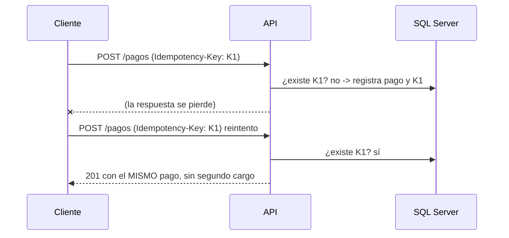

# POST

Parte de: [[02-Fundamentos/02 HTTP/_Índice HTTP|HTTP]]

> [!info] Cómo avanzar
> `progreso`: **pendiente** → **viendo** (estudiando) → **visto** (contestaste la autoevaluación sin abrir las respuestas) → **dominado** (hiciste el laboratorio o lo aplicaste de verdad).

## Contenido

### Qué es
`POST` es el método para **enviar datos al servidor para que los procese**. Sus dos usos principales:

1. **Crear un recurso subordinado** de una colección: `POST /pedidos` crea un pedido y el servidor decide su id.
2. **Ejecutar un procesamiento** que no encaja en otro método: `POST /pedidos/9/cancelacion`, `POST /reportes/ventas` (lanzar un reporte), `POST /clientes/busquedas` (búsqueda con filtros grandes).

`POST` **no es seguro ni idempotente**: cada llamada puede producir un efecto nuevo. Dos `POST /pedidos` iguales crean, en principio, dos pedidos.

### Cómo funciona
```http
POST /api/pedidos HTTP/1.1
Content-Type: application/json
Idempotency-Key: 6f1c2b8e-3a1d-4e57-9a0b-0b8f9d2e6c11

{"clienteId": 42, "partidas": [{"sku": "CAF-500", "cantidad": 2}]}
```

```http
HTTP/1.1 201 Created
Location: /api/pedidos/1088
Content-Type: application/json

{"id": 1088, "estado": "registrado", "total": 398.00}
```

La respuesta correcta al **crear** es **`201 Created`** con el header **`Location`** apuntando al nuevo recurso y, opcionalmente, el recurso en el body. Si la creación se hará después (por ejemplo, entra a una cola), responde **`202 Accepted`** con dónde consultar el estado. Si el `POST` ejecuta una acción sin crear un recurso, `200` (con resultado) o `204`.

#### El problema del doble clic
El usuario da doble clic en "Pagar", o la red corta después de que el servidor procesó la petición pero antes de que llegara la respuesta, y el cliente reintenta. Resultado: **dos cargos**. Como `POST` no es idempotente, nadie (ni el navegador, ni Polly, ni el proxy) puede reintentarlo con seguridad.

La solución es hacerlo **idempotente** con una **idempotency key**: el cliente genera un identificador único por *intención* de operación y lo manda en el header `Idempotency-Key`. El servidor guarda la clave con el resultado; si llega otra petición con la misma clave, devuelve el resultado guardado sin volver a cobrar. Detalle completo en [[Idempotencia]].



Además, en la UI deshabilita el botón mientras la petición está en curso; ayuda, pero **no basta** (no cubre reintentos de red ni dobles pestañas).

### Ejemplo
En Itzamna.Dionisio:

```csharp
[ApiController]
[Route("api/pedidos")]
public class CrearPedidoController(ICrearPedido cmd, IValidator<CrearPedidoDto> validador) : ControllerBase
{
    [HttpPost]
    public async Task<IActionResult> Crear(CrearPedidoDto dto,
        [FromHeader(Name = "Idempotency-Key")] Guid? llave, CancellationToken ct)
    {
        if (llave is null)
            return Problem(statusCode: 400, title: "Falta Idempotency-Key",
                extensions: new Dictionary<string, object?> { ["codigo"] = "FALTA_LLAVE_IDEMPOTENCIA" });

        var v = await validador.ValidateAsync(dto, ct);
        if (!v.IsValid)
        {
            foreach (var e in v.Errors) ModelState.AddModelError(e.PropertyName, e.ErrorMessage);
            return ValidationProblem(ModelState);
        }

        // El procedimiento inserta el pedido y la llave en la misma transacción;
        // si la llave ya existe, devuelve el pedido original
        var pedido = await cmd.EjecutarAsync(dto, llave.Value, ct);
        return CreatedAtAction("Obtener", "ObtenerPedido", new { id = pedido.Id }, pedido);
    }
}
```

En el front (React), la llave se genera **una vez por intención** y se reutiliza en los reintentos:

```ts
const llave = crypto.randomUUID(); // al abrir la pantalla de pago, no en cada intento
await fetch("/api/pedidos", {
  method: "POST",
  headers: { "Content-Type": "application/json", "Idempotency-Key": llave },
  body: JSON.stringify(pedido),
});
```

### Cuándo usarlo y cuándo no
- **Sí**: crear cuando el servidor asigna el id, acciones de negocio (cancelar, aprobar, enviar), procesos (generar reporte), búsquedas que no caben en la URL.
- **Usa `PUT`** si el cliente conoce la URL final del recurso y envía la representación completa (ver [[PUT]]).
- **Usa `PATCH`** para modificar parcialmente un recurso existente.
- **No** uses `POST` para todo (ver [[Verbos HTTP]]): pierdes caché, reintentos seguros y claridad.

### Errores comunes
- **Responder `200` al crear sin `Location`**: el cliente no sabe dónde quedó el recurso.
- **Reintentar `POST` automáticamente** sin idempotency key: duplicados.
- **Generar la idempotency key en cada intento**: entonces no sirve; debe ser la misma para la misma intención.
- **Validar solo en el front**: el servidor siempre valida (FluentValidation).
- **Aceptar el id del recurso en el body** de un `POST` de creación y confiar en él.

### Para profundizar
- [MDN: POST](https://developer.mozilla.org/en-US/docs/Web/HTTP/Methods/POST)
- [RFC 9110, sección 9.3.3: POST](https://www.rfc-editor.org/rfc/rfc9110#section-9.3.3)
- [IETF draft: The Idempotency-Key HTTP Header Field](https://datatracker.ietf.org/doc/draft-ietf-httpapi-idempotency-key-header/)

## Autoevaluación

Contesta primero en voz alta o en papel; luego despliega la respuesta.

> [!question]- ¿Para qué se usa `POST`?
> Para crear un recurso subordinado (`POST /pedidos`) o ejecutar un procesamiento que no encaja en otros métodos. No es seguro ni idempotente.

> [!question]- ¿Qué respuesta es la correcta al crear un recurso con `POST`?
> `201 Created` con el header `Location: /pedidos/123` y, opcionalmente, el recurso en el body. Si la creación es asíncrona, `202 Accepted`.

> [!question]- El usuario da doble clic en "Pagar" y se crean dos cargos. ¿Cómo se previene?
> Haciendo el `POST` idempotente con una **idempotency key** (header `Idempotency-Key`) que el servidor recuerda, además de deshabilitar el botón en la UI. Ver [[Idempotencia]].

## Práctica

- [[Lab 1 - Peticiones HTTP con curl y archivos .http]]

