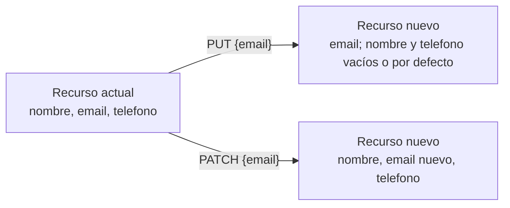

# PUT

Parte de: [[02-Fundamentos/02 HTTP/_Índice HTTP|HTTP]]

> [!info] Cómo avanzar
> `progreso`: **pendiente** → **viendo** (estudiando) → **visto** (contestaste la autoevaluación sin abrir las respuestas) → **dominado** (hiciste el laboratorio o lo aplicaste de verdad).

## Contenido

### Qué es
`PUT` **reemplaza por completo** el recurso que está en la URL indicada con la representación que envías en el body. Si el recurso no existe y el servidor lo permite, `PUT` lo **crea** en esa URL (el cliente decide el identificador). Es **idempotente**: mandar el mismo `PUT` una o diez veces deja el recurso exactamente igual, lo que hace seguro reintentarlo.

La idea clave: con `PUT` el body es **el estado completo deseado**, no una lista de cambios.

### Cómo funciona
```http
PUT /api/clientes/7 HTTP/1.1
Content-Type: application/json
If-Match: "v12"

{"nombre": "Ana López", "email": "ana@correo.mx", "telefono": "3312345678", "activo": true}
```

Respuestas habituales:

| Situación | Código |
|---|---|
| Se actualizó y devuelves el recurso | `200 OK` |
| Se actualizó y no devuelves nada | `204 No Content` |
| No existía y se creó | `201 Created` |
| La versión no coincide (`If-Match`) | `412 Precondition Failed` |
| Datos inválidos | `400` (o `422`) |

#### ¿Qué pasa con los campos que no envías?
Si mandas `PUT /clientes/7` solo con `{"email": "a@b.mx"}`, con semántica estricta los demás campos quedan **vacíos o con su valor por defecto**, porque `PUT` reemplaza todo. Muchas APIs "suavizan" esto y solo actualizan lo que llega, pero entonces en realidad están implementando un `PATCH` con el método equivocado y confunden a los clientes. Si quieres cambiar un solo campo, usa [[PATCH]].



#### Por qué es idempotente
El resultado no depende de cuántas veces lo apliques: "el cliente 7 queda así". Comparado con "suma 10 al saldo" (no idempotente), "el saldo es 150" sí lo es. Por eso `PUT` debe expresar estados absolutos.

### Ejemplo
En Itzamna.Dionisio, con FluentValidation y concurrencia optimista:

```csharp
public sealed record ActualizarClienteDto(string Nombre, string Email, string? Telefono, bool Activo);

public sealed class ActualizarClienteValidador : AbstractValidator<ActualizarClienteDto>
{
    public ActualizarClienteValidador()
    {
        RuleFor(x => x.Nombre).NotEmpty().MaximumLength(200);
        RuleFor(x => x.Email).NotEmpty().EmailAddress();
    }
}

[HttpPut("{id:int}")]
public async Task<IActionResult> Reemplazar(int id, ActualizarClienteDto dto,
    [FromServices] IValidator<ActualizarClienteDto> validador,
    [FromServices] IReemplazarCliente cmd, CancellationToken ct)
{
    var v = await validador.ValidateAsync(dto, ct);
    if (!v.IsValid)
    {
        foreach (var e in v.Errors) ModelState.AddModelError(e.PropertyName, e.ErrorMessage);
        return ValidationProblem(ModelState);
    }

    var resultado = await cmd.EjecutarAsync(id, dto, Request.Headers.IfMatch.ToString(), ct);
    return resultado switch
    {
        Reemplazo.NoExiste => NotFound(),
        Reemplazo.VersionDistinta => StatusCode(StatusCodes.Status412PreconditionFailed),
        _ => NoContent()
    };
}
```

```sql
-- ReemplazarCliente.sql: TODOS los campos se sobrescriben
UPDATE dbo.Cliente
SET Nombre = @Nombre, Email = @Email, Telefono = @Telefono, Activo = @Activo
WHERE Id = @Id AND Version = @Version;
SELECT @@ROWCOUNT;
```

Nota cómo `Telefono` queda `NULL` si el cliente no lo envía: eso es `PUT`.

### Cuándo usarlo y cuándo no
- **Sí**: formularios de edición que envían el recurso completo, configuraciones (`PUT /usuarios/7/preferencias`), recursos cuyo id define el cliente (`PUT /archivos/reporte-2026-10.xlsx`).
- **Mejor `PATCH`**: cuando el cliente solo conoce o quiere cambiar algunos campos, o el recurso es grande.
- **Mejor `POST`**: cuando el servidor asigna el id.
- Si el recurso tiene campos que el cliente no debe tocar (fecha de alta, saldo), no los incluyas en el DTO del `PUT`.

### Errores comunes
- **Implementar `PUT` como actualización parcial**: los clientes no saben si un campo omitido se borra o se conserva. Documenta y respeta la semántica.
- **Usar `PUT` con operaciones relativas** ("incrementa existencia en 5"): rompe la idempotencia.
- **Ignorar la concurrencia**: dos usuarios editan el mismo cliente y el último pisa al primero. Usa `ETag`/`If-Match` (ver [[Caché HTTP (Cache-Control y ETag)]]).
- **Permitir que el id del body contradiga el de la URL**: valida que coincidan o ignora el del body.

### Para profundizar
- [MDN: PUT](https://developer.mozilla.org/en-US/docs/Web/HTTP/Methods/PUT)
- [RFC 9110, sección 9.3.4: PUT](https://www.rfc-editor.org/rfc/rfc9110#section-9.3.4)
- [Microsoft REST API Guidelines](https://github.com/microsoft/api-guidelines/blob/vNext/azure/Guidelines.md)

## Autoevaluación

Contesta primero en voz alta o en papel; luego despliega la respuesta.

> [!question]- ¿Qué hace `PUT`?
> Reemplaza **completo** el recurso en la URL indicada con la representación enviada; puede crearlo si el cliente decide el identificador. Es idempotente.

> [!question]- Envías `PUT /clientes/7` solo con `{"email": "a@b.mx"}`. ¿Qué debería pasar con los demás campos?
> Con semántica estricta, quedan vacíos o con valor por defecto, porque `PUT` reemplaza todo. Para cambiar un campo usa `PATCH`.

> [!question]- ¿Qué códigos devuelve normalmente un `PUT`?
> `200 OK` (con el recurso) o `204 No Content` si actualizó; `201 Created` si lo creó.

## Práctica

- [[Lab 1 - Peticiones HTTP con curl y archivos .http]]

