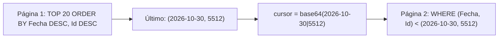

# Paginación, filtrado y ordenamiento

Parte de: [[02-Fundamentos/02 HTTP/_Índice HTTP|HTTP]]

> [!info] Cómo avanzar
> `progreso`: **pendiente** → **viendo** (estudiando) → **visto** (contestaste la autoevaluación sin abrir las respuestas) → **dominado** (hiciste el laboratorio o lo aplicaste de verdad).

## Contenido

### Qué es
Cuando una colección puede crecer (clientes, pedidos, movimientos), una API no debe devolverla completa. **Paginar** es entregarla por partes; **filtrar** es reducirla a lo que interesa; **ordenar** es definir en qué orden llegan los elementos. Juntos protegen al servidor (memoria, CPU, base de datos), a la red y al cliente, y hacen la API usable desde pantallas con tablas y scroll.

### Cómo funciona
#### Convención de query
```http
GET /api/clientes?estado=activo&entidad=JAL&sort=-nombre&page=2&size=20
```
- **Filtros** como parámetros con nombre (`estado`, `entidad`, `desde`, `hasta`).
- **Orden** con `sort`; una convención común es `-campo` para descendente y comas para varios campos (`sort=-fecha,id`). Documéntala en el contrato.
- **Paginación** con `page`/`size` (offset) o con `after`/`limit` (cursor).

#### Paginación por offset
Con páginas numeradas desde 1: `OFFSET = (page − 1) × size`. Para `page=4` y `size=25`, `OFFSET 75`. El total de páginas es `⌈total ÷ size⌉`: con 1,234 registros y `size=50` hay 25 páginas, la última con 34 registros.

- **Ventajas**: simple, permite saltar a la página N, fácil de mostrar como "página 3 de 25".
- **Desventajas**: en páginas profundas la base de datos igual tiene que recorrer y descartar las filas anteriores (lento), y si se insertan o borran registros mientras navegas, **saltas o repites** filas.

#### Paginación por cursor (keyset)
En vez de "salta 40 filas", dices "dame las que vienen **después de esta**": `?after=<cursor>&limit=20`, donde el cursor codifica los valores de orden del último elemento recibido.

- **Ventajas**: rápida (usa el índice directamente sin importar la profundidad) y estable ante inserciones.
- **Desventajas**: no permite saltar a la página N ni calcular fácilmente "página X de Y". Ideal para scroll infinito, feeds, exportaciones e integraciones.

En SQL Server:

```sql
SELECT TOP (@Limite) Id, Fecha, Total
FROM dbo.Pedido
WHERE (Fecha < @Fecha) OR (Fecha = @Fecha AND Id < @Id)
ORDER BY Fecha DESC, Id DESC;
```

El orden debe ser **total** (si dos pedidos tienen la misma fecha, `Id` desempata) y estar **indexado** (`CREATE INDEX IX_Pedido_Fecha_Id ON dbo.Pedido(Fecha DESC, Id DESC)`).



### Ejemplo
En Itzamna.Dionisio, ordenamiento seguro con **lista blanca** (nunca concatenes lo que manda el cliente):

```csharp
public sealed record ListarClientesQuery(string? Estado, string? Entidad, string? Sort, int Page = 1, int Size = 20);

public sealed class ListarClientes(IDbConnectionFactory db) : IListarClientes
{
    // Solo estos valores se aceptan; se mapean a SQL fijo
    private static readonly Dictionary<string, string> Ordenes = new(StringComparer.OrdinalIgnoreCase)
    {
        ["nombre"] = "Nombre ASC, Id ASC",
        ["-nombre"] = "Nombre DESC, Id DESC",
        ["-alta"] = "FechaAlta DESC, Id DESC",
    };

    public async Task<Pagina<ClienteResumen>> EjecutarAsync(ListarClientesQuery q, CancellationToken ct)
    {
        if (!Ordenes.TryGetValue(q.Sort ?? "nombre", out var orden))
            throw new ValidacionException("SORT_NO_PERMITIDO"); // se traduce a 400 con ProblemDetails

        var size = Math.Clamp(q.Size, 1, 100);
        var offset = (Math.Max(q.Page, 1) - 1) * size;

        var sql = SqlArchivos.Leer("ListarClientes.sql").Replace("/*ORDEN*/", orden); // orden viene de la lista blanca
        using var cn = db.Crear();
        using var multi = await cn.QueryMultipleAsync(new CommandDefinition(sql,
            new { q.Estado, q.Entidad, Offset = offset, Size = size }, cancellationToken: ct));
        var items = (await multi.ReadAsync<ClienteResumen>()).ToList();
        var total = await multi.ReadSingleAsync<int>();
        return new Pagina<ClienteResumen>(items, q.Page, size, total);
    }
}
```

```sql
-- ListarClientes.sql
SELECT Id, Nombre, Entidad, Estado
FROM dbo.Cliente
WHERE (@Estado IS NULL OR Estado = @Estado) AND (@Entidad IS NULL OR Entidad = @Entidad)
ORDER BY /*ORDEN*/
OFFSET @Offset ROWS FETCH NEXT @Size ROWS ONLY;

SELECT COUNT(*) FROM dbo.Cliente
WHERE (@Estado IS NULL OR Estado = @Estado) AND (@Entidad IS NULL OR Entidad = @Entidad);
```

Respuesta: `{"items":[...], "page":2, "size":20, "total":1234}`. Para cursor: `{"items":[...], "next":"MjAyNi0xMC0zMHw1NTEy"}` y el cliente manda `?after=` con ese valor.

### Cuándo usarlo y cuándo no
- **Offset**: tablas administrativas con "página X de Y" y volúmenes moderados.
- **Cursor**: scroll infinito, colecciones enormes o que cambian mucho, sincronización entre sistemas.
- **Siempre** pon un `size` máximo en el servidor (por ejemplo 100), aunque el cliente pida más.
- El `COUNT(*)` total puede ser caro en tablas grandes; ofrécelo solo si la UI lo necesita.

### Errores comunes
- **Concatenar `sort` directo en el SQL**: inyección SQL y consultas costosas sobre columnas sin índice. Usa lista blanca.
- **Orden no determinista** (`ORDER BY Nombre` con nombres repetidos): las páginas repiten o pierden filas. Agrega un desempate único.
- **Sin límite de tamaño**: `?size=1000000` tumba el servidor.
- **Offsets profundos** en tablas de millones de filas: cambia a keyset.
- **Cursors transparentes que el cliente manipula**: codifícalos (Base64) y valídalos; trátalos como opacos.

### Para profundizar
- [Microsoft Learn: Pagination (EF Core docs, explica offset vs keyset)](https://learn.microsoft.com/en-us/ef/core/querying/pagination)
- [Microsoft Learn: SELECT - ORDER BY clause (OFFSET FETCH)](https://learn.microsoft.com/en-us/sql/t-sql/queries/select-order-by-clause-transact-sql)
- [Microsoft REST API Guidelines](https://github.com/microsoft/api-guidelines/blob/vNext/azure/Guidelines.md)

## Ejercicios

Resuélvelos en papel o en la herramienta; la solución está plegada.

> [!question]- Con `size=25`, ¿qué `OFFSET` corresponde a `page=4` (páginas desde 1)?
> (4 − 1) × 25 = **75**.

> [!question]- Hay 1,234 registros y `size=50`. ¿Cuántas páginas hay?
> ⌈1234 / 50⌉ = **25** (la última con 34 registros).

> [!question]- Diseña la URL para pedir clientes activos de Jalisco, ordenados por nombre descendente, 2.ª página de 20.
> `GET /clientes?estado=activo&entidad=JAL&sort=-nombre&page=2&size=20` (la convención `-campo` para descendente se documenta en el contrato).

## Autoevaluación

Contesta primero en voz alta o en papel; luego despliega la respuesta.

> [!question]- ¿Qué diferencia hay entre paginación por offset y por cursor?
> **Offset**: `?page=3&size=20` → `OFFSET 40`. Simple y permite saltar a una página, pero es lenta en páginas profundas y salta o repite filas si los datos cambian. **Cursor** (keyset): `?after=<último id>`; estable y rápida con índice, pero no permite saltar a la página N.

> [!question]- ¿Cómo se implementa keyset en SQL?
> ```sql
> SELECT TOP (20) Id, Fecha
> FROM Pedidos
> WHERE (Fecha < @fecha) OR (Fecha = @fecha AND Id < @id)
> ORDER BY Fecha DESC, Id DESC;
> ```
> El orden debe ser total (agrega un desempate único) y estar indexado.

> [!question]- ¿Qué riesgo hay en aceptar `?sort=` directo del cliente?
> Inyección SQL si se concatena el nombre de columna y consultas costosas. Mapea los valores permitidos a columnas en una lista blanca.

