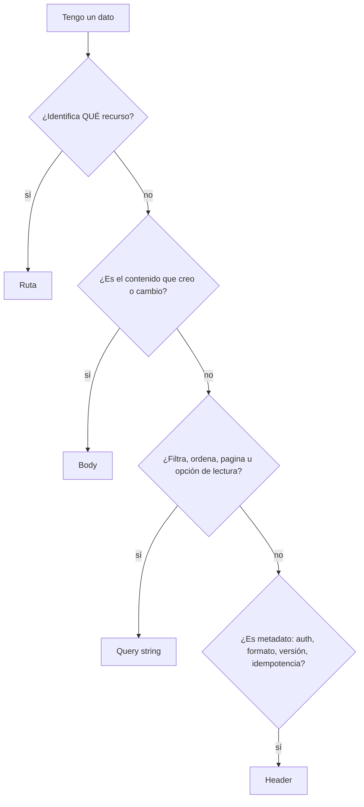

# Parámetros de ruta, query string y body

Parte de: [[02-Fundamentos/02 HTTP/_Índice HTTP|HTTP]]

> [!info] Cómo avanzar
> `progreso`: **pendiente** → **viendo** (estudiando) → **visto** (contestaste la autoevaluación sin abrir las respuestas) → **dominado** (hiciste el laboratorio o lo aplicaste de verdad).

## Contenido

### Qué es
Una petición HTTP puede llevar datos en tres lugares principales (más los headers), y cada uno tiene un propósito:

- **Ruta** (path): **identifica el recurso**. `/clientes/42/direcciones/3`.
- **Query string**: **modifica cómo** quieres el recurso o la colección: filtrar, ordenar, paginar, elegir campos. `?estado=activo&sort=-nombre&page=2`.
- **Body**: **la representación** que creas o modificas (en `POST`, `PUT`, `PATCH`). `{"nombre": "Ana", "email": "ana@correo.mx"}`.

Elegir bien hace que la API sea predecible, cacheable y segura.

### Cómo funciona
```http
PATCH /api/clientes/42/direcciones/3?notificar=false HTTP/1.1
Content-Type: application/merge-patch+json

{"codigoPostal": "44100"}
```

- `42` y `3` (ruta): qué dirección de qué cliente.
- `notificar=false` (query): una opción de cómo procesar.
- El body: el cambio.

#### Regla práctica


#### Datos sensibles: nunca en la query
La URL completa (con su query) queda registrada en: logs de acceso del servidor y del proxy, Application Insights, el historial y los marcadores del navegador, y el header `Referer` que se envía a otros sitios al seguir un enlace. Contraseñas, tokens, CURP, números de tarjeta van en el **body** o en **headers** (`Authorization`), que viajan cifrados por TLS y normalmente no se registran.

#### Listas en la query
No hay un estándar único. Las dos convenciones habituales:
- Repetir la clave: `?id=1&id=2&id=3`. ASP.NET Core la entiende directamente para `int[] id` o `List<int> id`.
- Separar por comas: `?ids=1,2,3`. Hay que partirla manualmente o con un model binder.

Lo importante es **documentarla** en el contrato [[OpenAPI con Swagger y Scalar|OpenAPI]] (allí se describe con `style` y `explode`).

### Ejemplo
En un controller de Itzamna.Dionisio, cada atributo dice de dónde viene el dato:

```csharp
[ApiController]
[Route("api/clientes/{clienteId:int}/pedidos")]
public class PedidosClienteController(IListarPedidosCliente consulta) : ControllerBase
{
    // GET /api/clientes/42/pedidos?estado=abierto&id=10&id=11&page=1&size=20
    [HttpGet]
    public async Task<IActionResult> Listar(
        [FromRoute] int clienteId,                 // ruta: identifica al cliente
        [FromQuery] string? estado,                // query: filtro
        [FromQuery(Name = "id")] int[]? ids,       // query: lista repetida
        [FromQuery] int page = 1, [FromQuery] int size = 20,
        CancellationToken ct = default)
        => Ok(await consulta.EjecutarAsync(clienteId, estado, ids ?? [], page, Math.Clamp(size, 1, 100), ct));

    // POST /api/clientes/42/pedidos  body: {"partidas":[...]}
    [HttpPost]
    public IActionResult Crear([FromRoute] int clienteId, [FromBody] CrearPedidoDto dto) => StatusCode(201);
}
```

Con `[ApiController]` las inferencias son automáticas (tipos complejos desde el body, parámetros que coinciden con la plantilla desde la ruta, el resto desde la query), pero ser explícito ayuda a leer el código. Para pasar una lista de ids a SQL Server con Dapper puedes usar un parámetro de tabla (TVP) o `STRING_SPLIT`; Dapper también expande `IN @Ids` automáticamente.

En el front:

```ts
const params = new URLSearchParams({ estado: "abierto", page: "1" });
[10, 11].forEach((id) => params.append("id", String(id)));
await fetch(`/api/clientes/42/pedidos?${params}`);
```

### Cuándo usarlo y cuándo no
- **Ruta**: ids y jerarquías de pertenencia reales. No metas filtros en la ruta (`/clientes/activos/jalisco`): explotan las combinaciones.
- **Query**: todo lo opcional de lectura. Mantén nombres consistentes en toda la API (`page`, `size`, `sort`).
- **Body**: datos de creación y modificación; búsquedas complejas por `POST` si no caben en la URL.
- **Headers**: metadatos transversales (autenticación, versión, idempotencia).

### Errores comunes
- **Datos sensibles en la query**, incluido el token en `?access_token=` (a veces inevitable en WebSockets; si lo haces, que sea de vida muy corta).
- **Body en `GET` o `DELETE`**: muchos intermediarios lo descartan.
- **Ids en el body que contradicen la ruta** (`PUT /clientes/7` con `{"id": 8}`): valida o ignora el del body.
- **No codificar valores** al armar la query (ver [[Anatomía de una URL]]).
- **Convenciones distintas para listas** en cada endpoint.

### Para profundizar
- [Microsoft Learn: Model Binding in ASP.NET Core](https://learn.microsoft.com/en-us/aspnet/core/mvc/models/model-binding)
- [OpenAPI Specification: Parameter Object (style y explode)](https://spec.openapis.org/oas/v3.1.0#parameter-object)
- [MDN: URLSearchParams](https://developer.mozilla.org/en-US/docs/Web/API/URLSearchParams)

## Autoevaluación

Contesta primero en voz alta o en papel; luego despliega la respuesta.

> [!question]- ¿Cuándo va un dato en la ruta, en la query o en el body?
> **Ruta**: identifica el recurso (`/clientes/42`). **Query**: filtra, ordena o pagina (`?estado=activo&page=2`). **Body**: la representación que creas o modificas.

> [!question]- ¿Por qué no poner datos sensibles en la query string?
> Quedan en logs de servidores y proxies, historial del navegador y el header `Referer`. Van en el body o en headers.

> [!question]- ¿Cómo se envía una lista en la query?
> No hay un estándar único: `?id=1&id=2` (repetido, lo entiende ASP.NET Core para `int[]`) o `?ids=1,2`. Documenta la convención en el contrato OpenAPI.

## Práctica

- [[Lab 1 - Peticiones HTTP con curl y archivos .http]]

