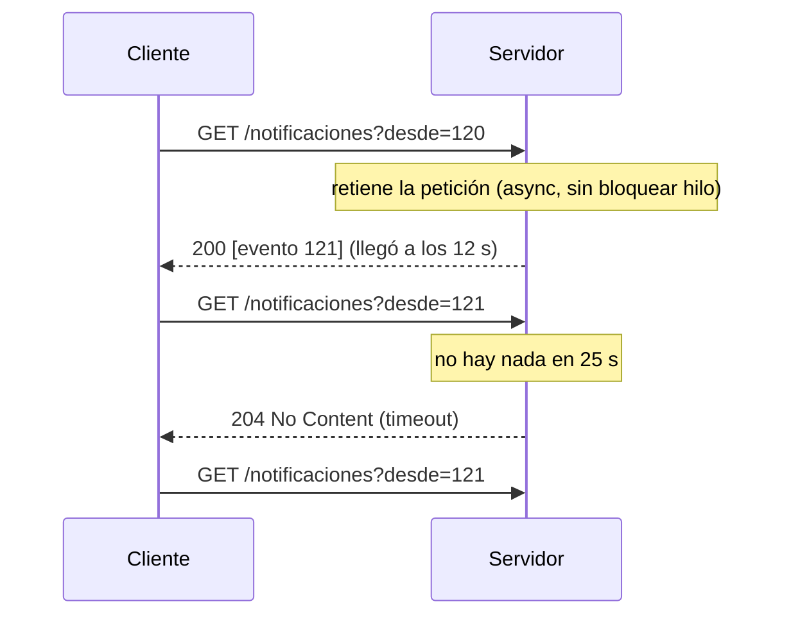

# Polling y long polling

Parte de: [[Polling, long polling, SSE y WebSockets]]

> [!info] Cómo avanzar
> `progreso`: **pendiente** → **viendo** (estudiando) → **visto** (contestaste la autoevaluación sin abrir las respuestas) → **dominado** (hiciste el laboratorio o lo aplicaste de verdad).

## Contenido

### Qué es
Son las dos formas de enterarse de novedades usando **solo peticiones HTTP normales**:

- **Polling (corto)**: el cliente pregunta periódicamente, por ejemplo cada 5 segundos: "¿cambió algo?". El servidor responde de inmediato, haya o no novedades.
- **Long polling**: el cliente pregunta y el servidor **no responde hasta que haya algo nuevo** o hasta que se cumpla un tiempo límite (por ejemplo 30 s). En cuanto el cliente recibe la respuesta, vuelve a preguntar.

Funcionan en cualquier navegador, proxy y servidor, sin protocolos especiales. Son la base de compatibilidad sobre la que se construyen técnicas más eficientes (ver [[Polling, long polling, SSE y WebSockets]]).

### Cómo funciona
#### Costo del polling corto
Si 1,000 usuarios consultan cada 5 s, son 200 peticiones por segundo, aunque solo haya una novedad por minuto: casi todas son respuestas vacías que consumen CPU, conexiones, base de datos y red. Además, la **latencia de la novedad** depende del intervalo: si un evento ocurre justo después de una consulta, el cliente se entera hasta la siguiente; **en promedio la mitad del intervalo** (2.5 s con intervalo de 5 s), y en el peor caso el intervalo completo.

Bajar el intervalo reduce la latencia pero multiplica la carga. Con `ETag` y `304 Not Modified` cada respuesta vacía pesa menos, pero la petición sigue existiendo.

#### Long polling


- El cliente indica desde qué evento quiere (`desde=121`) para no perder ni repetir.
- Al vencer el timeout, el servidor responde vacío (`204`) y el cliente reintenta de inmediato.
- La novedad llega casi al instante, y solo hay una petición abierta por cliente.

#### Qué cuidar en el timeout
- Debe ser **menor que el timeout de los intermediarios**: proxies, balanceadores y CDN cortan conexiones inactivas (muchos alrededor de 60 s o menos; revisa el tuyo). Si el proxy corta primero, el cliente ve errores `504` en lugar de un `204` limpio. Un valor típico es 20–30 s.
- El servidor **no debe bloquear un hilo** por petición en espera: usa código asíncrono (`await` sobre una señal o un canal) para que miles de peticiones abiertas no agoten el thread pool.
- Pasa el `CancellationToken` de la petición: si el cliente se va, deja de esperar.

### Ejemplo
Long polling en Itzamna.Dionisio con un canal en memoria (válido para una sola instancia; con varias, la señal debe venir de Redis o de la base de datos):

```csharp
public sealed class AvisosPedidos
{
    private TaskCompletionSource _senal = new(TaskCreationOptions.RunContinuationsAsynchronously);
    public Task EsperarAsync() => _senal.Task;
    public void Notificar() => Interlocked.Exchange(ref _senal,
        new TaskCompletionSource(TaskCreationOptions.RunContinuationsAsynchronously)).TrySetResult();
}

[HttpGet("api/pedidos/cambios")]
public async Task<IActionResult> Cambios([FromQuery] long desde, [FromServices] AvisosPedidos avisos,
    [FromServices] IListarCambiosPedidos consulta, CancellationToken ct)
{
    var hasta = DateTime.UtcNow.AddSeconds(25); // menor que el timeout del proxy
    while (DateTime.UtcNow < hasta)
    {
        var espera = avisos.EsperarAsync();      // tomar la señal ANTES de consultar evita perder avisos
        var cambios = await consulta.EjecutarAsync(desde, ct);
        if (cambios.Count > 0) return Ok(cambios);

        var restante = hasta - DateTime.UtcNow;
        if (restante <= TimeSpan.Zero) break;
        try { await espera.WaitAsync(restante, ct); }  // no bloquea hilos
        catch (TimeoutException) { break; }
    }
    return NoContent();
}
```

Cliente en TypeScript:

```ts
async function escuchar(desde: number): Promise<never> {
  for (;;) {
    try {
      const r = await fetch(`/api/pedidos/cambios?desde=${desde}`);
      if (r.status === 200) {
        const cambios: { id: number }[] = await r.json();
        cambios.forEach(mostrar);
        desde = cambios[cambios.length - 1].id;
      }
    } catch {
      await new Promise((res) => setTimeout(res, 2000)); // espera antes de reintentar si hubo error
    }
  }
}
declare function mostrar(c: { id: number }): void;
```

### Cuándo usarlo y cuándo no
- **Polling corto**: pocas novedades, pocos clientes, retrasos de segundos aceptables (estado de un trabajo de `202`). Muy fácil de implementar y depurar.
- **Long polling**: necesitas inmediatez pero no puedes usar SSE o WebSockets (proxies antiguos, restricciones). Es el último respaldo de [[SignalR]].
- **Mejor [[Server-Sent Events (SSE)]]** si solo el servidor envía y el entorno lo soporta.
- Añade **jitter** al intervalo del polling para que todos los clientes no consulten en el mismo segundo.

### Errores comunes
- **Intervalos agresivos** (cada segundo) "para que se sienta en tiempo real": carga desproporcionada.
- **Timeout de long polling mayor que el del proxy**: errores 504 intermitentes.
- **Bloquear hilos** con `Thread.Sleep` o `.Result` mientras se espera.
- **No usar un marcador `desde`**: se pierden o duplican eventos entre una petición y la siguiente.
- **Seguir consultando con la pestaña oculta**: usa `document.visibilityState` para pausar.

### Para profundizar
- [MDN: Page Visibility API](https://developer.mozilla.org/en-US/docs/Web/API/Page_Visibility_API)
- [RFC 6202: Known Issues and Best Practices for the Use of Long Polling and Streaming in Bidirectional HTTP](https://www.rfc-editor.org/rfc/rfc6202)
- [Microsoft Learn: ASP.NET Core SignalR configuration (transportes)](https://learn.microsoft.com/en-us/aspnet/core/signalr/configuration)

## Autoevaluación

Contesta primero en voz alta o en papel; luego despliega la respuesta.

> [!question]- ¿Cuál es el costo del polling corto?
> Muchas peticiones vacías: carga en servidor y red, y la latencia de la novedad depende del intervalo (en promedio la mitad del intervalo).

> [!question]- ¿Cómo funciona el long polling?
> El cliente pide; el servidor retiene la respuesta hasta que hay un evento o se cumple un timeout (por ejemplo 30 s); el cliente vuelve a pedir de inmediato.

> [!question]- ¿Qué cuidar en el timeout del long polling?
> Que sea menor que el timeout de proxies y balanceadores (muchos cortan a 60 s o menos), y que el servidor no bloquee un hilo por petición (usar código asíncrono).

