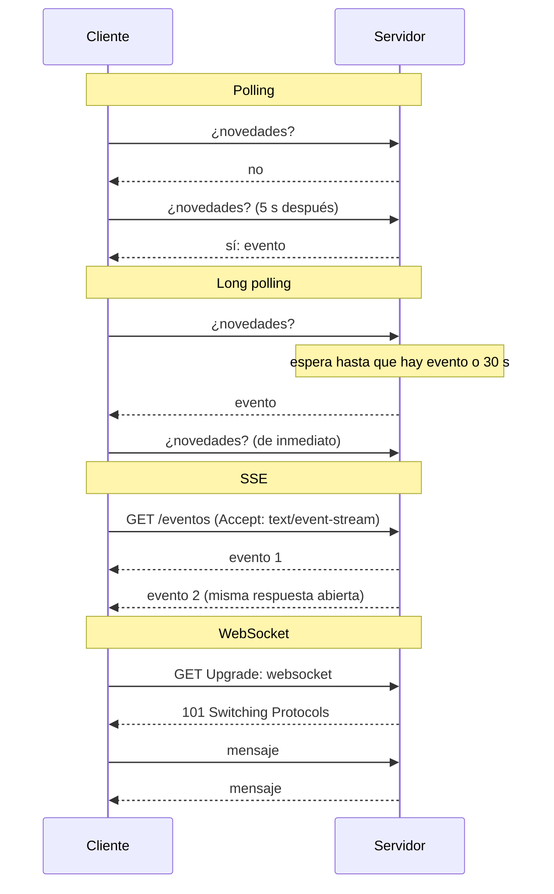
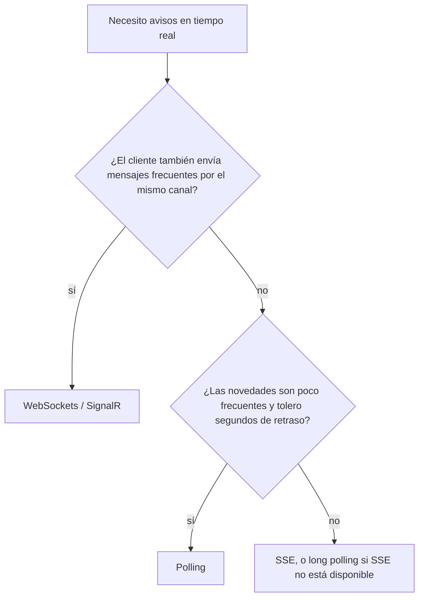

# Polling, long polling, SSE y WebSockets

Parte de: [[02-Fundamentos/02 HTTP/_Índice HTTP|HTTP]]

> [!info] Cómo avanzar
> `progreso`: **pendiente** → **viendo** (estudiando) → **visto** (contestaste la autoevaluación sin abrir las respuestas) → **dominado** (hiciste el laboratorio o lo aplicaste de verdad).

## Contenido

### Qué es
HTTP clásico funciona por **petición-respuesta**: el servidor solo habla cuando el cliente pregunta. Pero muchas pantallas necesitan enterarse de cosas **cuando pasan**: un pedido cambió de estado, terminó un reporte, llegó un mensaje, avanzó un proceso. Hay cuatro técnicas para lograrlo, de la más simple a la más capaz:

1. **[[Polling y long polling|Polling]]**: el cliente pregunta cada N segundos "¿hay algo nuevo?".
2. **[[Polling y long polling|Long polling]]**: el cliente pregunta y el servidor **retiene** la respuesta hasta que hay novedades o se cumple un timeout.
3. **[[Server-Sent Events (SSE)]]**: el servidor envía eventos por una respuesta HTTP que se mantiene abierta. Un solo sentido: servidor → cliente.
4. **[[WebSockets]]**: canal **bidireccional** (full-duplex) y persistente sobre una conexión TCP.

[[SignalR]] es la librería de .NET que elige automáticamente entre WebSockets, SSE y long polling según lo que soporten cliente y servidor.

### Cómo funciona


| Técnica | Dirección | Latencia de la novedad | Costo | Complejidad en producción |
|---|---|---|---|---|
| Polling | Cliente pregunta | Hasta el intervalo | Muchas peticiones vacías | Mínima |
| Long polling | Cliente pregunta | Casi inmediata | Una petición abierta por cliente | Baja (timeouts) |
| SSE | Servidor → cliente | Inmediata | Una conexión abierta por cliente | Media |
| WebSockets | Ambas | Inmediata | Una conexión abierta por cliente | Alta |

### Ejemplo
Tres casos en tus proyectos:

- **Avance de un reporte en Wee.Reporteria**: solo el servidor necesita avisar ("40 %… 80 %… listo"). **SSE** es ideal: funciona sobre HTTP normal, pasa por proxies y `EventSource` reconecta solo. Si el reporte tarda minutos y el usuario puede esperar, hasta un **polling** cada 5 s al recurso de estado del `202 Accepted` es aceptable (ver [[Códigos HTTP 2xx (éxito)]]).
- **Tablero de pedidos en vivo en Ocelotl.Hermes**: varios usuarios ven cambios de estado en tiempo real y además envían acciones; **SignalR** sobre WebSockets.
- **Integración con un sistema externo que no soporta nada de lo anterior**: polling del lado del servidor con un worker, o mejor, [[Webhooks]] si el otro sistema los ofrece.

Regla rápida para elegir:



### Cuándo usarlo y cuándo no
- **Polling**: cambios poco frecuentes, pocos clientes, o como solución inicial. Fácil de cachear y depurar.
- **Long polling**: cuando necesitas inmediatez y no tienes SSE ni WebSockets (es el respaldo de SignalR).
- **SSE**: notificaciones, avance de procesos, feeds; texto de servidor a cliente.
- **WebSockets**: chat, colaboración, juegos, tableros con interacción en ambos sentidos.
- Si tienes muchas instancias del servidor, cualquier técnica "push" necesita distribuir los eventos entre instancias (backplane: Redis o Azure SignalR Service).

### Errores comunes
- **Elegir WebSockets "porque es lo moderno"** para algo que es solo servidor → cliente: SSE es más simple.
- **Polling cada segundo con miles de clientes**: carga enorme para pocas novedades.
- **Ignorar los timeouts de proxies y balanceadores**, que cortan conexiones largas o inactivas.
- **No planear la reconexión**: las conexiones persistentes se caen (redes móviles, despliegues). El cliente debe reconectar y recuperar lo que se perdió.
- **Olvidar la escalabilidad horizontal**: un evento generado en la instancia A no llega a los clientes conectados a la instancia B sin backplane.

### Para profundizar
- [MDN: Server-sent events](https://developer.mozilla.org/en-US/docs/Web/API/Server-sent_events)
- [MDN: The WebSocket API](https://developer.mozilla.org/en-US/docs/Web/API/WebSockets_API)
- [Microsoft Learn: Overview of ASP.NET Core SignalR](https://learn.microsoft.com/en-us/aspnet/core/signalr/introduction)

## Subtemas

- [[Polling y long polling]]
- [[Server-Sent Events (SSE)]]
- [[WebSockets]]

## Autoevaluación

Contesta primero en voz alta o en papel; luego despliega la respuesta.

> [!question]- Ordena de más simple a más capaz: polling, long polling, SSE, WebSockets.
> **Polling**: preguntar cada N segundos. **Long polling**: la petición queda abierta hasta que hay datos. **SSE**: el servidor envía eventos por una respuesta HTTP abierta (un solo sentido). **WebSockets**: canal bidireccional full-duplex.

> [!question]- ¿Qué técnica elegirías para mostrar el avance de un proceso largo?
> **SSE** (o polling si es poco frecuente): solo el servidor necesita enviar, funciona sobre HTTP normal y el navegador reconecta solo con `EventSource`.

> [!question]- ¿Qué complica a WebSockets en producción?
> Conexiones de larga duración: el balanceador y los proxies deben soportarlas, hay que reconectar, mandar heartbeats y, con varias instancias, distribuir mensajes (backplane). [[SignalR]] resuelve parte de esto.

## Progreso de los subtemas

```base
filters:
  and:
    - file.inFolder("02-Fundamentos/02 HTTP/Polling, long polling, SSE y WebSockets")
    - file.name != "Polling, long polling, SSE y WebSockets"
views:
  - type: table
    name: Progreso
    order:
      - file.name
      - progreso
      - nivel
```
