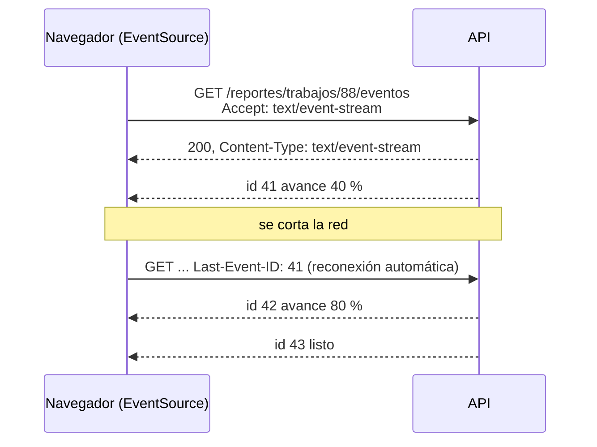

# Server-Sent Events (SSE)

Parte de: [[Polling, long polling, SSE y WebSockets]]

> [!info] Cómo avanzar
> `progreso`: **pendiente** → **viendo** (estudiando) → **visto** (contestaste la autoevaluación sin abrir las respuestas) → **dominado** (hiciste el laboratorio o lo aplicaste de verdad).

## Contenido

### Qué es
**Server-Sent Events** (SSE) es un estándar para que el servidor **empuje eventos al cliente** sobre una respuesta HTTP que se mantiene abierta. El cliente hace un `GET` normal, el servidor responde con `Content-Type: text/event-stream` y, en lugar de terminar, va escribiendo eventos de texto conforme ocurren. En el navegador se consume con la API **`EventSource`**. Es comunicación en **un solo sentido**: servidor → cliente.

### Cómo funciona
El formato es texto plano, un campo por línea, y cada evento termina con una **línea en blanco**:

```text
id: 41
event: avance
data: {"trabajo":"88","porcentaje":40}

id: 42
event: avance
data: {"trabajo":"88","porcentaje":80}

: esto es un comentario, sirve como heartbeat

id: 43
event: listo
retry: 5000
data: {"trabajo":"88","archivo":"/reportes/archivos/88"}

```

- `data:` el contenido (puede haber varias líneas `data:` seguidas).
- `event:` el tipo de evento (si no se indica, es `message`).
- `id:` identificador del evento. Si la conexión se cae, `EventSource` **reconecta solo** y envía el header **`Last-Event-ID: 42`** para que el servidor retome desde ahí.
- `retry:` cuántos milisegundos esperar antes de reconectar.
- Líneas que empiezan con `:` son comentarios (útiles como heartbeat para que los proxies no cierren por inactividad).



#### Ventajas frente a WebSockets
- Es **HTTP normal**: pasa por proxies, CDN y firewalls sin configuración especial, aprovecha HTTP/2 (muchos streams en una conexión) y usa la misma autenticación por cookie y CORS que el resto de la app.
- **Reconexión automática** y reanudación con `Last-Event-ID` incluidas en el navegador.
- Mucho más simple en servidor: no hay protocolo de frames ni handshake especial.

#### Limitaciones de `EventSource`
- Solo hace **`GET`** y **no permite agregar headers propios** como `Authorization: Bearer`. Se autentica con **cookies** (con `withCredentials` si es otro origen) o, si usas tokens, con librerías que implementan SSE sobre `fetch` (que sí permite headers).
- Solo transmite **texto** (UTF-8); datos binarios hay que codificarlos.
- En HTTP/1.1 los navegadores limitan las conexiones por dominio (alrededor de 6), y cada `EventSource` ocupa una; con HTTP/2 ese problema desaparece casi por completo.

### Ejemplo
Avance de un reporte en Wee.Reporteria. En .NET 10 existe `TypedResults.ServerSentEvents`, pero escribirlo a mano en un controller muestra el mecanismo:

```csharp
[HttpGet("api/reportes/trabajos/{id:guid}/eventos")]
public async Task Eventos(Guid id, [FromServices] IAvanceReportes avances, CancellationToken ct)
{
    Response.Headers.ContentType = "text/event-stream";
    Response.Headers.CacheControl = "no-cache";

    long.TryParse(Request.Headers["Last-Event-ID"], out var ultimo); // reanudación

    // avances.LeerAsync es un IAsyncEnumerable que emite cada cambio del trabajo
    await foreach (var a in avances.LeerAsync(id, desde: ultimo, ct))
    {
        await Response.WriteAsync($"id: {a.Secuencia}\nevent: {a.Tipo}\ndata: {JsonSerializer.Serialize(a)}\n\n", ct);
        await Response.Body.FlushAsync(ct); // sin flush el evento se queda en el búfer
    }
}
```

En el front (Itzamna.Clio):

```ts
const fuente = new EventSource(`/api/reportes/trabajos/${id}/eventos`, { withCredentials: true });
fuente.addEventListener("avance", (e) => {
  const { porcentaje } = JSON.parse((e as MessageEvent).data);
  setAvance(porcentaje);
});
fuente.addEventListener("listo", (e) => {
  descargar(JSON.parse((e as MessageEvent).data).archivo);
  fuente.close(); // si no lo cierras, EventSource reconecta para siempre
});
fuente.onerror = () => console.warn("Reconectando…");
declare function setAvance(p: number): void;
declare function descargar(url: string): void;
```

### Cuándo usarlo y cuándo no
- **Sí**: notificaciones, avance de procesos largos, feeds de actividad, streaming de texto (por ejemplo respuestas de un modelo de IA token por token).
- **No**: cuando el cliente también envía mensajes frecuentes por el mismo canal (chat, colaboración): [[WebSockets]] o [[SignalR]].
- **No**: datos binarios de alto volumen.
- Con muchas instancias, los eventos deben distribuirse entre ellas (Redis, Service Bus).

### Errores comunes
- **Olvidar el flush** o tener compresión/búfer en un proxy: los eventos llegan todos juntos al final. Desactiva el buffering para esa ruta.
- **No cerrar el `EventSource`** al terminar: sigue reconectando.
- **Querer mandar `Authorization`** con `EventSource`: no se puede; usa cookies o SSE sobre `fetch`.
- **Sin heartbeats**: proxies cierran la conexión inactiva.
- **No soportar `Last-Event-ID`**: se pierden eventos en cada reconexión.

### Para profundizar
- [MDN: Using server-sent events](https://developer.mozilla.org/en-US/docs/Web/API/Server-sent_events/Using_server-sent_events)
- [MDN: EventSource](https://developer.mozilla.org/en-US/docs/Web/API/EventSource)
- [HTML Living Standard: Server-sent events](https://html.spec.whatwg.org/multipage/server-sent-events.html)

## Autoevaluación

Contesta primero en voz alta o en papel; luego despliega la respuesta.

> [!question]- ¿Qué es SSE?
> Una respuesta HTTP con `Content-Type: text/event-stream` que se mantiene abierta y por la que el servidor envía eventos de texto (`data: ...` seguido de una línea en blanco). En el navegador se consume con `EventSource`.

> [!question]- ¿Qué ventajas tiene sobre WebSockets?
> Es HTTP normal (pasa por proxies y usa HTTP/2), reconexión automática y reanudación con `Last-Event-ID`. Sirve cuando solo el servidor necesita enviar.

> [!question]- ¿Qué limitación tiene `EventSource` del navegador?
> Solo hace `GET` y no permite agregar headers propios como `Authorization`; se autentica con cookies o con librerías que usan `fetch`. Además solo transmite texto.

