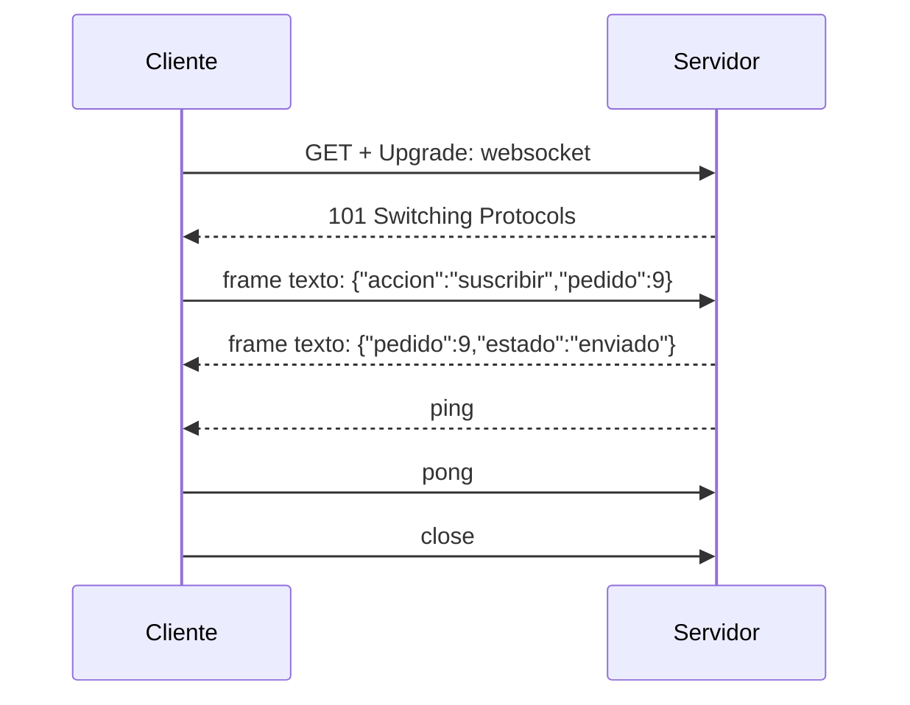

# WebSockets

Parte de: [[Polling, long polling, SSE y WebSockets]]

> [!info] Cómo avanzar
> `progreso`: **pendiente** → **viendo** (estudiando) → **visto** (contestaste la autoevaluación sin abrir las respuestas) → **dominado** (hiciste el laboratorio o lo aplicaste de verdad).

## Contenido

### Qué es
**WebSocket** es un protocolo que abre un canal **bidireccional y persistente** (full-duplex) entre cliente y servidor sobre una sola conexión TCP. Después de establecerlo, cualquiera de los dos puede enviar mensajes en cualquier momento, sin el esquema petición-respuesta de HTTP y con muy poca sobrecarga por mensaje. Se usa para chat, colaboración en tiempo real, tableros en vivo, juegos y cualquier caso donde ambos lados hablan con frecuencia. Las URLs usan `ws://` o, cifrado con TLS, **`wss://`** (el único aceptable en producción).

### Cómo funciona
#### Handshake
La conexión empieza como una petición HTTP/1.1 que pide "cambiar de protocolo":

```http
GET /hubs/pedidos HTTP/1.1
Host: api.ejemplo.com
Upgrade: websocket
Connection: Upgrade
Sec-WebSocket-Key: dGhlIHNhbXBsZSBub25jZQ==
Sec-WebSocket-Version: 13
Origin: https://hermes.ejemplo.com
```

```http
HTTP/1.1 101 Switching Protocols
Upgrade: websocket
Connection: Upgrade
Sec-WebSocket-Accept: s3pPLMBiTxaQ9kYGzzhZRbK+xOo=
```

El servidor calcula `Sec-WebSocket-Accept` a partir de la llave del cliente para demostrar que entiende el protocolo. Tras el **`101 Switching Protocols`** (ver [[Códigos HTTP 1xx (informativos)]]), la misma conexión TCP deja de hablar HTTP y transporta **frames** de WebSocket: texto, binario, `ping`, `pong` y `close`.



#### WebSockets y la política de mismo origen
CORS **no aplica** como en `fetch`: el navegador envía el header `Origin`, pero **no bloquea** la conexión aunque el servidor no responda headers CORS. Si tu servidor autentica la conexión con **cookies**, un sitio malicioso puede abrir un WebSocket hacia tu API desde el navegador de la víctima, y el navegador mandará las cookies: es el **cross-site WebSocket hijacking**. Por eso el servidor **debe validar `Origin`** contra una lista permitida (o autenticar con un token que el sitio atacante no puede obtener).

#### Heartbeats (ping/pong)
Una conexión puede "morir" sin aviso (el celular cambió de red, un NAT olvidó la conexión). Sin tráfico, ninguno de los lados se entera. Los **pings periódicos** sirven para dos cosas: detectar conexiones muertas (si no llega el pong, se cierra y el cliente reconecta) y mantener vivo el tráfico para que proxies, balanceadores y NAT no cierren la conexión por inactividad.

### Ejemplo
En la práctica, en .NET casi siempre usarás [[SignalR]] (que maneja reconexión, heartbeats, grupos y escalado). Pero así se ve WebSocket "crudo" en ASP.NET Core:

```csharp
app.UseWebSockets(new WebSocketOptions { KeepAliveInterval = TimeSpan.FromSeconds(30) }); // ping automático

app.Map("/ws/pedidos", async ctx =>
{
    if (!ctx.WebSockets.IsWebSocketRequest) { ctx.Response.StatusCode = 400; return; }

    var origen = ctx.Request.Headers.Origin.ToString();
    if (origen is not ("https://hermes.ejemplo.com" or "http://localhost:5173"))
    { ctx.Response.StatusCode = 403; return; }             // validar Origin

    using var ws = await ctx.WebSockets.AcceptWebSocketAsync();
    var buffer = new byte[4 * 1024];
    while (ws.State == WebSocketState.Open)
    {
        var r = await ws.ReceiveAsync(buffer, ctx.RequestAborted);
        if (r.MessageType == WebSocketMessageType.Close) break;
        // eco: responde lo mismo que recibió
        await ws.SendAsync(buffer.AsMemory(0, r.Count), WebSocketMessageType.Text, r.EndOfMessage, ctx.RequestAborted);
    }
    await ws.CloseAsync(WebSocketCloseStatus.NormalClosure, "fin", CancellationToken.None);
});
```

Cliente en el navegador:

```ts
const ws = new WebSocket("wss://api.ejemplo.com/ws/pedidos");
ws.onopen = () => ws.send(JSON.stringify({ accion: "suscribir", pedido: 9 }));
ws.onmessage = (e) => console.log("Servidor:", e.data);
ws.onclose = () => setTimeout(reconectar, 2000); // la API del navegador NO reconecta sola
declare function reconectar(): void;
```

En Azure App Service hay que habilitar WebSockets en la configuración (Pendiente de confirmar si sigue siendo necesario en tu plan y sistema operativo); con muchas conexiones, Azure SignalR Service las absorbe por ti.

### Cuándo usarlo y cuándo no
- **Sí**: comunicación frecuente en ambos sentidos con baja latencia (chat, colaboración, juegos, control remoto).
- **No**: si solo el servidor envía, [[Server-Sent Events (SSE)]] es más simple y más amigable con la infraestructura.
- **No**: para peticiones normales de una API (CRUD); pierdes caché, códigos de estado, herramientas y semántica HTTP.
- Con varias instancias, necesitas un **backplane** para que un mensaje llegue a usuarios conectados en otra instancia.

### Errores comunes
- **No validar `Origin`** con autenticación por cookie: hijacking entre sitios.
- **Usar `ws://`** en producción: sin cifrado, y muchos proxies lo rompen.
- **Sin heartbeats ni reconexión**: conexiones zombis y usuarios "desconectados" sin saberlo.
- **Proxies o balanceadores sin soporte de upgrade** o con timeouts de inactividad cortos.
- **Token en la query string** (`?access_token=`) sin cuidado: queda en logs. Si es inevitable, que sea de vida muy corta.

### Para profundizar
- [RFC 6455: The WebSocket Protocol](https://www.rfc-editor.org/rfc/rfc6455)
- [MDN: The WebSocket API](https://developer.mozilla.org/en-US/docs/Web/API/WebSockets_API)
- [Microsoft Learn: WebSockets support in ASP.NET Core](https://learn.microsoft.com/en-us/aspnet/core/fundamentals/websockets)
- [OWASP: WebSocket Security Cheat Sheet](https://cheatsheetseries.owasp.org/cheatsheets/WebSocket_Security_Cheat_Sheet.html)

## Autoevaluación

Contesta primero en voz alta o en papel; luego despliega la respuesta.

> [!question]- ¿Cómo se establece una conexión WebSocket?
> Con una petición HTTP/1.1 `GET` que incluye `Upgrade: websocket` y `Sec-WebSocket-Key`; el servidor responde `101 Switching Protocols` y a partir de ahí se intercambian frames por la misma conexión TCP (`ws://` o `wss://`).

> [!question]- ¿Aplica la política de mismo origen (CORS) a WebSockets?
> No como en `fetch`: el navegador envía el header `Origin` pero no bloquea la conexión. El servidor **debe validar `Origin`** o la conexión puede ser abusada desde otro sitio (cross-site WebSocket hijacking) si se autentica con cookies.

> [!question]- ¿Por qué se necesitan heartbeats (ping/pong)?
> Para detectar conexiones muertas y para que proxies o NAT no cierren la conexión por inactividad.

