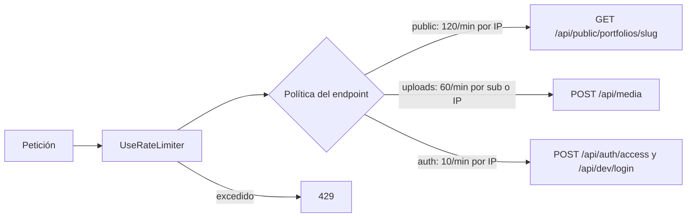

# Rate limiting

> Limitar cuántas peticiones acepta la API por cliente en una ventana de tiempo; [[Itzamna.Dionisio]] usa el middleware nativo de ASP.NET Core con tres políticas: `public`, `uploads` y `auth`.

## Qué es y qué problema resuelve
Sin límites, un cliente (o un bot) puede: adivinar códigos de acceso por fuerza bruta, subir archivos sin parar (costo de almacenamiento y CPU), o saturar el endpoint público. El rate limiting responde **429 Too Many Requests** cuando se excede la cuota.

## Cómo funciona por dentro
- `System.Threading.RateLimiting` trae algoritmos: **fixed window** (N permisos por ventana fija), sliding window, token bucket y concurrency.
- **Particiones**: cada llave (IP, usuario) tiene su propio contador (`RateLimitPartition.GetFixedWindowLimiter(llave, opciones)`).
- `AddRateLimiter` define políticas con nombre; `[EnableRateLimiting("x")]` las aplica a una acción; `UseRateLimiter()` las ejecuta en el pipeline.
- `RejectionStatusCode` define el código de rechazo (por defecto 503; conviene 429).
- Los contadores viven **en memoria del proceso**.



## Cuándo usarla y cuándo no
### Ventajas
- Nativo en .NET, sin dependencias.
- Protección básica contra fuerza bruta y abuso de costo.
- Políticas por endpoint y por llave.
### Desventajas
- En memoria: con varias instancias, cada una cuenta por separado.
- Por IP: detrás de NAT o proxy muchos usuarios comparten IP; sin `ForwardedHeaders` la IP puede ser la del proxy.
- Fixed window permite ráfagas en el borde de dos ventanas.

## Alternativas
| Alternativa | En qué se diferencia |
|---|---|
| Rate limit en el gateway (Azure Front Door, API Management) | Antes de llegar a la app; distribuido. |
| Redis + algoritmo propio | Contadores compartidos entre instancias. |
| Sliding window / token bucket | Suavizan ráfagas frente a fixed window. |
| CAPTCHA / bloqueo de cuenta | Complementos contra fuerza bruta en login. |

## Cómo se usó en Itzamna
`Itzamna.Dionisio/src/Itzamna.Dionisio.API/Program.cs`:
```csharp
builder.Services.AddRateLimiter(o =>
{
    o.RejectionStatusCode = StatusCodes.Status429TooManyRequests;
    o.AddPolicy("public", ctx => RateLimitPartition.GetFixedWindowLimiter(
        ctx.Connection.RemoteIpAddress?.ToString() ?? "anon",
        _ => new FixedWindowRateLimiterOptions { PermitLimit = 120, Window = TimeSpan.FromMinutes(1) }));
    o.AddPolicy("uploads", ctx => RateLimitPartition.GetFixedWindowLimiter(
        ctx.User.FindFirst("sub")?.Value ?? ctx.Connection.RemoteIpAddress?.ToString() ?? "anon",
        _ => new FixedWindowRateLimiterOptions { PermitLimit = 60, Window = TimeSpan.FromMinutes(1) }));
    o.AddPolicy("auth", ctx => RateLimitPartition.GetFixedWindowLimiter(
        ctx.Connection.RemoteIpAddress?.ToString() ?? "anon",
        _ => new FixedWindowRateLimiterOptions { PermitLimit = 10, Window = TimeSpan.FromMinutes(1) }));
});
```

| Política | Llave | Límite | Endpoints | Funcionalidad |
|---|---|---|---|---|
| `public` | IP | 120/min | `GET /api/public/portfolios/{slug}` | [[Portfolio público]] |
| `uploads` | `sub` del token (o IP) | 60/min | `POST /api/media` | [[Biblioteca de medios]] |
| `auth` | IP | 10/min | `POST /api/dev/login`, `POST /api/auth/access` | [[Autenticación y acceso]] |

Orden del pipeline: `UseCors()` → `UseRateLimiter()` → `UseAuthentication()` → tenant → `UseAuthorization()` → `UseOutputCache()`.

> [!note] Pendiente de confirmar
> `UseRateLimiter()` va **antes** de `UseAuthentication()`, así que en la política `uploads` `ctx.User` probablemente aún no tiene el `sub` y la partición cae a la IP. No lo probé. Tampoco hay `UseForwardedHeaders`: en App Service la IP podría ser la del front-end de Azure. El 429 no pasa por `AppExceptionHandler`, así que no es un ProblemDetails en español.

## Errores comunes y buenas prácticas
- Dejar `RejectionStatusCode` en 503: el cliente cree que la API está caída. Aquí es 429.
- Particionar por un valor que el cliente controla (header inventado).
- Ignorar proxies: configurar `ForwardedHeaders` para obtener la IP real.
- Olvidar `[EnableRateLimiting]` en endpoints sensibles nuevos (no hay política global).

## Qué estudiar después
- [[Output caching]], [[JWT y autenticación con Bearer]]
- `ForwardedHeadersMiddleware`, `OnRejected` para personalizar la respuesta y `Retry-After`.

## Documentación oficial
- https://learn.microsoft.com/aspnet/core/performance/rate-limit

## Autoevaluación

Contesta primero en voz alta o en papel; luego despliega la respuesta.

> [!question]- ¿Qué es el rate limiting y para qué sirve?
> Limitar cuántas peticiones acepta un cliente en una ventana de tiempo. Protege contra abuso, fuerza bruta y picos que tumban el servicio, y reparte la capacidad entre clientes.

> [!question]- ¿Qué diferencia hay entre ventana fija, ventana deslizante y token bucket?
> **Ventana fija**: N por minuto calendario (permite ráfagas en el borde). **Ventana deslizante**: reparte el conteo en segmentos y suaviza el borde. **Token bucket**: se recargan tokens a ritmo constante y permite ráfagas hasta el tamaño del cubo.

> [!question]- ¿Qué debe responder el API al rechazar por límite?
> `429 Too Many Requests` con `Retry-After` indicando cuándo reintentar.

> [!question]- Tienes 3 instancias con el limitador en memoria configurado a 100/min. ¿Cuál es el límite real?
> Hasta ~300/min, porque cada instancia cuenta por separado. Para un límite global se usa un almacén compartido (Redis) o se aplica en el gateway.

