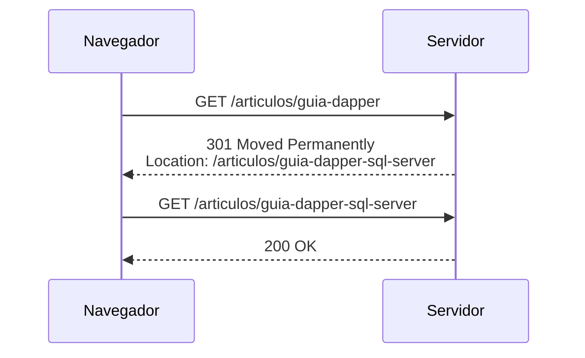
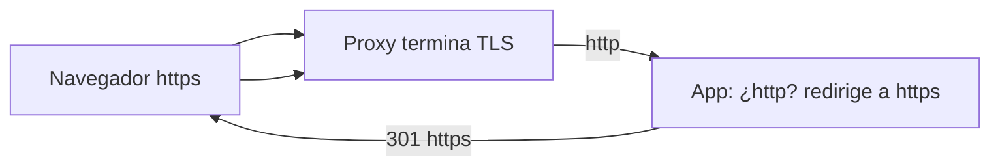

# Redirecciones

Parte de: [[02-Fundamentos/02 HTTP/_Índice HTTP|HTTP]]

> [!info] Cómo avanzar
> `progreso`: **pendiente** → **viendo** (estudiando) → **visto** (contestaste la autoevaluación sin abrir las respuestas) → **dominado** (hiciste el laboratorio o lo aplicaste de verdad).

## Contenido

### Qué es
Una **redirección** es una respuesta 3xx con un header `Location` que le dice al cliente: "lo que buscas está en otra URL, ve allá". El navegador la sigue automáticamente. Sirve para mover contenido sin romper enlaces, forzar HTTPS, mandar al login y regresar, y evitar reenvíos de formularios. Los códigos y sus diferencias técnicas están en [[Códigos HTTP 3xx (redirección)]]; aquí vemos los **casos de uso** y los **riesgos**.

### Cómo funciona


#### Permanente o temporal
- **`301`** (o `308` si hay que conservar método y body) cuando la URL cambió **para siempre**: un slug renombrado, un dominio nuevo, una sección reorganizada. Los navegadores pueden **cachear** la redirección y los buscadores **transfieren** el posicionamiento a la URL nueva.
- **`302`** (o `307`, o `303` después de un formulario) cuando es **temporal**: mandar al login, una página de mantenimiento, una campaña. Se seguirá consultando la URL original.

#### Cambio de slug
Si el artículo `/articulos/guia-dapper` ahora se llama `/articulos/guia-dapper-sql-server`, la URL vieja debe responder **`301` hacia la nueva**. Así se conservan los enlaces externos, los marcadores y el posicionamiento en buscadores. Para resolverlo necesitas guardar el **historial de slugs** (una tabla `ArticuloSlug(ArticuloId, Slug, EsActual)`), o incluir el id en la URL (`/articulos/57/guia-dapper`) y redirigir si el slug no coincide.

#### Open redirect
Un endpoint como `/login?returnUrl=https://malo.com` que redirige a **cualquier** destino que reciba es una vulnerabilidad: el atacante envía por correo un enlace con **tu dominio** (que parece confiable), el usuario inicia sesión en tu sitio real y termina en una página falsa idéntica que le pide "volver a escribir la contraseña". Se evita validando que el destino sea **local** (empiece con `/` pero no con `//` ni `/\`) o esté en una **lista permitida**. En ASP.NET Core: `Url.IsLocalUrl(returnUrl)` o `LocalRedirect(returnUrl)`, que lanza excepción si no es local.

#### Ciclos detrás de un proxy
`ERR_TOO_MANY_REDIRECTS` aparece cuando A redirige a B y B redirige a A (o a sí misma). La causa típica: el proxy inverso (Front Door, App Service, Nginx) termina TLS y le habla a la app por **HTTP**. La app ve `http`, aplica `UseHttpsRedirection`, responde "ve a https"; el navegador vuelve a pedir por HTTPS, el proxy otra vez reenvía por HTTP… sin fin. Se arregla haciendo que la app procese **`X-Forwarded-Proto`** (ver [[Proxy, proxy inverso y balanceador de carga]]).



### Ejemplo
Login con `returnUrl` seguro en un controller:

```csharp
[HttpPost("cuenta/login")]
public async Task<IActionResult> Login([FromForm] LoginForm f, [FromQuery] string? returnUrl)
{
    // ... validar credenciales y emitir la cookie
    if (!string.IsNullOrEmpty(returnUrl) && Url.IsLocalUrl(returnUrl))
        return LocalRedirect(returnUrl); // 302 solo hacia rutas locales
    return RedirectToAction("Index", "Inicio");
}
```

Redirección de slug viejo:

```csharp
[HttpGet("/articulos/{slug}")]
public async Task<IActionResult> Articulo(string slug, [FromServices] IResolverSlug resolver, CancellationToken ct)
{
    var r = await resolver.EjecutarAsync(slug, ct);       // busca en ArticuloSlug
    if (r is null) return NotFound();
    if (!r.EsActual) return RedirectPermanent($"/articulos/{r.SlugActual}"); // 301
    return Ok(r.Articulo);
}
```

Para depurar: `curl -sIL https://ejemplo.com/articulos/guia-dapper` muestra cada salto con su código y `Location`.

### Cuándo usarlo y cuándo no
- **Sí**: URLs que cambian, HTTP → HTTPS, dominio sin `www` → con `www` (o al revés, pero uno solo), login y regreso, PRG en formularios.
- **No** para APIs como mecanismo habitual: muchos clientes no siguen redirecciones con body o con headers de autorización. Para mover una API, versiona y avisa (ver [[Versionado de APIs]]).
- Evita **cadenas**: redirige directo al destino final, cada salto cuesta un RTT.

### Errores comunes
- **`301` para algo temporal**: queda cacheado en navegadores y no se deshace fácilmente.
- **Open redirect** por aceptar cualquier `returnUrl`.
- **Ciclos detrás del proxy** por no procesar `X-Forwarded-Proto`.
- **Perder la query string** al redirigir (`?utm_source=` o filtros) cuando debería conservarse.
- **Redirigir a `/login` las llamadas de API** sin autenticación en lugar de responder `401`: el front recibe HTML en vez de JSON.

### Para profundizar
- [MDN: Redirections in HTTP](https://developer.mozilla.org/en-US/docs/Web/HTTP/Redirections)
- [Microsoft Learn: Prevent open redirect attacks in ASP.NET Core](https://learn.microsoft.com/en-us/aspnet/core/security/preventing-open-redirects)
- [OWASP: Unvalidated Redirects and Forwards Cheat Sheet](https://cheatsheetseries.owasp.org/cheatsheets/Unvalidated_Redirects_and_Forwards_Cheat_Sheet.html)
- [Google Search Central: Redirects and Google Search](https://developers.google.com/search/docs/crawling-indexing/301-redirects)

## Autoevaluación

Contesta primero en voz alta o en papel; luego despliega la respuesta.

> [!question]- ¿Cuándo usar 301 y cuándo 302?
> `301` (o `308`) cuando la URL cambió para siempre, por ejemplo un slug renombrado: navegadores y buscadores actualizan el enlace. `302` (o `307`) si es temporal (mantenimiento, login).

> [!question]- Cambiaste el slug de un artículo. ¿Qué debe pasar con la URL vieja?
> Responder `301` hacia la nueva para conservar el posicionamiento y los enlaces externos. Guarda el historial de slugs para resolverlos.

> [!question]- ¿Qué es un open redirect y cómo se evita?
> Un endpoint como `/login?returnUrl=https://malo.com` que redirige a cualquier destino: sirve para phishing. Valida que el destino sea local o esté en una lista permitida (`Url.IsLocalUrl` en ASP.NET Core).

> [!question]- Error común: un ciclo de redirecciones (`ERR_TOO_MANY_REDIRECTS`). ¿Causa típica detrás de un proxy?
> La app no sabe que la petición original fue HTTPS (el proxy le habla por HTTP) y vuelve a redirigir a HTTPS sin fin. Se arregla procesando `X-Forwarded-Proto`.

## Práctica

- [[Lab 2 - Caché, redirecciones y compresión con curl]]

