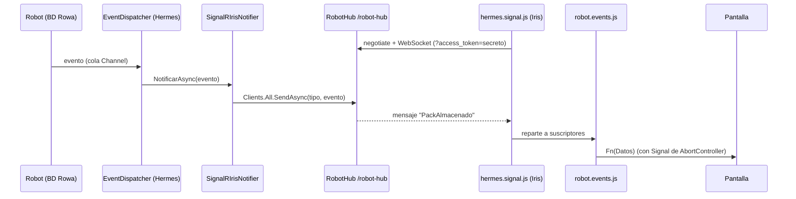

# SignalR

> Librería de ASP.NET Core para comunicación en tiempo real servidor ↔ cliente sobre WebSockets (con respaldo automático a otros transportes).

## Qué es y qué problema resuelve
SignalR permite que el servidor **empuje** mensajes al cliente en cuanto algo ocurre, sin que el cliente tenga que preguntar cada N segundos (*polling*). También permite que el cliente llame métodos del servidor sobre la misma conexión.

En Ocelotl resuelve: "el robot almacenó una caja / terminó un dispensado / cambió de estado" → [[Ocelotl.Iris]] lo muestra al instante. Es la base de [[Eventos en tiempo real]].

Versiones: cliente `@microsoft/signalr ^8.0.7` (Iris); servidor ASP.NET Core SignalR incluido en `net10.0` (Hermes).

## Cómo funciona por dentro
- **Hub**: clase del servidor (`: Hub`) publicada en una ruta (`MapHub<T>("/ruta")`). Sus métodos públicos se pueden invocar desde el cliente.
- **`IHubContext<T>`**: permite enviar mensajes desde cualquier servicio (fuera del Hub), p. ej. `Clients.All.SendAsync("Evento", datos)`.
- **Negociación y transporte**: el cliente hace `POST /ruta/negotiate` y elige WebSockets, Server-Sent Events o Long Polling, en ese orden de preferencia.
- **Protocolo**: JSON por defecto (MessagePack opcional). Cada mensaje tiene un nombre (*target*) y argumentos.
- **Cliente JS**: `HubConnectionBuilder().withUrl().withAutomaticReconnect().build()`, luego `start()`, `on(nombre, fn)` para escuchar e `invoke(metodo, ...args)` para llamar.
- **Reconexión automática**: `withAutomaticReconnect` acepta una política con `nextRetryDelayInMilliseconds({ previousRetryCount })`; si devuelve `null` deja de intentar. Durante el reintento se disparan `onreconnecting` / `onreconnected`; si se rinde, `onclose`.
- **Autenticación**: `accessTokenFactory` manda el token; en WebSockets el navegador no permite headers personalizados, así que viaja como `?access_token=` en la URL.



## Cuándo usarla y cuándo no
### Ventajas
- Reconexión, negociación de transporte y serialización resueltas.
- Integración nativa con ASP.NET Core ([[Inyección de dependencias]], `IHubContext`).
- Mismo canal para push del servidor e invocaciones del cliente.
### Desventajas
- Ata cliente y servidor al protocolo de SignalR (no es WebSocket "puro").
- La librería cliente pesa más que un `WebSocket` nativo.
- No garantiza entrega: si el cliente está desconectado, los mensajes de ese momento se pierden (hay que resincronizar al reconectar).
- Escalar a varios servidores requiere backplane (no aplica a Hermes, que es local).

## Alternativas
| Alternativa | En qué se diferencia |
|---|---|
| WebSocket nativo | Sin dependencias, pero hay que implementar reconexión, mensajes y autenticación a mano. |
| Server-Sent Events (EventSource) | Solo servidor → cliente, sobre HTTP simple; reconexión nativa. |
| Polling HTTP | Simple, pero con latencia y tráfico constante. |
| gRPC streaming | Tipado fuerte y eficiente; en navegador requiere gRPC-Web. |
| Socket.IO | Equivalente en el mundo Node.js. |

## Cómo se usó en Ocelotl
### Servidor ([[Ocelotl.Hermes]])
- `Program.cs` registra `AddSignalR().AddJsonProtocol(...)` con `JsonStringEnumConverter` (los enums viajan como texto), y publica el hub con `app.MapHub<RobotHub>("/robot-hub")`.
- `RobotHub` expone `ObtenerConexiones` para que el cliente pida el estado actual.
- `SignalRIrisNotifier` implementa el puerto de aplicación `IIrisNotifier` (ver [[Arquitectura hexagonal]]): el nombre del mensaje es el **nombre del tipo del evento** (`EstadoRobotCambiado`, `PackAlmacenado`, `PackDispensado`, `IngresoTerminado`, `DispensadoTerminado`, `EgresoSolicitado`, `PackEntranteResuelto`).
- El `EventDispatcher` ([[BackgroundService]]) saca cada evento de la cola ([[System.Threading.Channels]]) y, además del outbox ([[Patrón Outbox]]) y las reacciones, lo notifica a Iris. Un fallo al notificar solo se registra en log.
- `LocalSessionMiddleware` acepta el secreto de sesión en `/robot-hub` por `?access_token=` o `Authorization: Bearer` (ver [[Arranque y seguridad local]]).

`Ocelotl.Hermes/src/Ocelotl.Hermes.Api/Hubs/SignalRIrisNotifier.cs`:
```csharp
public sealed class SignalRIrisNotifier(IHubContext<RobotHub> hub) : IIrisNotifier
{
    public Task NotificarAsync(IEventoRobot evento, CancellationToken ct) =>
        hub.Clients.All.SendAsync(evento.GetType().Name, evento, ct);
}
```

`Ocelotl.Hermes/src/Ocelotl.Hermes.Api/Hubs/RobotHub.cs`:
```csharp
public sealed class RobotHub : Hub
{
    /// <summary>Iris lo llama al (re)conectarse para pintar el estado actual sin esperar eventos.</summary>
    public IReadOnlyList<ListarConexiones.Item> ObtenerConexiones(ListarConexiones.Handler handler) =>
        handler.Handle();
}
```

### Cliente ([[Ocelotl.Iris]])
- Desde el 2026-11-08 se importa como módulo, `import { HubConnectionBuilder, LogLevel } from '@microsoft/signalr'` en `core/hermes.signal.js`, y [[Vite]] lo empaqueta. Antes, `signalr.min.js` se copiaba a `src/vendor/` y exponía `window.signalR`.
- `core/hermes.signal.js` abre **una sola conexión** al arrancar (`app.js`) y vive toda la sesión; navegar no la toca.
- Reconexión **sin rendirse**: 0 s, 2 s, 5 s, 10 s y luego cada 30 s; si la conexión se cierra o el primer `start()` falla, vuelve a intentar cada 5 s.
- **Un solo listener real por evento** en la conexión; reparte a un `Set` de suscriptores. Las pantallas no usan este módulo: se suscriben en `core/robot.events.js` con el `Signal` de su [[AbortController]].
- El estado de la conexión (conectando / conectado / reconectando / desconectado) se muestra en el header (`core/layout.js`) y en [[Soporte y estado del sistema]].
- `robot.events.js` guarda los últimos 50 eventos y el último estado de cada robot, y lanza toasts globales (dispensado terminado, caja rechazada).

`Ocelotl.Iris/src/core/hermes.signal.js`:
```js
const Reintentos = {
    nextRetryDelayInMilliseconds: ({ previousRetryCount }) => Limites.Reintentos[previousRetryCount] ?? Limites.ReintentoMaximoMs
}
// ...
Conexion = new HubConnectionBuilder()
    .withUrl(`${BaseUrl}${Hub.Ruta}`, { accessTokenFactory: () => Secreto ?? '' })
    .withAutomaticReconnect(Reintentos)
    .configureLogging(LogLevel.Warning)
    .build()
```

Funcionalidades que la usan: [[Eventos en tiempo real]], [[Panel de Inicio]] (actividad en vivo), [[Ingresos]] (refresca conteos con `PackAlmacenado`), [[Dispensar]] (`DispensadoTerminado`), [[Conexión de robots]] (`EstadoRobotCambiado`), [[Soporte y estado del sistema]].

> [!warning] Pendiente de confirmar
> `RobotHub.ObtenerConexiones` existe y su comentario dice que Iris lo llama al (re)conectarse, pero en el código actual de Iris no hay ninguna llamada a `fnInvocar('ObtenerConexiones')`: el estado inicial se siembra con `GET /api/conexion` (`core/app.service.js`) solo al arrancar o al iniciar sesión. No está claro si tras una reconexión se resincroniza el estado de los robots.

> [!tip] Reutilizable
> El par "`IIrisNotifier` (puerto) + `SignalRIrisNotifier` (adaptador que usa el nombre del tipo como nombre del mensaje)" y, en el cliente, "una conexión global + reparto a suscriptores cancelables con `AbortSignal`" se pueden reutilizar en cualquier proyecto con tiempo real (p. ej. [[Argo]]).

## Errores comunes y buenas prácticas
- Registrar los `on(...)` **antes** de `start()` para no perder mensajes tempranos (Iris registra los manejadores pendientes al construir la conexión).
- No crear una conexión por pantalla: una global y suscripciones locales.
- Siempre quitar suscripciones al desmontar (fugas de memoria y handlers duplicados).
- Recordar que la política por defecto de `withAutomaticReconnect()` se rinde tras 4 intentos; para una app de escritorio que siempre debe estar conectada conviene una política propia más `onclose` → reintentar.
- Resincronizar el estado al reconectar: los eventos ocurridos durante la desconexión no llegan.
- Serializar enums como texto en ambos lados para que el contrato sea legible.
- Mandar el token por `accessTokenFactory`, nunca concatenarlo a mano en la URL.

## Qué estudiar después
- [[Eventos de dominio y reacciones]]
- [[Patrón Outbox]]
- [[BackgroundService]]
- [[System.Threading.Channels]]
- [[AbortController]]
- [[Arquitectura hexagonal]]
- Protocolo MessagePack de SignalR y grupos (`Groups`) por robot.

## Documentación oficial
- https://learn.microsoft.com/aspnet/core/signalr/introduction
- https://learn.microsoft.com/aspnet/core/signalr/hubs
- https://learn.microsoft.com/aspnet/core/signalr/javascript-client
- https://learn.microsoft.com/aspnet/core/signalr/hubcontext

## Autoevaluación

Contesta primero en voz alta o en papel; luego despliega la respuesta.

> [!question]- ¿Qué es SignalR?
> Una librería de ASP.NET Core para comunicación en tiempo real servidor ↔ cliente mediante **hubs**. Negocia el mejor transporte disponible: WebSockets, luego SSE y luego long polling.

> [!question]- Escalaste a 3 instancias y los mensajes solo llegan a algunos clientes. ¿Por qué?
> Cada instancia conoce solo sus conexiones. Se necesita un backplane (Redis) o Azure SignalR Service; además, sticky sessions si no se usa solo WebSockets.

> [!question]- ¿Cómo se envía el token JWT a un hub desde el navegador?
> Con `accessTokenFactory` en el cliente; para WebSockets y SSE el token viaja en la query (`access_token`), así que el servidor debe leerlo de ahí (evento `OnMessageReceived`) solo para la ruta del hub, y cuidar que no quede en logs.

> [!question]- ¿Qué diferencia hay entre `Clients.All`, `Clients.Group` y `Clients.User`?
> `All`: todas las conexiones. `Group`: las conexiones agregadas a un grupo con nombre (por ejemplo una sala). `User`: todas las conexiones de un usuario identificado (varias pestañas o dispositivos).

