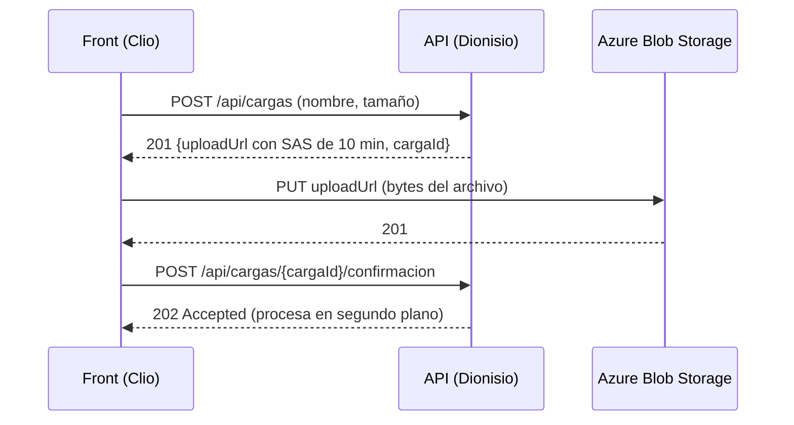

# Subida de archivos (multipart)

Parte de: [[02-Fundamentos/02 HTTP/_Índice HTTP|HTTP]]

> [!info] Cómo avanzar
> `progreso`: **pendiente** → **viendo** (estudiando) → **visto** (contestaste la autoevaluación sin abrir las respuestas) → **dominado** (hiciste el laboratorio o lo aplicaste de verdad).

## Contenido

### Qué es
Para enviar archivos en una petición HTTP desde un formulario o desde `fetch`, el formato estándar es **`multipart/form-data`**: un body dividido en **partes**, donde cada parte puede ser un campo de texto o un archivo con su nombre y tipo. Es lo que usa un `<form enctype="multipart/form-data">` y lo que genera `FormData` en JavaScript. Recibir archivos es una de las superficies de ataque más delicadas de una API, así que la validación importa tanto como el mecanismo.

### Cómo funciona
El `Content-Type` declara un **boundary**, una cadena que no aparece en el contenido y que separa las partes:

```http
POST /api/facturas/importaciones HTTP/1.1
Content-Type: multipart/form-data; boundary=----Frontera7MA4YWxk

------Frontera7MA4YWxk
Content-Disposition: form-data; name="empresaId"

12
------Frontera7MA4YWxk
Content-Disposition: form-data; name="archivo"; filename="facturas-octubre.xlsx"
Content-Type: application/vnd.openxmlformats-officedocument.spreadsheetml.sheet

(bytes del archivo)
------Frontera7MA4YWxk--
```

- Cada parte tiene sus propios headers: `Content-Disposition` con el `name` del campo y, si es archivo, el `filename`; y opcionalmente `Content-Type`.
- El último boundary termina con `--`.
- **Nunca armes el boundary a mano**: `FormData` en el navegador y `MultipartFormDataContent` en .NET lo generan; si fijas tú el `Content-Type` sin boundary, el servidor no puede leer el body.

#### Validaciones mínimas al recibir
1. **Tamaño máximo en el servidor**, no solo en el cliente (el cliente se puede saltar).
2. **Extensión y tipo en lista blanca** (`.xlsx`, `.pdf`, `.png`…), nunca lista negra.
3. **Revisar los primeros bytes** (firma o *magic number*) en lugar de confiar en el `Content-Type` o en la extensión, que los pone el cliente. Un PDF empieza con `%PDF`, un PNG con `89 50 4E 47`, un XLSX (ZIP) con `50 4B 03 04`.
4. **Generar un nombre propio** (un GUID). No uses `filename` para armar rutas: puede traer `../../` (path traversal) o caracteres raros.
5. **Guardar fuera de la raíz web** (o en Blob Storage) para que nadie pueda ejecutar o servir el archivo directamente.
6. Opcional según el riesgo: análisis antivirus, límite de cantidad de archivos por usuario.

#### Archivos grandes
Por defecto, el model binding de ASP.NET Core con `IFormFile` puede guardar en memoria los archivos pequeños y en disco temporal los grandes, pero igual procesa todo el body antes de llegar a tu código. Con archivos de cientos de MB o muchas subidas simultáneas:
- **Streaming**: leer el body por partes con `MultipartReader` y escribir directo al destino, sin cargar todo.
- **Subida directa al almacenamiento**: la API genera una **URL firmada** (SAS de Azure Blob Storage, de vida corta y con permiso solo de escritura a un blob) y el navegador sube directo a Blob. La API solo recibe el aviso de "ya subí" y procesa después.



### Ejemplo
Importación de facturas en Excel en Itzamna.Dionisio (archivos moderados):

```csharp
[HttpPost("api/facturas/importaciones")]
[RequestSizeLimit(20 * 1024 * 1024)] // 20 MB máximo para este endpoint
public async Task<IActionResult> Importar([FromForm] int empresaId, IFormFile archivo, CancellationToken ct)
{
    if (archivo.Length == 0) return Problem(statusCode: 400, title: "Archivo vacío");

    var ext = Path.GetExtension(archivo.FileName).ToLowerInvariant();
    if (ext != ".xlsx")
        return Problem(statusCode: 415, title: "Solo se aceptan archivos .xlsx",
            extensions: new Dictionary<string, object?> { ["codigo"] = "TIPO_ARCHIVO_NO_PERMITIDO" });

    // Firma: XLSX es un ZIP y empieza con PK\x03\x04
    var firma = new byte[4];
    await using (var s = archivo.OpenReadStream()) { await s.ReadExactlyAsync(firma, ct); }
    if (firma is not [0x50, 0x4B, 0x03, 0x04])
        return Problem(statusCode: 415, title: "El contenido no es un XLSX válido");

    var nombre = $"{Guid.NewGuid()}.xlsx";                         // nombre propio
    var ruta = Path.Combine("/datos/cargas", nombre);              // fuera de wwwroot
    await using (var destino = System.IO.File.Create(ruta))
        await archivo.CopyToAsync(destino, ct);

    return Accepted(new { carga = nombre });
}
```

En el front:

```ts
const datos = new FormData();
datos.append("empresaId", "12");
datos.append("archivo", input.files![0]);
await fetch("/api/facturas/importaciones", { method: "POST", body: datos }); // sin fijar Content-Type
declare const input: HTMLInputElement;
```

El servidor (Kestrel) también tiene un límite global de tamaño del body (por defecto alrededor de 28.6 MB, es decir 30,000,000 bytes) y los formularios tienen su propio límite (`FormOptions.MultipartBodyLengthLimit`); ajústalos de forma consciente.

### Cuándo usarlo y cuándo no
- **Multipart**: formularios con archivos de tamaño moderado, junto con otros campos.
- **Streaming con `MultipartReader`**: archivos grandes que deben pasar por la API.
- **URL firmada (SAS)**: archivos grandes o muchos usuarios; descarga la API del tráfico pesado.
- **Base64 dentro de JSON**: solo para archivos muy pequeños; aumenta el tamaño alrededor de un 33 %.

### Errores comunes
- **Fijar `Content-Type: multipart/form-data` a mano en `fetch`**: se pierde el boundary.
- **Confiar en `Content-Type` o en la extensión** sin revisar la firma.
- **Usar `filename` para la ruta**: path traversal y sobrescritura de archivos.
- **Guardar en `wwwroot`**: el archivo queda accesible (o ejecutable) públicamente.
- **Cargar todo en memoria** (`MemoryStream` de un archivo de 500 MB por usuario).

### Para profundizar
- [Microsoft Learn: Upload files in ASP.NET Core](https://learn.microsoft.com/en-us/aspnet/core/mvc/models/file-uploads)
- [MDN: Using FormData objects](https://developer.mozilla.org/en-US/docs/Web/API/XMLHttpRequest_API/Using_FormData_Objects)
- [OWASP: File Upload Cheat Sheet](https://cheatsheetseries.owasp.org/cheatsheets/File_Upload_Cheat_Sheet.html)
- [Microsoft Learn: Grant limited access to Azure Storage resources using SAS](https://learn.microsoft.com/en-us/azure/storage/common/storage-sas-overview)

## Autoevaluación

Contesta primero en voz alta o en papel; luego despliega la respuesta.

> [!question]- ¿Cómo viaja un archivo en `multipart/form-data`?
> El body se divide en partes separadas por un `boundary` declarado en el `Content-Type`; cada parte tiene sus headers (`Content-Disposition: form-data; name="archivo"; filename="a.pdf"`, `Content-Type`) y su contenido.

> [!question]- ¿Qué validaciones mínimas haces al recibir un archivo?
> Tamaño máximo (en el servidor, no solo en el cliente), extensión y tipo permitidos en lista blanca, revisar los primeros bytes (firma) en vez de confiar en `Content-Type`, generar un nombre propio (no usar `filename` en rutas) y guardarlo fuera de la raíz web.

> [!question]- Archivos de cientos de MB saturan la memoria del API. ¿Qué haces?
> Leer en streaming en vez de cargar todo (`MultipartReader` en ASP.NET Core) o que el cliente suba directo al almacenamiento con una URL firmada (SAS de Azure Blob).

