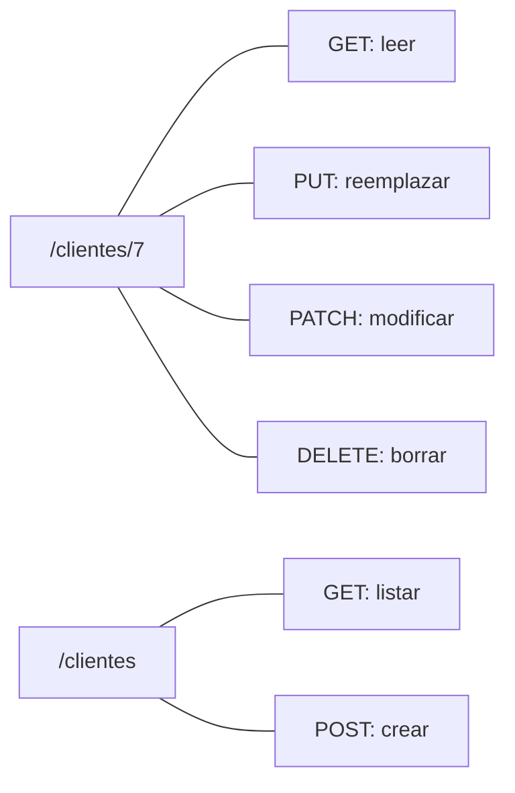

# Verbos HTTP

Parte de: [[02-Fundamentos/02 HTTP/_Índice HTTP|HTTP]]

> [!info] Cómo avanzar
> `progreso`: **pendiente** → **viendo** (estudiando) → **visto** (contestaste la autoevaluación sin abrir las respuestas) → **dominado** (hiciste el laboratorio o lo aplicaste de verdad).

## Contenido

### Qué es
Un **verbo** (o **método**) HTTP es la acción que el cliente pide realizar sobre el recurso identificado por la URL. La URL dice **qué**; el método dice **qué hacer** con eso. Esta separación es la base del diseño de APIs HTTP: en vez de `POST /borrarCliente`, haces `DELETE /clientes/7`.

| Método | Acción | Detalle |
|---|---|---|
| `GET` | Leer | [[GET]] |
| `POST` | Crear un recurso subordinado o procesar | [[POST]] |
| `PUT` | Reemplazar completo (o crear en una URL conocida) | [[PUT]] |
| `PATCH` | Modificar parcialmente | [[PATCH]] |
| `DELETE` | Borrar | [[DELETE]] |
| `HEAD` | Como `GET` sin body | [[HEAD y OPTIONS]] |
| `OPTIONS` | Opciones del recurso, preflight de CORS | [[HEAD y OPTIONS]] |
| `TRACE` | Eco de diagnóstico (normalmente deshabilitado por seguridad) | — |
| `CONNECT` | Abrir un túnel a través de un proxy (HTTPS por proxy) | — |

### Cómo funciona
Cada método tiene **propiedades** definidas por la especificación que el resto del ecosistema usa:

- **Seguro**: no pide cambiar estado (`GET`, `HEAD`, `OPTIONS`).
- **Idempotente**: repetirlo deja el mismo estado (los seguros, más `PUT` y `DELETE`).
- **Cacheable**: la respuesta se puede guardar (`GET` y `HEAD`, principalmente).

Detalle en [[Métodos seguros e idempotentes]].



#### ¿Por qué no hacerlo todo con POST?
Técnicamente funciona, pero pierdes la **semántica** que entienden las herramientas:
- **Cachés y CDN** solo cachean `GET`: con todo en `POST`, nada se cachea.
- **Reintentos**: librerías como el resilience handler de .NET, los proxies y los navegadores reintentan con confianza `GET`, `PUT` y `DELETE` porque son idempotentes; un `POST` no se reintenta automáticamente. Si todo es `POST`, nadie puede reintentar nada.
- **Precarga y rastreo**: los navegadores pueden precargar `GET`; no tocan `POST`.
- **Legibilidad y documentación**: `DELETE /clientes/7` se entiende solo; `POST /api` con `{"accion":"borrar","id":7}` necesita un manual.
- **Seguridad y monitoreo**: un WAF o un log puede distinguir lecturas de escrituras.

Ese estilo "todo por POST a un endpoint" corresponde al nivel 0 del [[Modelo de madurez de Richardson]] (estilo RPC/SOAP).

#### Método no soportado
Si llamas un método que la ruta no tiene (`DELETE /clientes` cuando solo existen `GET` y `POST`), lo correcto es **`405 Method Not Allowed`** con el header **`Allow: GET, POST`**. No es `404` (la ruta sí existe) ni `400`. Si el servidor no reconoce el método en absoluto, puede responder `501 Not Implemented`.

### Ejemplo
Un recurso completo en Itzamna.Dionisio con controllers. Cada acción se asocia a un método con su atributo:

```csharp
[ApiController]
[Route("api/clientes")]
public class ClientesController : ControllerBase
{
    [HttpGet]               public IActionResult Listar() => Ok();             // GET    /api/clientes
    [HttpPost]              public IActionResult Crear(ClienteDto d) => StatusCode(201); // POST /api/clientes
    [HttpGet("{id:int}")]   public IActionResult Obtener(int id) => Ok();      // GET    /api/clientes/7
    [HttpPut("{id:int}")]   public IActionResult Reemplazar(int id, ClienteDto d) => NoContent();
    [HttpPatch("{id:int}")] public IActionResult Modificar(int id) => NoContent();
    [HttpDelete("{id:int}")]public IActionResult Eliminar(int id) => NoContent();
}
public sealed record ClienteDto(string Nombre, string Email);
```

Si alguien hace `DELETE /api/clientes` (sin id), el enrutamiento de ASP.NET Core encuentra la ruta pero no el método y responde `405` con `Allow`. Pruébalo:

```bash
curl -i -X DELETE https://localhost:5001/api/clientes
```

```http
HTTP/1.1 405 Method Not Allowed
Allow: GET, POST
```

En un archivo `.http` de Visual Studio o VS Code (REST Client) puedes tener todas las variantes a mano para pruebas.

### Cuándo usarlo y cuándo no
- Usa el método que coincide con la semántica real; si dudas, pregúntate: ¿cambia estado? ¿es repetible? ¿el cliente conoce la URL final?
- Para acciones de negocio que no encajan en CRUD (aprobar, cancelar, timbrar), usa `POST` a un sub-recurso de acción o `PATCH` de estado (ver [[Diseño de endpoints y nombres de recursos]]).
- Deshabilita `TRACE` en servidores expuestos (Kestrel no lo implementa por defecto; revisa proxies).

### Errores comunes
- **Verbos en la URL** (`/obtenerClientes`, `/borrarCliente`): el método ya expresa la acción.
- **`GET` que cambia datos**: lo ejecutan prefetchers, rastreadores y ataques CSRF.
- **Todo por `POST`**: sin caché ni reintentos seguros.
- **Responder `404` en lugar de `405`** cuando la ruta existe con otro método.
- **Proxies o firewalls corporativos que bloquean `PUT`/`PATCH`/`DELETE`**: no se resuelve con "todo por POST", sino arreglando la infraestructura (como último recurso existe el header `X-HTTP-Method-Override`, pero evítalo).

### Para profundizar
- [MDN: HTTP request methods](https://developer.mozilla.org/en-US/docs/Web/HTTP/Methods)
- [RFC 9110, sección 9: Methods](https://www.rfc-editor.org/rfc/rfc9110#section-9)
- [Microsoft Learn: Routing to controller actions in ASP.NET Core](https://learn.microsoft.com/en-us/aspnet/core/mvc/controllers/routing)

## Autoevaluación

Contesta primero en voz alta o en papel; luego despliega la respuesta.

> [!question]- ¿Qué es un verbo (método) HTTP?
> La acción que se pide sobre el recurso identificado por la URL: `GET` leer, `POST` crear o procesar, `PUT` reemplazar, `PATCH` modificar parcialmente, `DELETE` borrar; además `HEAD`, `OPTIONS`, `TRACE` y `CONNECT`.

> [!question]- ¿Por qué no conviene hacer todo con `POST`?
> Se pierde la semántica que usan cachés, proxies, reintentos y herramientas: `GET` es cacheable y seguro de repetir; `PUT`/`DELETE` son idempotentes. Con todo en `POST` nadie puede reintentar con confianza ni cachear.

> [!question]- ¿Qué devuelve un servidor si llamas un método que la ruta no soporta?
> `405 Method Not Allowed` con el header `Allow` listando los métodos válidos (`Allow: GET, POST`).

## Práctica

- [[Lab 1 - Peticiones HTTP con curl y archivos .http]]

