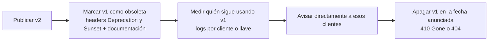

# Versionado de APIs

Parte de: [[02-Fundamentos/02 HTTP/_Índice HTTP|HTTP]]

> [!info] Cómo avanzar
> `progreso`: **pendiente** → **viendo** (estudiando) → **visto** (contestaste la autoevaluación sin abrir las respuestas) → **dominado** (hiciste el laboratorio o lo aplicaste de verdad).

## Contenido

### Qué es
**Versionar** una API es permitir que convivan varias formas de su contrato para que los clientes existentes sigan funcionando mientras introduces **cambios incompatibles**. La versión le dice al servidor qué contrato espera el cliente. No se versiona por cada despliegue ni por cada campo nuevo: solo cuando un cambio rompería a quien ya consume la API (ver [[Compatibilidad hacia atrás y cambios incompatibles en APIs]]).

### Cómo funciona
#### Dónde va la versión
| Estrategia | Ejemplo | A favor | En contra |
|---|---|---|---|
| **Ruta** | `GET /v1/pedidos` | Muy visible, fácil de enrutar, probar en el navegador y cachear | La URL del recurso cambia entre versiones |
| **Query** | `GET /pedidos?api-version=2024-10-01` | URL base estable; usada por las APIs de Azure con versiones por fecha | Fácil de olvidar; algunas cachés la tratan distinto |
| **Header** | `Api-Version: 2` | URLs limpias | Invisible en enlaces y logs; hay que acordarse de `Vary` |
| **Media type** | `Accept: application/vnd.empresa.v2+json` | Muy "REST" | La más difícil de usar y depurar |

La **ruta** es la más común y la más fácil para equipos y consumidores; es una buena opción por defecto.

Esquemas de numeración: **mayor** (`v1`, `v2`) o por **fecha** (`2024-10-01`). Solo cambias la versión **mayor** ante cambios incompatibles: quitar o renombrar campos, cambiar tipos o significados, volver obligatorio algo opcional, cambiar el formato de errores. Agregar endpoints o campos opcionales **no** requiere nueva versión.

#### Ciclo de vida y retiro
Retirar una versión vieja sin romper a nadie es un proceso, no un evento:



- El header **`Sunset`** (RFC 8594) anuncia la fecha en que el recurso dejará de funcionar: `Sunset: Sat, 31 Oct 2026 23:59:59 GMT`.
- El header **`Deprecation`** (RFC 9745) indica desde cuándo el recurso está obsoleto; su valor es una fecha en formato de *structured fields*: `Deprecation: @1688169599` (segundos Unix).
- Un `Link` con `rel="deprecation"` o `rel="sunset"` puede apuntar a la documentación de migración.
- Mide el uso por versión (Application Insights, API Management) antes de apagar nada.

### Ejemplo
Con el paquete `Asp.Versioning.Mvc` (el sucesor de `Microsoft.AspNetCore.Mvc.Versioning`) en Itzamna.Dionisio, versionando por ruta:

```csharp
// Program.cs
builder.Services.AddControllers();
builder.Services.AddApiVersioning(o =>
{
    o.DefaultApiVersion = new Asp.Versioning.ApiVersion(1, 0);
    o.ReportApiVersions = true;                       // agrega api-supported-versions y api-deprecated-versions
    o.ApiVersionReader = new Asp.Versioning.UrlSegmentApiVersionReader();
}).AddMvc();
```

```csharp
[ApiController]
[Asp.Versioning.ApiVersion("1.0", Deprecated = true)]
[Route("api/v{version:apiVersion}/pedidos")]
public class PedidosV1Controller : ControllerBase
{
    [HttpGet("{id:int}")]
    public IActionResult Obtener(int id)
    {
        Response.Headers["Sunset"] = "Sat, 31 Oct 2026 23:59:59 GMT";
        return Ok(new { id, cliente = "Ana López" });            // v1: cliente como texto
    }
}

[ApiController]
[Asp.Versioning.ApiVersion("2.0")]
[Route("api/v{version:apiVersion}/pedidos")]
public class PedidosV2Controller : ControllerBase
{
    [HttpGet("{id:int}")]
    public IActionResult Obtener(int id)
        => Ok(new { id, cliente = new { id = 42, nombreCompleto = "Ana López" } }); // v2: objeto (incompatible)
}
```

Con vertical slice, cada versión puede tener su propio DTO y su propio `.sql` si la consulta cambia; lo que no cambia se comparte. Documenta cada versión como un documento OpenAPI separado (ver [[OpenAPI con Swagger y Scalar]]).

### Cuándo usarlo y cuándo no
- Versiona **desde el día uno** (aunque solo exista `v1`) si la API tendrá consumidores externos: agregarlo después es incómodo.
- Si solo la consume tu propio front y se despliegan juntos, quizá no necesitas versiones; basta con no romper.
- Prefiere **evolucionar sin romper** (expandir y contraer) antes que sacar versiones mayores seguido: cada versión viva es código que mantener, probar y documentar.
- No mezcles estrategias (ruta en unos endpoints, header en otros).

### Errores comunes
- **Nueva versión por cada cambio menor**: terminas manteniendo `v1` a `v7`.
- **Cambios incompatibles dentro de la misma versión** "porque es pequeño".
- **Apagar una versión sin medir ni avisar**.
- **Versionar por header y olvidar `Vary`**: una caché sirve la respuesta de `v2` a un cliente `v1`.
- **Copiar y pegar todo el controller** para la nueva versión, duplicando reglas de negocio que deberían compartirse.

### Para profundizar
- [Asp.Versioning (GitHub, documentación del paquete)](https://github.com/dotnet/aspnet-api-versioning/wiki)
- [RFC 8594: The Sunset HTTP Header Field](https://www.rfc-editor.org/rfc/rfc8594)
- [Microsoft REST API Guidelines](https://github.com/microsoft/api-guidelines/blob/vNext/azure/Guidelines.md)
- [Azure Architecture Center: Web API design best practices (versioning)](https://learn.microsoft.com/en-us/azure/architecture/best-practices/api-design)

## Autoevaluación

Contesta primero en voz alta o en papel; luego despliega la respuesta.

> [!question]- ¿Qué formas comunes hay de versionar un API?
> En la ruta (`/v1/pedidos`), en la query (`?api-version=2024-10-01`), en un header (`Api-Version: 2`) o por media type (`Accept: application/vnd.empresa.v2+json`). La ruta es la más visible y fácil de cachear.

> [!question]- ¿Cuándo hace falta una nueva versión mayor?
> Solo ante un **cambio incompatible**: quitar o renombrar campos, cambiar tipos o significado, volver obligatorio algo opcional. Agregar campos o endpoints opcionales no la requiere.

> [!question]- ¿Cómo retiras una versión vieja sin romper a nadie?
> Anúnciala como obsoleta (headers `Deprecation` y `Sunset`, documentación), mide quién la sigue usando, avisa a esos clientes y apágala en la fecha anunciada.

