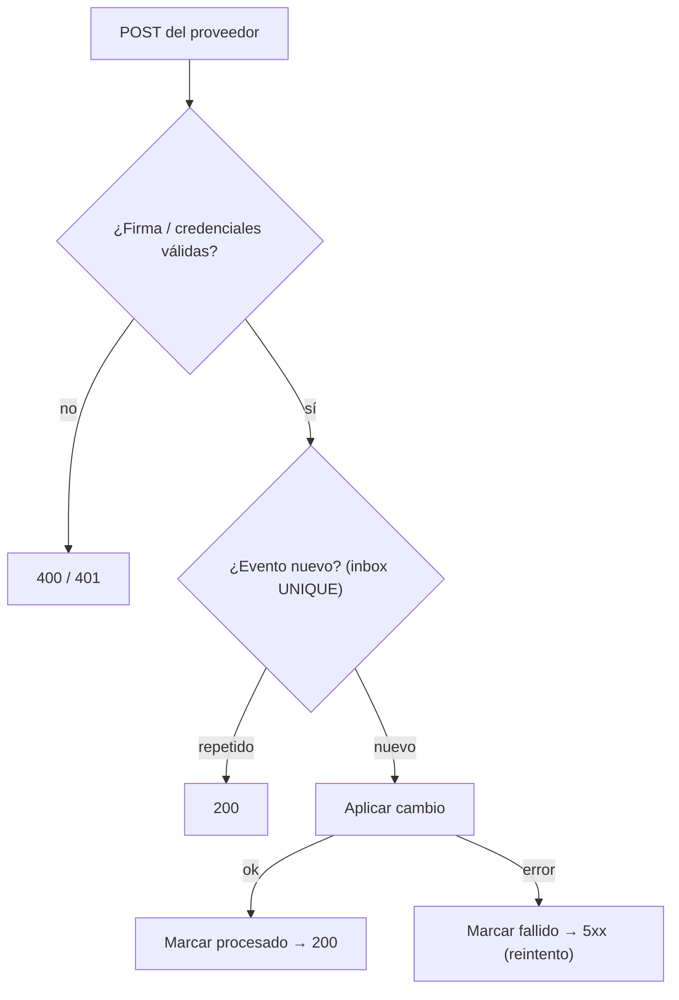

---
proyecto:
  - Pochteca.Nomisma
proyectos:
  - "[[Pochteca.Nomisma]]"
tipo: patron
nivel: intermedio
estado: completo
tags:
  - conocimiento
  - backend
  - integracion
  - seguridad
progreso: pendiente
area: Fundamentos
contenido: completo
---
# Webhooks

> Un servicio externo avisa a tu API con un `POST` cuando algo cambia (un pago se completó, una cuenta se actualizó). [[Pochteca.Nomisma]] recibe webhooks de [[Stripe]], [[Stripe Connect]] y [[OpenPay]].

## Qué es y qué problema resuelve
Sin webhooks habría que consultar (polling) cada pago hasta que cambie. Con webhooks el proveedor empuja el evento. A cambio, tu endpoint es **público** y el proveedor **reintenta**: hay que verificar quién manda y aguantar repetidos.

## Cómo funciona por dentro
- **Autenticidad**:
  - **Firma HMAC** del cuerpo crudo con un secreto compartido (Stripe: `Stripe-Signature` con timestamp contra ataques de repetición).
  - **Basic auth** (OpenPay): usuario y contraseña en el header; protege menos que una firma.
- **Reintentos**: si no respondes 2xx, el proveedor reintenta (Stripe, hasta 3 días con backoff). Un 2xx significa "recibido".
- **Orden**: los eventos pueden llegar desordenados o repetidos.
- **Inbox idempotente**: guardar el id del evento con UNIQUE; si ya existe, responder 2xx sin reprocesar ([[Idempotencia]]).
- **Transiciones monotónicas**: un evento atrasado no regresa un pago Completado a Pendiente.

## Cuándo usarla y cuándo no
### Ventajas
- Tiempo real sin polling.
### Desventajas
- Endpoint público que asegurar; repetidos y desorden que manejar.
- En local hace falta un túnel o el CLI del proveedor (`stripe listen`).

## Alternativas
| Alternativa | En qué se diferencia |
|---|---|
| Polling | Simple, pero tarde y con más llamadas |
| Colas del proveedor (EventBridge de Stripe) | El evento llega a tu nube, no a un endpoint público |

## Cómo se usó en Pochteca.Nomisma
| Endpoint | Autenticidad | Repetidos |
|---|---|---|
| [[Webhook Stripe]] | `EventUtility.ConstructEvent` con `Stripe:WebhookSecret` | Reescribe el mismo estatus |
| [[Webhook Stripe Connect]] | Secreto propio `Stripe:ConnectWebhookSecret` | **Inbox** `payment` (UNIQUE livemode + event id) + transición monotónica |
| [[Webhook OpenPay]] | Basic auth con `FixedTimeEquals` | Reescribe el mismo estatus |

- El controller lee el **cuerpo crudo** (`StreamReader(Request.Body)`) para que la firma cuadre, y no conoce el SDK.
- Firma inválida → 400 `webhook_invalido`; error al aplicar → 500 (el proveedor reintenta).

> [!warning] Inbox + fallidos
> Si un evento se marca **fallido** y el reintento choca con el UNIQUE del inbox, no se vuelve a aplicar. La función de inserción tiene que dejar pasar los fallidos (pendiente de confirmar en Nomisma).

> [!tip] Reutilizable
> El flujo del diagrama (verificar → inbox → aplicar → marcar) sirve para cualquier webhook.

## Errores comunes y buenas prácticas
- Verificar la firma sobre el JSON ya deserializado.
- Responder 2xx antes de guardar: si el proceso muere, el evento se pierde.
- Hacer trabajo lento dentro del webhook (llamar a otra API): mejor encolarlo ([[Patrón Outbox]]).

## Qué estudiar después
- [[Idempotencia]], [[Patrón Outbox]].

## Documentación oficial
- https://docs.stripe.com/webhooks
- https://docs.stripe.com/webhooks/signature

## Autoevaluación

Contesta primero en voz alta o en papel; luego despliega la respuesta.

> [!question]- ¿Qué es un webhook?
> Una llamada HTTP (normalmente `POST`) que un sistema hace a una URL tuya cuando ocurre un evento. Es "no me llames, yo te llamo" en lugar de que consultes periódicamente.

> [!question]- ¿Cómo verificas que un webhook viene realmente del proveedor?
> Validando la firma HMAC del body con el secreto compartido (comparación en tiempo constante) y una marca de tiempo para rechazar repeticiones viejas.

> [!question]- El proveedor reenvía el mismo evento 3 veces. ¿Cómo lo manejas?
> Asume entrega "al menos una vez": guarda el id del evento y procésalo de forma idempotente. Responde `2xx` rápido y procesa en segundo plano.

