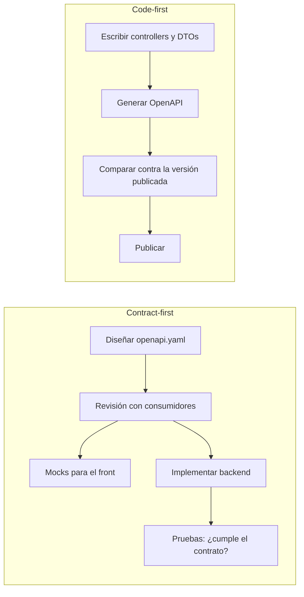

# Contract-first y diseño de contratos

Parte de: [[02-Fundamentos/03 APIs/_Índice APIs|APIs]]

> [!info] Cómo avanzar
> `progreso`: **pendiente** → **viendo** (estudiando) → **visto** (contestaste la autoevaluación sin abrir las respuestas) → **dominado** (hiciste el laboratorio o lo aplicaste de verdad).

## Contenido

### Qué es
El **contrato** de una API es la descripción formal de lo que ofrece: endpoints, parámetros, cuerpos, respuestas, códigos de error y esquemas de datos. En APIs HTTP se escribe normalmente en **OpenAPI** (YAML o JSON) (ver [[OpenAPI con Swagger y Scalar]]). Hay dos formas de llegar a él:

- **Contract-first** (o *design-first*): primero se **escribe y acuerda** el documento OpenAPI; después se implementa el código que lo cumple.
- **Code-first**: primero se escribe el código (controllers, DTOs) y el contrato se **genera** a partir de él.

Ninguna es "la correcta"; cada una encaja en situaciones distintas. Lo importante es que el contrato sea un artefacto **revisado**, no un subproducto que nadie mira.

### Cómo funciona


#### Contract-first
1. Se diseña el contrato (recursos, nombres, errores, paginación) en un archivo `openapi.yaml` dentro del repositorio.
2. Se revisa en un pull request con quienes lo van a consumir: el equipo del front, otra área, un proveedor.
3. Con el contrato aprobado, **el front trabaja en paralelo** contra un mock generado del contrato, mientras el backend implementa.
4. Se pueden generar clientes tipados (TypeScript para Itzamna.Clio) y validar en pruebas que la implementación cumple el contrato.

Conviene cuando **varios equipos trabajan en paralelo**, cuando hay **consumidores externos**, o cuando el contrato es un **acuerdo formal** (con un cliente, un proveedor, un regulador) que debe aprobarse antes de programar.

#### Code-first
El código es la fuente de verdad. En .NET, `Microsoft.AspNetCore.OpenApi` genera el documento a partir de controllers, atributos y tipos. Es rápido y el contrato nunca se desincroniza del código.

Su riesgo: **cambios incompatibles accidentales**. Renombrar una propiedad en un DTO de C#, cambiar un enum o la política de serialización modifica el JSON público sin que nadie lo note en la revisión, porque el diff muestra código, no contrato. Mitigación: generar el OpenAPI en el pipeline de Azure DevOps y **compararlo** contra la versión publicada (diff de contratos), fallando el build si hay cambios incompatibles no aprobados.

#### Qué hace bueno a un contrato
- Nombres y convenciones consistentes (ver [[Diseño de endpoints y nombres de recursos]]).
- Todos los códigos de respuesta documentados, incluidos los errores con [[ProblemDetails]] y su `codigo`.
- Ejemplos realistas en cada operación.
- Campos obligatorios, formatos (`date-time`, `uuid`), límites (`maxLength`) y enums documentados, indicando que los enums pueden crecer.
- Esquemas de seguridad (Bearer con JWT de Xolotl.Hecate).

### Ejemplo
Fragmento de contrato para Itzamna.Dionisio (contract-first):

```yaml
openapi: 3.1.0
info: { title: Itzamna.Dionisio, version: "1.0" }
paths:
  /api/pedidos/{id}:
    get:
      operationId: obtenerPedido
      parameters:
        - { name: id, in: path, required: true, schema: { type: string, format: uuid } }
      responses:
        "200":
          description: Pedido encontrado
          content:
            application/json:
              schema: { $ref: "#/components/schemas/Pedido" }
        "404":
          description: No existe o no pertenece a la empresa
          content:
            application/problem+json:
              schema: { $ref: "#/components/schemas/Problema" }
components:
  schemas:
    Pedido:
      type: object
      required: [id, estado, total]
      properties:
        id: { type: string, format: uuid }
        estado: { type: string, description: "Puede crecer; tolera valores desconocidos", enum: [registrado, pagado, enviado, cancelado] }
        total: { type: number }
    Problema:
      type: object
      properties:
        title: { type: string }
        status: { type: integer }
        codigo: { type: string }
```

Y si trabajas code-first, en el pipeline:

Fragmento de `azure-pipelines.yml` para generar y comparar el contrato:

```yaml
- script: dotnet build src/Dionisio.Api -c Release
- script: |
    # Con Microsoft.Extensions.ApiDescription.Server el build puede emitir el documento OpenAPI
    # (Pendiente de confirmar la ruta exacta de salida en tu configuración)
    npx --yes oasdiff breaking contratos/openapi-publicado.json artefactos/openapi.json --fail-on ERR
  displayName: Detectar cambios incompatibles en el contrato
```

### Cuándo usarlo y cuándo no
- **Contract-first**: APIs públicas o para terceros, integraciones entre equipos, proyectos donde el front y el back arrancan al mismo tiempo, contratos regulados.
- **Code-first**: APIs internas de un solo equipo que despliega front y back juntos; prototipos.
- **Mixto** (lo más común en la práctica): diseño acordado en un documento o PR, implementación code-first, y el OpenAPI generado se revisa y compara en CI.

### Errores comunes
- **Contrato que no se revisa**: en code-first, nadie nota que cambió el JSON.
- **Contrato y código desincronizados** en contract-first, por no validar la implementación contra el documento.
- **Documentar solo el caso feliz**: los errores son parte del contrato.
- **Exponer las entidades internas** (tablas) como contrato: cualquier cambio de base de datos rompe clientes.
- **Ejemplos falsos o desactualizados** que confunden más de lo que ayudan.

### Para profundizar
- [OpenAPI Specification 3.1](https://spec.openapis.org/oas/v3.1.0)
- [OpenAPI Initiative: Learn OpenAPI](https://learn.openapis.org/)
- [Microsoft Learn: Generate OpenAPI documents in ASP.NET Core](https://learn.microsoft.com/en-us/aspnet/core/fundamentals/openapi/aspnetcore-openapi)
- [oasdiff (detector de cambios incompatibles en OpenAPI)](https://github.com/oasdiff/oasdiff)

## Autoevaluación

Contesta primero en voz alta o en papel; luego despliega la respuesta.

> [!question]- ¿Qué diferencia hay entre contract-first y code-first?
> **Contract-first**: se escribe y acuerda primero el documento OpenAPI y luego se implementa. **Code-first**: se escribe el código y el contrato se genera de él.

> [!question]- ¿Cuándo conviene contract-first?
> Cuando varios equipos trabajan en paralelo (frontend con mocks, backend implementando), con consumidores externos o cuando el contrato es un acuerdo formal que debe revisarse antes de programar.

> [!question]- ¿Qué riesgo tiene code-first si no se revisa el contrato generado?
> Cambios incompatibles accidentales: renombrar una propiedad o un enum en C# cambia el JSON público sin que nadie lo note. Mitigación: comparar el OpenAPI generado en el pipeline (diff de contratos).

