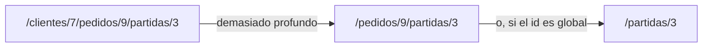

# Diseño de endpoints y nombres de recursos

Parte de: [[02-Fundamentos/03 APIs/_Índice APIs|APIs]]

> [!info] Cómo avanzar
> `progreso`: **pendiente** → **viendo** (estudiando) → **visto** (contestaste la autoevaluación sin abrir las respuestas) → **dominado** (hiciste el laboratorio o lo aplicaste de verdad).

## Contenido

### Qué es
Diseñar endpoints es decidir **cómo se llaman y cómo se organizan los recursos** de tu API en URLs, y qué método corresponde a cada operación. Un buen diseño hace que la API sea predecible: quien ya usó `/clientes` adivina cómo funciona `/proveedores`. Las URLs son parte del **contrato público**; cambiarlas después rompe clientes, así que vale la pena pensarlas al inicio.

### Cómo funciona
#### Convenciones básicas
- **Sustantivos, no verbos**: el método HTTP ya es el verbo. `/clientes`, no `/obtenerClientes`.
- **Plural para colecciones**: `/clientes` (la colección) y `/clientes/7` (un elemento).
- **Minúsculas con guiones** (kebab-case) para palabras compuestas: `/ordenes-compra`, `/notas-credito`.
- **Sin extensiones** (`.json`): el formato se negocia con `Accept` (ver [[Content-Type y Accept]]).
- **Jerarquía solo cuando hay pertenencia real**: `/clientes/7/direcciones` (las direcciones pertenecen al cliente).
- **Consistencia** en nombres de parámetros (`page`, `size`, `sort`) y en el formato de errores ([[ProblemDetails]]).

```text
GET    /clientes                     lista (con filtros en la query)
POST   /clientes                     crea
GET    /clientes/7                   obtiene
PATCH  /clientes/7                   modifica
DELETE /clientes/7                   elimina
GET    /clientes/7/direcciones       sub-colección
```

#### Acciones que no son CRUD
"Cancelar un pedido", "timbrar una factura", "aprobar una solicitud". Dos opciones válidas:

1. **Cambio de estado**: `PATCH /pedidos/9` con `{"estado": "cancelado"}`. Simple, pero las reglas y efectos (reembolso, liberar inventario, notificar) quedan escondidos detrás de un cambio de campo.
2. **Sub-recurso de acción** (sustantivo que representa la acción): `POST /pedidos/9/cancelacion` con `{"motivo": "..."}`. Expresa mejor que es una operación de negocio con sus propias reglas, permisos y auditoría; puede devolver `409` si no procede.

Elige **una** convención y úsala en toda la API.

#### Niveles de anidación
Uno o dos como máximo. `/clientes/7/pedidos/9/partidas/3` es frágil: obliga a conocer toda la cadena y cada nivel es una validación de pertenencia más. Si un recurso tiene identificador global, accede directo: `/partidas/3` o `/pedidos/9/partidas/3`.



#### Identificadores públicos
Exponer ids autoincrementales (`/pedidos/1088`) tiene dos problemas:
- **Enumeración y fuga de información**: cualquiera puede probar `/pedidos/1089`, `/pedidos/1090`, y estimar cuántos pedidos tienes al mes.
- Si además falta la **autorización por recurso**, se accede a datos ajenos (vulnerabilidad **IDOR**, *Insecure Direct Object Reference*, la primera del OWASP API Top 10 como *Broken Object Level Authorization*).

Usa **GUID** u otros identificadores opacos en las URLs públicas (puedes conservar el `int` interno para llaves foráneas e índices) y, sobre todo, **valida siempre la pertenencia**: que el pedido pertenezca a la empresa del usuario.

### Ejemplo
Diseño de una sección de Itzamna.Dionisio con vertical slice (una carpeta por caso de uso):

```text
Features/
  Pedidos/
    Listar/          GET    /api/pedidos?estado=&page=&size=
    Obtener/         GET    /api/pedidos/{id:guid}
    Crear/           POST   /api/pedidos
    Cancelar/        POST   /api/pedidos/{id:guid}/cancelacion
    Partidas/Listar/ GET    /api/pedidos/{id:guid}/partidas
```

```csharp
[ApiController]
[Route("api/pedidos/{id:guid}/cancelacion")]
public class CancelarPedidoController(ICancelarPedido cmd) : ControllerBase
{
    [HttpPost]
    public async Task<IActionResult> Cancelar(Guid id, CancelacionDto dto, CancellationToken ct)
    {
        var empresa = User.FindFirstValue("empresa_id")!;
        var r = await cmd.EjecutarAsync(id, empresa, dto.Motivo, ct); // el SQL filtra por EmpresaId
        return r switch
        {
            Cancelacion.NoEncontrado => NotFound(), // también si es de otra empresa
            Cancelacion.NoPermitida => Problem(statusCode: 409, title: "El pedido ya no se puede cancelar",
                extensions: new Dictionary<string, object?> { ["codigo"] = "PEDIDO_NO_CANCELABLE" }),
            _ => NoContent()
        };
    }
}
public sealed record CancelacionDto(string Motivo);
```

### Cuándo usarlo y cuándo no
- Aplica estas convenciones en cualquier API HTTP orientada a recursos.
- Para búsquedas complejas que no caben en la query: `POST /pedidos/busquedas`.
- Para operaciones por lote: un recurso propio (`POST /pedidos/lotes`) en vez de forzar la semántica de `PUT` sobre colecciones.
- Si tu organización tiene una guía de estilo (o adoptas la de Microsoft o Google), síguela aunque difiera en detalles: la consistencia gana.

### Errores comunes
- **Verbos en la ruta** (`/pedidos/9/cancelarPedido`).
- **Mezclar singular y plural** (`/cliente/7` y `/pedidos`).
- **Anidación profunda** que obliga al cliente a conocer toda la jerarquía.
- **Ids secuenciales sin autorización por recurso** (IDOR).
- **Filtros en la ruta** (`/clientes/activos/jalisco`): usa la query.

### Para profundizar
- [Microsoft REST API Guidelines](https://github.com/microsoft/api-guidelines/blob/vNext/azure/Guidelines.md)
- [Google API Design Guide: Resource names](https://cloud.google.com/apis/design/resource_names)
- [OWASP API Security Top 10 (2023): API1 Broken Object Level Authorization](https://owasp.org/API-Security/editions/2023/en/0xa1-broken-object-level-authorization/)
- [Azure Architecture Center: Web API design best practices](https://learn.microsoft.com/en-us/azure/architecture/best-practices/api-design)

## Autoevaluación

Contesta primero en voz alta o en papel; luego despliega la respuesta.

> [!question]- ¿Qué convenciones básicas sigues al nombrar recursos?
> Sustantivos en plural (`/clientes`), jerarquía solo cuando hay pertenencia real (`/clientes/7/direcciones`), minúsculas con guiones (`/ordenes-compra`), sin verbos ni extensiones (`.json`).

> [!question]- ¿Cómo modelas una acción que no es CRUD, como "cancelar un pedido"?
> Como cambio de estado (`PATCH /pedidos/9` con `{"estado":"cancelado"}`) o como sub-recurso de acción (`POST /pedidos/9/cancelacion`). Elige uno y sé consistente.

> [!question]- ¿Cuántos niveles de anidación conviene usar?
> Uno o dos como máximo. `/clientes/7/pedidos/9/partidas/3` es frágil; si el recurso tiene id global, accede directo (`/partidas/3`).

> [!question]- ¿Por qué no exponer ids autoincrementales en las URLs públicas?
> Permiten enumerar recursos y estimar volumen de negocio; si además falta autorización por recurso (IDOR), se accede a datos ajenos. Usa GUID o ids opacos y siempre valida pertenencia.

## Práctica

- [[Lab 1 - Explorar un API REST con OpenAPI]]

