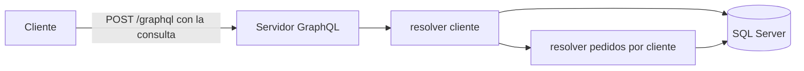

# GraphQL

Parte de: [[02-Fundamentos/03 APIs/_Índice APIs|APIs]]

> [!info] Cómo avanzar
> `progreso`: **pendiente** → **viendo** (estudiando) → **visto** (contestaste la autoevaluación sin abrir las respuestas) → **dominado** (hiciste el laboratorio o lo aplicaste de verdad).

## Contenido

### Qué es
**GraphQL** es un lenguaje de consulta para APIs y un entorno para ejecutarlas, creado en Facebook y publicado en 2015. El servidor publica un **esquema tipado** que describe los tipos y sus relaciones, y el cliente envía una consulta que dice **exactamente qué campos quiere**; recibe un JSON con esa misma forma. Normalmente todo pasa por **un solo endpoint** (`POST /graphql`). Hay tres tipos de operación:

- **Queries**: leer.
- **Mutations**: modificar.
- **Subscriptions**: recibir eventos en tiempo real (normalmente sobre WebSockets).

### Cómo funciona
Esquema (SDL):

```graphql
type Cliente {
  id: ID!
  nombre: String!
  pedidos(ultimos: Int = 5): [Pedido!]!
}
type Pedido {
  id: ID!
  total: Float!
  estado: String!
}
type Query {
  cliente(id: ID!): Cliente
}
type Mutation {
  cancelarPedido(id: ID!, motivo: String!): Pedido
}
```

Consulta del cliente: solo nombre y los 3 últimos pedidos con su total.

```graphql
query {
  cliente(id: "42") {
    nombre
    pedidos(ultimos: 3) { id total }
  }
}
```

```json
{ "data": { "cliente": { "nombre": "Ana López", "pedidos": [ { "id": "9", "total": 398.0 } ] } } }
```

El servidor resuelve cada campo con una función **resolver**.



#### Qué resuelve frente a REST
- **Over-fetching**: con REST, `GET /clientes/42` devuelve 30 campos aunque la pantalla use 2. En GraphQL pides solo los que necesitas.
- **Under-fetching**: con REST, una pantalla puede requerir `GET /clientes/42`, luego `GET /clientes/42/pedidos`, luego un `GET` por pedido. En GraphQL es una sola consulta.
- Esquema fuertemente tipado e introspección: herramientas, autocompletado y generación de tipos TypeScript.

#### Qué introduce
- **Caché HTTP más difícil**: casi todo va por `POST` a una sola URL, así que CDN y navegadores no cachean por URL. Se usan cachés en el cliente (Apollo, Relay) o *persisted queries* por `GET`.
- **Problema N+1**: el resolver `pedidos` se ejecuta una vez por cada cliente de una lista; 100 clientes = 101 consultas. Se mitiga con **DataLoader**, que agrupa las cargas en una sola consulta por lote.
- **Consultas costosas**: un cliente puede pedir relaciones anidadas muy profundas. Hay que limitar **profundidad** y **complejidad**, y aplicar timeouts.
- **Autorización por campo**: hay que pensar en permisos a nivel de cada campo, no solo de endpoint.

#### Códigos HTTP y errores
Por convención histórica, un servidor GraphQL responde con frecuencia **`200 OK` aunque la consulta tenga errores**, con un arreglo `errors` en el body y, posiblemente, **datos parciales** en `data`:

```json
{
  "data": { "cliente": { "nombre": "Ana López", "pedidos": null } },
  "errors": [ { "message": "No autorizado para ver pedidos", "path": ["cliente", "pedidos"] } ]
}
```

La especificación *GraphQL over HTTP*, todavía en borrador, define el media type `application/graphql-response+json`, con el que el servidor puede usar códigos no-2xx en ciertos casos (por ejemplo, cuando la consulta ni siquiera se puede analizar). Consecuencia práctica: el **monitoreo debe revisar el body**, no solo el código, o los errores pasarán como éxitos.

### Ejemplo
En .NET la librería más usada es **Hot Chocolate** (de ChilliCream). Un esquema code-first mínimo que reutiliza tus consultas Dapper:

```csharp
// Program.cs
builder.Services
    .AddGraphQLServer()
    .AddQueryType<Consultas>()
    .AddMaxExecutionDepthRule(5); // limita la profundidad de las consultas

app.MapGraphQL(); // expone /graphql

public class Consultas
{
    // Reutiliza la interfaz por consulta de tu vertical slice
    public Task<ClienteDto?> GetCliente(int id, [Service] IObtenerCliente consulta, CancellationToken ct)
        => consulta.EjecutarAsync(id, ct);
}
```

Para relaciones (cliente → pedidos) usarías un DataLoader que haga una sola consulta `WHERE ClienteId IN @Ids` por lote. Revisa la documentación de la versión vigente de Hot Chocolate, porque su API cambia entre versiones mayores.

### Cuándo usarlo y cuándo no
- **Sí**: muchos clientes distintos (web, móvil, socios) con necesidades de datos muy variadas sobre un dominio con muchas relaciones; un *backend for frontend* que agrega varios servicios.
- **No**: APIs simples de CRUD, integraciones servidor a servidor, archivos y descargas, o cuando la caché HTTP/CDN es clave. REST suele ser más simple de operar.
- Si tu único cliente es tu propio front de React y controlas la API, un buen diseño REST con DTOs por pantalla suele bastar.

### Errores comunes
- **No limitar profundidad ni complejidad**: una consulta maliciosa tumba el servidor.
- **Ignorar el N+1**: rendimiento terrible en listas.
- **Monitorear solo códigos HTTP**: los errores llegan con `200`.
- **Dejar la introspección abierta en producción** para APIs privadas, facilitando el reconocimiento a un atacante.
- **Autorizar solo la entrada** y olvidar que cada campo puede exponer datos sensibles.

### Para profundizar
- [GraphQL: Introduction to GraphQL](https://graphql.org/learn/)
- [GraphQL Specification](https://spec.graphql.org/)
- [GraphQL over HTTP (especificación en desarrollo)](https://graphql.github.io/graphql-over-http/draft/)
- [Hot Chocolate (ChilliCream) documentación](https://chillicream.com/docs/hotchocolate)

## Autoevaluación

Contesta primero en voz alta o en papel; luego despliega la respuesta.

> [!question]- ¿Qué es GraphQL?
> Un lenguaje de consulta para APIs con un esquema tipado y normalmente un solo endpoint: el cliente pide exactamente los campos que necesita (queries), modifica con mutations y recibe eventos con subscriptions.

> [!question]- ¿Qué problemas de REST resuelve y cuáles introduce?
> Resuelve over-fetching y under-fetching (varias llamadas). Introduce: caché HTTP más difícil (todo es `POST`), problema N+1 en resolvers (se mitiga con DataLoader) y consultas costosas que hay que limitar (profundidad y complejidad).

> [!question]- ¿Qué código HTTP devuelve GraphQL cuando una consulta tiene errores?
> Con frecuencia `200 OK` con un arreglo `errors` en el body (y datos parciales en `data`). El monitoreo debe revisar el body, no solo el código.

