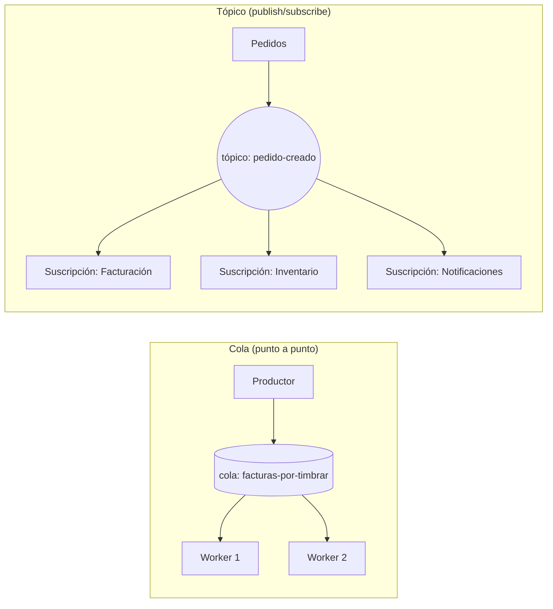

# Mensajería y colas (conceptos)

Parte de: [[02-Fundamentos/03 APIs/_Índice APIs|APIs]]

> [!info] Cómo avanzar
> `progreso`: **pendiente** → **viendo** (estudiando) → **visto** (contestaste la autoevaluación sin abrir las respuestas) → **dominado** (hiciste el laboratorio o lo aplicaste de verdad).

## Contenido

### Qué es
La **mensajería** es una forma de comunicación **asíncrona** entre sistemas: en lugar de llamar directamente a otro servicio y esperar la respuesta (como con HTTP), un **productor** deja un **mensaje** en un intermediario llamado **broker**, y uno o varios **consumidores** lo procesan cuando pueden. El broker guarda los mensajes de forma durable hasta que se procesan. Ejemplos: Azure Service Bus, Azure Storage Queues, RabbitMQ, Apache Kafka, Amazon SQS.

Su gran aporte es el **desacoplamiento**: en el **tiempo** (el consumidor puede procesar después), en la **disponibilidad** (si el consumidor está caído, los mensajes esperan) y en la **carga** (los picos se acumulan en la cola y se procesan al ritmo que el consumidor aguante).

### Cómo funciona
#### Cola frente a tópico


- **Cola**: cada mensaje lo procesa **un solo** consumidor. Si hay varios workers, se **reparten el trabajo** (competing consumers). Ideal para tareas: "timbra esta factura", "genera este reporte".
- **Tópico (publish/subscribe)**: cada **suscriptor** recibe **su propia copia** del mensaje. Ideal para **eventos**: "se creó el pedido 9", y a Facturación, Inventario y Notificaciones les interesa por separado. El productor no sabe ni le importa quién escucha.

#### Garantías de entrega
La mayoría de los brokers garantizan entrega **al menos una vez** (*at-least-once*): el consumidor recibe el mensaje, lo procesa y lo **confirma** (*complete*/*ack*). Si falla, se cae o tarda demasiado antes de confirmar, el broker lo vuelve a entregar. Consecuencia: **el mismo mensaje puede llegar dos veces** (por ejemplo, el consumidor timbró la factura pero se cayó justo antes de confirmar). Por eso los **consumidores deben ser idempotentes**: procesar dos veces el mismo mensaje debe dejar el mismo resultado. Técnicas: guardar el id del mensaje procesado en una tabla con índice único, o usar operaciones naturalmente idempotentes (ver [[Idempotencia]]).

#### Dead-letter queue (DLQ)
Si un mensaje falla una y otra vez (datos inválidos, un error de código), reintentarlo para siempre bloquea o desperdicia recursos (*poison message*). Tras un número máximo de entregas, o si expira, el broker lo mueve a una **dead-letter queue**: una cola aparte donde se puede **revisar, corregir y reenviar** sin detener el procesamiento del resto. En Azure Service Bus cada cola y suscripción tiene su DLQ.

### Ejemplo
Itzamna.Dionisio recibe pedidos; la facturación (que llama a un PAC para timbrar y puede estar lento o caído) se hace en segundo plano con Azure Service Bus:

```csharp
// Productor: después de guardar el pedido
public class PublicarPedidoCreado(ServiceBusSender sender)
{
    public Task EjecutarAsync(Guid pedidoId, CancellationToken ct)
        => sender.SendMessageAsync(new ServiceBusMessage(BinaryData.FromObjectAsJson(new { pedidoId }))
        {
            MessageId = pedidoId.ToString(), // permite detección de duplicados si se habilita en la cola o tópico
            Subject = "pedido-creado"
        }, ct);
}
```

```csharp
// Consumidor idempotente (worker)
processor.ProcessMessageAsync += async args =>
{
    var pedidoId = args.Message.Body.ToObjectFromJson<PedidoCreado>()!.PedidoId;

    // INSERT en MensajeProcesado(MessageId) con índice único: si ya existe, ya lo procesamos
    if (!await registro.IntentarRegistrarAsync(args.Message.MessageId, args.CancellationToken))
    {
        await args.CompleteMessageAsync(args.Message);
        return;
    }
    await facturacion.TimbrarAsync(pedidoId, args.CancellationToken);
    await args.CompleteMessageAsync(args.Message);
};
processor.ProcessErrorAsync += args => { logger.LogError(args.Exception, "Error en Service Bus"); return Task.CompletedTask; };
```

(En un caso real, registrar el mensaje y timbrar deberían coordinarse para no marcar como procesado algo que falló; un patrón común es registrar al final dentro de la misma transacción local, o usar el patrón *outbox* del lado del productor.) Para el desarrollo puedes usar el emulador de Service Bus o una cola de Azure Storage, que es más barata (Pendiente de confirmar precios y límites vigentes del nivel que elijas).

### Cuándo usarlo y cuándo no
Usa una cola en lugar de una llamada HTTP directa cuando:
- El trabajo **puede hacerse después** y el usuario no necesita el resultado en la misma respuesta (responde `202 Accepted`).
- El receptor **puede estar caído o lento** (un PAC, un ERP, un correo) y no quieres que su falla tumbe tu API.
- Necesitas **absorber picos** (cierre de mes) y procesar a ritmo constante.
- Varios sistemas reaccionan al mismo evento (tópico).

No la uses cuando el usuario **necesita la respuesta ya** (validar existencia antes de confirmar un pedido) o el flujo es simple y síncrono: agrega infraestructura, monitoreo y consistencia eventual. Para avisar a **sistemas externos**, considera [[Webhooks]].

### Errores comunes
- **Consumidores no idempotentes**: cargos o facturas duplicadas con la primera reentrega.
- **No vigilar la DLQ**: mensajes muertos acumulándose sin que nadie se entere. Pon alertas.
- **Asumir orden**: la mayoría de las colas no garantizan orden global; si lo necesitas, usa sesiones o particiones.
- **Mensajes enormes**: manda referencias (el id del pedido o la URL del blob), no el archivo completo.
- **Publicar el evento y guardar en la base de datos sin coordinación**: si una de las dos falla, quedan inconsistentes. Usa el patrón outbox.

### Para profundizar
- [Microsoft Learn: Azure Service Bus queues, topics, and subscriptions](https://learn.microsoft.com/en-us/azure/service-bus-messaging/service-bus-queues-topics-subscriptions)
- [Microsoft Learn: Service Bus dead-letter queues](https://learn.microsoft.com/en-us/azure/service-bus-messaging/service-bus-dead-letter-queues)
- [Azure Architecture Center: Competing Consumers pattern](https://learn.microsoft.com/en-us/azure/architecture/patterns/competing-consumers)
- [Enterprise Integration Patterns: Messaging](https://www.enterpriseintegrationpatterns.com/patterns/messaging/)

## Autoevaluación

Contesta primero en voz alta o en papel; luego despliega la respuesta.

> [!question]- ¿Qué diferencia hay entre una cola y un tópico (publish/subscribe)?
> En una **cola** cada mensaje lo procesa **un** consumidor (reparto de trabajo). En un **tópico** cada suscriptor recibe su **copia** del mensaje (difusión de eventos).

> [!question]- ¿Por qué los consumidores deben ser idempotentes?
> La mayoría de los brokers garantizan entrega **al menos una vez**: tras un fallo o timeout el mismo mensaje puede llegar de nuevo.

> [!question]- ¿Qué es una dead-letter queue?
> Una cola donde van los mensajes que fallaron demasiadas veces o expiraron, para revisarlos sin bloquear el procesamiento del resto.

> [!question]- ¿Cuándo usar una cola en lugar de una llamada HTTP directa?
> Cuando el trabajo puede hacerse después, el receptor puede estar caído o saturado, o se necesitan absorber picos: la cola desacopla en tiempo y disponibilidad.

