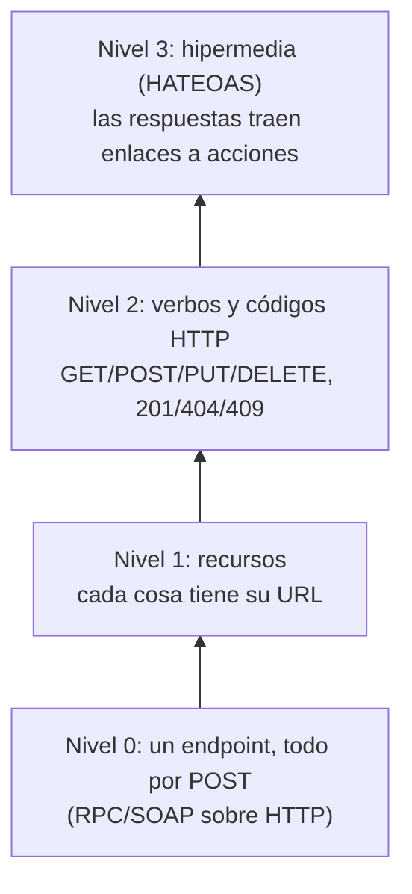

# Modelo de madurez de Richardson

Parte de: [[02-Fundamentos/03 APIs/_Índice APIs|APIs]]

> [!info] Cómo avanzar
> `progreso`: **pendiente** → **viendo** (estudiando) → **visto** (contestaste la autoevaluación sin abrir las respuestas) → **dominado** (hiciste el laboratorio o lo aplicaste de verdad).

## Contenido

### Qué es
El **modelo de madurez de Richardson** es una escala, propuesta por Leonard Richardson y popularizada por Martin Fowler, para describir qué tanto aprovecha una API las ideas de la web y de [[REST]]. Tiene cuatro niveles, del 0 al 3. No es una certificación ni una meta obligatoria: es una herramienta para **ubicar** una API y conversar sobre qué le falta y si vale la pena.

### Cómo funciona


#### Nivel 0: el pantano de POX
Un solo endpoint y un solo método. HTTP es solo un túnel para mandar llamadas a procedimientos:

```http
POST /api/servicio
{"operacion": "ObtenerCliente", "id": 7}
```
Así funcionan SOAP y muchos JSON-RPC. Todo responde `200`, incluso los errores.

#### Nivel 1: recursos
Cada entidad tiene su URL, pero se sigue usando un solo método:

```http
POST /api/clientes/7       {"operacion": "obtener"}
POST /api/clientes/7       {"operacion": "borrar"}
```

#### Nivel 2: verbos y códigos HTTP
Se usan los métodos con su semántica y los códigos de estado correctos:

```http
GET    /api/clientes/7      -> 200 / 404
PUT    /api/clientes/7      -> 204 / 412
DELETE /api/clientes/7      -> 204
POST   /api/clientes        -> 201 + Location
```
Aquí se ganan caché, reintentos seguros e interoperabilidad con herramientas (ver [[Verbos HTTP]] y [[Códigos de estado HTTP]]). **La gran mayoría de las APIs públicas están en este nivel**, y una API con `/clientes/7`, `GET`/`PUT`/`DELETE` y códigos 201/404 pero sin enlaces es nivel 2.

#### Nivel 3: controles de hipermedia (HATEOAS)
La respuesta incluye **enlaces** a lo que se puede hacer a continuación, según el estado del recurso:

```json
{
  "id": 9,
  "estado": "registrado",
  "total": 398.00,
  "_links": {
    "self":      { "href": "/api/pedidos/9" },
    "cancelar":  { "href": "/api/pedidos/9/cancelacion", "method": "POST" },
    "pagar":     { "href": "/api/pedidos/9/pagos", "method": "POST" }
  }
}
```

Si el pedido ya se entregó, el enlace `cancelar` no aparece. El cliente **descubre** las acciones siguiendo enlaces en lugar de construir URLs a mano, y el servidor puede cambiar URLs o reglas sin romperlo.

### Ejemplo
Evolución de un endpoint de Itzamna.Dionisio:

| Nivel | Petición para cancelar el pedido 9 |
|---|---|
| 0 | `POST /api/servicio` con `{"op":"CancelarPedido","id":9}` |
| 1 | `POST /api/pedidos/9` con `{"op":"cancelar"}` |
| 2 | `POST /api/pedidos/9/cancelacion` → `204`, o `409` si ya se entregó |
| 3 | Lo mismo que 2, pero el cliente obtuvo esa URL del enlace `cancelar` del `GET /api/pedidos/9` |

Un acercamiento pragmático al nivel 3 sin adoptarlo todo: incluir en la respuesta qué acciones están permitidas, para que el front (Itzamna.Clio) no duplique reglas de negocio:

```csharp
public sealed record PedidoDto(int Id, string Estado, decimal Total, IReadOnlyList<string> Acciones);

// En la consulta: las reglas viven en el servidor
var acciones = new List<string>();
if (pedido.Estado is "registrado" or "pagado") acciones.Add("cancelar");
if (pedido.Estado == "registrado") acciones.Add("pagar");
return new PedidoDto(pedido.Id, pedido.Estado, pedido.Total, acciones);
```

En React, el botón "Cancelar" se muestra solo si `acciones.includes("cancelar")`.

### Cuándo usarlo y cuándo no
- Apunta al **nivel 2** como estándar de calidad para APIs de negocio: es donde está el mayor valor por esfuerzo.
- El **nivel 3** tiene sentido en APIs públicas de larga vida con muchos clientes genéricos, o en flujos donde las acciones disponibles cambian mucho según el estado. Se usa poco porque los clientes suelen estar **acoplados al contrato de todas formas** (programan contra la documentación OpenAPI, no navegan enlaces), y agrega complejidad en servidor y cliente.
- Usa el modelo para **diagnosticar** una API heredada y priorizar mejoras (subir de 0 a 2 suele ser lo importante).

### Errores comunes
- **Creer que nivel 2 "no es REST de verdad" y por eso está mal**: es el estándar de la industria y es útil.
- **Agregar `_links` decorativos** que ningún cliente usa: costo sin beneficio.
- **Estar en nivel 1 y creer que es nivel 2**: tener URLs bonitas pero usar `POST` para todo o responder `200` a los errores.
- **Construir URLs en el front** con lógica de negocio duplicada (si `estado == ...` entonces mostrar botón), cuando el servidor podría decir qué acciones hay.

### Para profundizar
- [Martin Fowler: Richardson Maturity Model](https://martinfowler.com/articles/richardsonMaturityModel.html)
- [Roy Fielding: REST APIs must be hypertext-driven](https://roy.gbiv.com/untangled/2008/rest-apis-must-be-hypertext-driven)
- [Azure Architecture Center: Web API design best practices](https://learn.microsoft.com/en-us/azure/architecture/best-practices/api-design)

## Autoevaluación

Contesta primero en voz alta o en papel; luego despliega la respuesta.

> [!question]- ¿Cuáles son los niveles del modelo de Richardson?
> **0**: un endpoint, todo por POST (estilo RPC/SOAP). **1**: recursos con URL propia. **2**: verbos y códigos HTTP correctos. **3**: hipermedia (HATEOAS): las respuestas incluyen enlaces a las acciones posibles.

> [!question]- ¿En qué nivel está un API con `/clientes/7`, `GET`/`PUT`/`DELETE` y códigos 201/404, sin enlaces?
> Nivel **2**, que es donde está la mayoría de las APIs públicas.

> [!question]- ¿Qué aporta el nivel 3 y por qué se usa poco?
> El cliente descubre acciones siguiendo enlaces (`"_links": {"cancelar": {...}}`), así el servidor puede cambiar URLs o reglas sin romperlo. Se usa poco porque los clientes suelen estar acoplados al contrato de todas formas y agrega complejidad.

## Práctica

- [[Lab 1 - Explorar un API REST con OpenAPI]]

