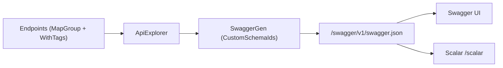

---
proyecto:
  - Ocelotl.Hermes
  - Itzamna.Dionisio
  - ReporteriaAzure
proyectos:
  - "[[Ocelotl.Hermes]]"
  - "[[Itzamna.Dionisio]]"
  - "[[ReporteriaAzure]]"
tipo: tecnologia
nivel: basico
estado: completo
tags:
  - conocimiento
  - backend
  - dotnet
  - openapi
progreso: pendiente
area: Fundamentos
---
# OpenAPI con Swagger y Scalar

> Documentación interactiva de la API de [[Ocelotl.Hermes]]: Swashbuckle 10.1.7 genera el documento OpenAPI y Scalar 2.17.14 lo muestra en `/scalar`, solo en Development.

## Qué es y qué problema resuelve
**OpenAPI** es una especificación estándar (JSON/YAML) que describe una API HTTP: rutas, parámetros, cuerpos y respuestas. Con ese documento se puede generar documentación interactiva, clientes y pruebas.
- **Swashbuckle.AspNetCore** ("Swagger"): inspecciona los endpoints de ASP.NET Core y genera el documento (`/swagger/v1/swagger.json`) y la UI clásica Swagger UI.
- **Scalar**: una interfaz más moderna que lee un documento OpenAPI existente y permite probar las rutas.

Resuelve el problema de saber qué espera cada endpoint sin leer el código, y de probar Hermes sin levantar [[Ocelotl.Iris]].

## Cómo funciona por dentro
1. `AddControllers()` registra el ApiExplorer, que expone los metadatos de las acciones de los [[ASP.NET Core Controllers]] (antes, con Minimal APIs, lo hacía `AddEndpointsApiExplorer()`).
2. `AddSwaggerGen()` los convierte en un documento OpenAPI; cada tipo C# se vuelve un **esquema** con un id.
3. `UseSwagger()` sirve el JSON; `UseSwaggerUI()` sirve la UI de Swagger.
4. `MapScalarApiReference()` sirve la UI de Scalar apuntando al JSON.
5. `WithTags(...)` en los grupos agrupa rutas; `ExcludeFromDescription()` las oculta.



## Cuándo usarla y cuándo no
### Ventajas
- Documentación siempre sincronizada con el código.
- Probar endpoints desde el navegador (perfil `Hermes.Swagger` abre `http://localhost:5017/scalar`).
- Base para generar clientes si algún día se necesitan.
### Desventajas
- Los nombres de esquema chocan si hay clases anidadas con el mismo nombre (pasa en Hermes).
- Las respuestas de error y códigos de estado no se documentan solos con lambdas sin `Produces...` (Hermes no los declara; los errores van como [[ProblemDetails]]).
- Expone la superficie de la API: no debe quedar abierto en producción.

## Alternativas
| Alternativa | En qué se diferencia |
|---|---|
| Microsoft.AspNetCore.OpenApi (`AddOpenApi`/`MapOpenApi`) | Generador oficial integrado desde .NET 9; Hermes usa Swashbuckle. |
| NSwag | Genera documento y además clientes C#/TypeScript. |
| Redoc | Otra UI de solo lectura sobre un documento OpenAPI. |
| Archivos `.http` / Postman | Colecciones manuales, no se derivan del código. |

## Cómo se usó en Ocelotl
En [[Ocelotl.Hermes]], los slices repiten nombres de clase (`Conectar.Command`, `Desconectar.Command`…) por el molde de [[Vertical Slice Architecture]]. Swagger usaría `Command` como id para ambos y fallaría, así que se configura `CustomSchemaIds` con una función que antepone la clase contenedora y aplana genéricos (`Ocelotl.Hermes/src/Ocelotl.Hermes.Api/Program.cs`):
```csharp
static string IdDeEsquema(Type t)
{
    var nombre = t.IsGenericType
        ? t.Name[..t.Name.IndexOf('`')] + string.Concat(t.GetGenericArguments().Select(IdDeEsquema))
        : t.Name;
    return t.IsNested && t.DeclaringType is not null ? IdDeEsquema(t.DeclaringType) + nombre : nombre;
}
```
Así `Conectar.Command` → `ConectarCommand` y `List<ArticuloEnStock>` → `ListArticuloEnStock`.

Swagger y Scalar solo se activan en Development; Scalar reutiliza el documento de Swagger (mismo archivo):
```csharp
if (app.Environment.IsDevelopment())
{
    app.UseSwagger();
    app.UseSwaggerUI();
    // Documentación interactiva en /scalar (usa el mismo documento que genera Swagger).
    app.MapScalarApiReference(o => o
        .WithTitle("Hermes")
        .WithOpenApiRoutePattern("/swagger/{documentName}/swagger.json"));
}
```

Uso en desarrollo (README): `dotnet run --project src/Ocelotl.Hermes.Api --launch-profile Hermes.Swagger` → Scalar en `:5017/scalar`. Los grupos tienen tags por funcionalidad ("Conexión", "Stock", "Egresos"…), y `/salud` se excluye. Nota: en Development sin `HERMES_SESSION_SECRET` el middleware de secreto se desactiva, pero las rutas siguen exigiendo login (`/api/sesion/login`, en Development `admin`/`admin1234`), ver [[Arranque y seguridad local]] y [[Sesión y roles]].

> [!tip] Reutilizable
> La función `IdDeEsquema` para `CustomSchemaIds` resuelve el choque de nombres en cualquier proyecto que use clases anidadas (`Feature.Command`, `Feature.Result`).


## Cómo se usó en Itzamna
[[Itzamna.Dionisio]] **no usa Swashbuckle**: usa el generador oficial `Microsoft.AspNetCore.OpenApi` 10.* (la primera alternativa de la tabla) y `Scalar.AspNetCore` 2.* para la UI.

`Itzamna.Dionisio/src/Itzamna.Dionisio.API/Program.cs`:
```csharp
builder.Services.AddOpenApi();
// ...
if (app.Environment.IsDevelopment())
{
    app.MapOpenApi().AllowAnonymous();
    app.MapScalarApiReference().AllowAnonymous();
}
```
- Solo en Development, como en Hermes.
- `.AllowAnonymous()` es necesario porque la API tiene `FallbackPolicy` que exige usuario autenticado en todo ([[JWT y autenticación con Bearer]]); sin eso, ni el documento ni la UI cargarían.
- Se usan las rutas por defecto de las librerías (documento en `/openapi/v1.json`, UI en `/scalar`); no se personalizan.
- No hace falta `CustomSchemaIds`: Dionisio no usa clases anidadas `Command/Result`; los mensajes son records con nombre propio (`PublishPortfolioCommand`, `ListVersionsQuery`) y los DTOs viven en `Itzamna.Dionisio.Contracts`.
- Complemento: `Itzamna.Dionisio.API.http` con peticiones listas (login de desarrollo → token → `GET /api/me`).

> [!note] Pendiente de confirmar
> No hay `AddDocumentTransformer` que declare el esquema de seguridad Bearer; no verifiqué cómo autenticarse desde Scalar (probablemente pegando el token a mano).


## Cómo se usó en ReporteriaAzure
[[ReporteriaAzure]] usa **Swashbuckle 7.2.0** (Swagger UI en `/swagger`), no `Microsoft.AspNetCore.OpenApi` + Scalar como Hermes e Itzamna.

- Está encendido **en todos los entornos**, también en producción.
- Los slices repiten nombres de clase (`Query`, `Item`), así que el id del esquema incluye la clase contenedora (`ConsultarTableroQuery`):

```csharp
// ReporteriaAzure/API/Program.cs
options.CustomSchemaIds(t => t.IsNested && t.DeclaringType is not null ? t.DeclaringType.Name + t.Name : t.Name);
```

> [!note] Pendiente de confirmar
> Si Swagger debe quedar público en producción: la API no tiene autenticación propia.

## Errores comunes y buenas prácticas
- Exponer Swagger/Scalar en producción: limitar a `IsDevelopment()`.
- Ids de esquema duplicados con clases anidadas → usar `CustomSchemaIds`.
- Olvidar `JsonStringEnumConverter`: Hermes lo registra para HTTP, pero si el documento OpenAPI muestra los enums como texto o como número depende de la configuración de Swashbuckle (Pendiente de confirmar).
- Agrupar con `WithTags` para que la UI sea navegable.

## Qué estudiar después
- [[ASP.NET Core Controllers]], [[ProblemDetails]]
- Especificación OpenAPI 3.x; `Produces<T>()` / `ProducesProblem()` para documentar respuestas.

## Documentación oficial

- https://spec.openapis.org/oas/latest.html
- https://github.com/domaindrivendev/Swashbuckle.AspNetCore
- https://github.com/scalar/scalar
- https://learn.microsoft.com/aspnet/core/fundamentals/openapi/overview

## Autoevaluación

Contesta primero en voz alta o en papel; luego despliega la respuesta.

> [!question]- ¿Qué es OpenAPI y qué son Swagger UI y Scalar?
> **OpenAPI** es la especificación (JSON/YAML) que describe un API: rutas, parámetros, esquemas, respuestas y seguridad. **Swagger UI** y **Scalar** son interfaces que leen ese documento y permiten explorarlo y probarlo.

> [!question]- ¿Para qué más sirve el documento OpenAPI además de la documentación?
> Generar clientes tipados (NSwag, Kiota, openapi-typescript), validar contratos en pruebas, configurar gateways y detectar cambios incompatibles comparando versiones.

> [!question]- ¿Qué cuidar al exponer la UI en producción?
> Decidir si debe ser pública; si no, protegerla o publicarla solo en entornos internos. Y no documentar endpoints internos o ejemplos con datos reales.

## Práctica

- [[Lab 1 - Explorar un API REST con OpenAPI]]

