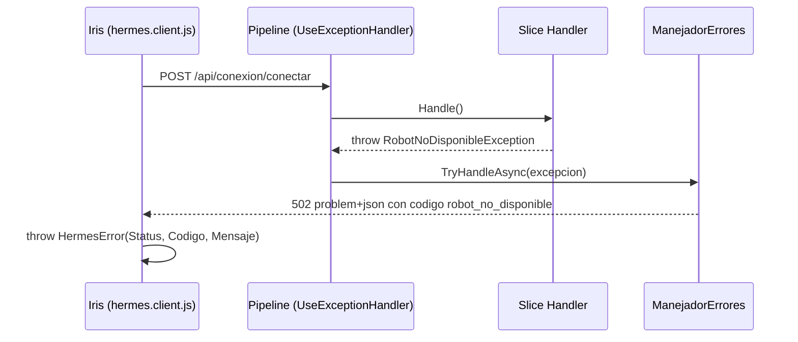

---
proyecto:
  - Ocelotl.Hermes
  - Ocelotl.Iris
  - Itzamna.Dionisio
  - ReporteriaAzure
  - Pochteca.Nomisma
proyectos:
  - "[[Ocelotl.Hermes]]"
  - "[[Ocelotl.Iris]]"
  - "[[Itzamna.Dionisio]]"
  - "[[ReporteriaAzure]]"
  - "[[Pochteca.Nomisma]]"
tipo: tecnologia
nivel: intermedio
estado: completo
tags:
  - conocimiento
  - backend
  - dotnet
  - errores
progreso: pendiente
area: Fundamentos
---
# ProblemDetails

> Formato estándar (RFC 9457, antes 7807) para errores HTTP en JSON; [[Ocelotl.Hermes]] lo emite con un campo extra `codigo` estable y [[Ocelotl.Iris]] decide qué hacer leyendo ese código, no el texto.

## Qué es y qué problema resuelve
Sin un estándar, cada API inventa su forma de error (`{error: ...}`, `{message: ...}`, HTML…). **Problem Details** define un objeto JSON (`application/problem+json`) con campos conocidos:
- `type` (URI del tipo de problema), `title` (resumen), `status` (código HTTP), `detail` (explicación), `instance`;
- y **extensiones** libres (aquí: `codigo`).

Resuelve que el cliente tenga que adivinar el formato y, con un código estable, que no dependa de mensajes que pueden cambiar o traducirse.

## Cómo funciona por dentro
En ASP.NET Core:
- `AddProblemDetails()` registra `IProblemDetailsService`, que escribe respuestas ProblemDetails (y rellena campos como `type` y `traceId`).
- `AddExceptionHandler<T>()` registra un `IExceptionHandler`; `UseExceptionHandler()` en el pipeline atrapa excepciones no controladas y llama a los handlers.
- El handler decide `status`, `title`, `detail` y extensiones, y escribe con `IProblemDetailsService.TryWriteAsync`.



## Cuándo usarla y cuándo no
### Ventajas
- Formato estándar, soportado por ASP.NET Core sin librerías extra.
- Un solo lugar traduce excepciones de negocio a HTTP.
- Extensiones (`codigo`) permiten contratos estables entre front y back.
### Desventajas
- Hay que mantener sincronizada la lista de códigos entre Hermes e Iris (son strings).
- Usar excepciones para flujo de negocio tiene costo y puede ocultar el camino feliz.
- No todo lo que responde con error pasa por aquí (ver middleware de secreto abajo).

## Alternativas
| Alternativa | En qué se diferencia |
|---|---|
| JSON de error propio (`{codigo, mensaje}`) | Más simple, pero no estándar; lo usa `LocalSessionMiddleware`. |
| Tipo `Result<T>` / `TypedResults.Problem` sin excepciones | Errores como valores de retorno; sin `throw`. |
| Solo códigos HTTP | No distingue `robot_no_conectado` de `no_encontrado` si ambos son 4xx parecidos. |
| GraphQL / gRPC status | Modelos de error propios de esos protocolos. |

## Cómo se usó en Ocelotl
**En [[Ocelotl.Hermes]]** los slices lanzan excepciones derivadas de `HermesException(codigo, mensaje)` (`Application/Common/Errores.cs`): `validacion`, `no_encontrado`, `robot_no_conectado`, `robot_no_disponible`, `argo_no_disponible`, `credenciales_invalidas`, `sesion_requerida`. `ManejadorErrores` las mapea con un `switch` (`Ocelotl.Hermes/src/Ocelotl.Hermes.Api/Errores/ManejadorErrores.cs`):
```csharp
var (estado, codigo, titulo) = excepcion switch
{
    ValidacionException e => (StatusCodes.Status400BadRequest, e.Codigo, "Datos inválidos"),
    CredencialesInvalidasException e => (StatusCodes.Status401Unauthorized, e.Codigo, "No autorizado"),
    SesionRequeridaException e => (StatusCodes.Status401Unauthorized, e.Codigo, "Sesión requerida"),
    NoEncontradoException e => (StatusCodes.Status404NotFound, e.Codigo, "No encontrado"),
    RobotNoConectadoException e => (StatusCodes.Status409Conflict, e.Codigo, "Robot no conectado"),
    RobotNoDisponibleException e => (StatusCodes.Status502BadGateway, e.Codigo, "Robot no disponible"),
    ArgoNoDisponibleException e => (StatusCodes.Status503ServiceUnavailable, e.Codigo, "Argo no disponible"),
    BadHttpRequestException => (StatusCodes.Status400BadRequest, "peticion_invalida", "Petición inválida"),
    _ => (StatusCodes.Status500InternalServerError, "error_interno", "Error interno"),
};
```
Luego escribe `ProblemDetails` con `Extensions = { ["codigo"] = codigo }`. En 500 el `detail` es genérico ("Ocurrió un error inesperado.") y se registra el error con `LogError`; en los demás, `detail` es el mensaje de la excepción. Registro en `Program.cs`: `AddProblemDetails()` + `AddExceptionHandler<ManejadorErrores>()` + `app.UseExceptionHandler()`.

**En [[Ocelotl.Iris]]**, `hermes.client.js` convierte cualquier respuesta no OK en `HermesError` con `Status`, `Codigo` y mensaje (`Ocelotl.Iris/src/core/hermes.client.js`):
```js
if (!Respuesta.ok) {
    const Codigo = Datos?.codigo ?? `http_${Respuesta.status}`
    const Mensaje = Datos?.detail ?? Datos?.mensaje ?? Datos?.title ?? Mensajes.Estatus(Respuesta.status)
    if (Codigo == Codigos.SesionRequerida) AlPerderSesion.forEach((Fn) => Fn())
    throw new HermesError(Respuesta.status, Codigo, Mensaje)
}
```
- `sesion_requerida` → los suscriptores de `fnAlPerderSesion` (en `app.js`: limpia la sesión, muestra aviso y va al login). Ver [[Sesión y roles]].
- Las pantallas comparan `error.Codigo`: `credenciales_invalidas` en `login.handlers.js`, `no_encontrado` en `ingresos.handlers.js` ([[Ingresos]]).
- Iris añade sus propios códigos locales: `sin_configurar`, `sin_conexion`, `cancelado` ([[AbortController]]).

**Excepción al formato**: `LocalSessionMiddleware` (secreto `X-Iris-Session` inválido) responde 401 con JSON simple `{ codigo: "secreto_invalido", mensaje: ... }`, no ProblemDetails; Iris lo maneja igual porque lee `codigo` y cae a `mensaje`. Ver [[Arranque y seguridad local]].

> [!tip] Reutilizable
> "Excepción base con `Codigo` + un único `IExceptionHandler` que la traduce + cliente que lee `codigo` antes que el texto" es un contrato de errores portátil a cualquier par front/back.


## Cómo se usó en Itzamna
En [[Itzamna.Dionisio]] el registro es el mismo que en Hermes (`AddProblemDetails()` + `AddExceptionHandler<AppExceptionHandler>()` + `app.UseExceptionHandler()` al inicio del pipeline), pero el contrato cambia: **no hay campo `codigo`**; el `title` es un mensaje en español "legible para el creador" y el front decide por `status` (y por `errors` en validación).

Mapeo en `Itzamna.Dionisio/src/Itzamna.Dionisio.API/Errors/AppExceptionHandler.cs`:

| Excepción | Status | Notas |
|---|---|---|
| `AppValidationException` | 400 | `ValidationProblemDetails` con `errors` por campo (camelCase), `title` "Revisa los campos marcados." ([[FluentValidation]]) |
| `DomainException` | 400 | Regla del dominio (`Core/Common/DomainException.cs`) |
| `NotFoundException` | 404 | "No encontramos esa red.", etc. |
| `ForbiddenException` | 403 | Usuario sin portfolio todavía ([[Multi-tenancy]]) |
| `ConflictException` | 409 | Extensión `details` con datos para la UI (checklist faltante al publicar, usos de un medio) |
| `DbUpdateConcurrencyException` | 409 | [[Concurrencia optimista]] |
| `BadHttpRequestException` | su código | 413 → "El archivo es demasiado grande." |
| `OperationCanceledException` | 499 | Cliente canceló |
| otra | 500 | Mensaje genérico + `LogError` |

Siempre agrega `instance` (ruta) y `traceId`, y escribe con `application/problem+json`:
```csharp
ConflictException c => WithDetails(new ProblemDetails { Status = StatusCodes.Status409Conflict, Title = c.Message }, c.Details),
// ...
if (problem.Status >= 500) logger.LogError(exception, "Error no controlado en {Path}", context.Request.Path);

problem.Instance = context.Request.Path;
problem.Extensions["traceId"] = context.TraceIdentifier;
context.Response.StatusCode = problem.Status ?? 500;
await context.Response.WriteAsJsonAsync(problem, problem.GetType(), options: null, contentType: "application/problem+json", cancellationToken);
```
Ejemplos de `details`: al publicar sin perfil/foto/contacto, `PublishPortfolioHandler` lanza `ConflictException("Te falta completar algunos datos para publicar.", new PublishBlockedDto(...))` ([[Publicación y versiones]]); al borrar un medio en uso, `details` es la lista de usos ([[Biblioteca de medios]]).

Diferencias con Hermes: Dionisio escribe directo con `WriteAsJsonAsync` (no con `IProblemDetailsService.TryWriteAsync`), y algunos controllers devuelven `Problem(...)`/`ValidationProblem(...)` en casos puntuales (404 del portfolio público, archivo vacío en la subida, 401 del acceso temporal).

> [!note] Pendiente de confirmar
> El 429 del [[Rate limiting]] no pasa por este handler (no es ProblemDetails en español). Errores de base no mapeados (p. ej. violación de índice único en `DbUpdateException`) terminan en 500 genérico.


## Cómo se usó en ReporteriaAzure
[[ReporteriaAzure]] sigue la regla de [[Reglas Back - .NET]]: todo error es ProblemDetails con `codigo`. Aquí el código lo trae **cada excepción** (`AppException.Codigo`, en `Application/Common/Excepciones.cs`) y `API/Errores/ManejadorErrores.cs` (un `IExceptionHandler`) solo elige el status:

| Excepción | HTTP | `codigo` |
|---|---|---|
| `ValidacionException` | 400 | `validacion` |
| `NoEncontradoException` | 404 | `no_encontrado` |
| `AzureDevOpsSinAccesoException` | 502 | `azure_devops_sin_acceso` |
| `AzureDevOpsRespuestaInvalidaException` | 502 | `azure_devops_respuesta_invalida` |
| `AzureDevOpsNoDisponibleException` | 503 | `azure_devops_no_disponible` |
| `BadHttpRequestException` | 400 | `peticion_invalida` |
| cualquier otra | 500 | `error_interno` (detalle genérico, se registra en el log) |

- Un servicio externo que falla responde **502/503**, no 500: el problema no es de esta API.
- `RespuestaModeloInvalido` da la misma forma al 400 automático de `[ApiController]` (JSON mal formado).
- `CustomizeProblemDetails` agrega `codigo` con `TryAdd` a las respuestas que arma ASP.NET solo (404 de ruta, 415…), sin pisar el del manejador.

```csharp
// ReporteriaAzure/API/Errores/ManejadorErrores.cs
var (estado, codigo, titulo) = excepcion switch
{
    ValidacionException e => (StatusCodes.Status400BadRequest, e.Codigo, "Datos inválidos"),
    NoEncontradoException e => (StatusCodes.Status404NotFound, e.Codigo, "No encontrado"),
    AzureDevOpsSinAccesoException e => (StatusCodes.Status502BadGateway, e.Codigo, "Sin acceso a Azure DevOps"),
```


## Cómo se usó en Pochteca.Nomisma
[[Pochteca.Nomisma]] tiene dos capas que lanzan errores (Application y las pasarelas en Infrastructure), así que las excepciones con `Codigo` viven en **Core** (`Core/Common/Excepciones.cs`). `API/Errores/ManejadorErrores.cs` elige el status:

| Excepción | HTTP | `codigo` |
|---|---|---|
| `FluentValidation.ValidationException` | 400 | `validacion` + `errores` por campo |
| `ValidacionException`, `WebhookInvalidoException` | 400 | `validacion`, `webhook_invalido` |
| `NoEncontradoException` | 404 | `no_encontrado` |
| `ConflictoException(codigo)` | 409 | `cuenta_ya_existe`, `orden_ya_pagada`, `cancelacion_rechazada`… |
| `PasarelaRechazoException` | 409 | `pasarela_rechazo` |
| `PasarelaSinAccesoException` | 502 | `pasarela_sin_acceso` |
| `PasarelaNoDisponibleException` | 503 | `pasarela_no_disponible` |
| `PostgresException` 23505 | 409 | `duplicado` (sin detalle de la constraint) |
| cliente canceló la petición | 499 | (sin cuerpo, log informativo) |

- Antes había un middleware a mano que solo traducía `ValidationException` a `{ error, detalles }`; lo demás salía como 500 o como texto (`BadRequest("...")`).
- Un cargo **rechazado** no es error: sigue regresando 400 con el resultado del cargo.

## Errores comunes y buenas prácticas
- Mostrar `detail` de errores 500 al usuario (puede filtrar datos internos): Hermes lo reemplaza por un texto genérico.
- Cambiar el texto de un `codigo` existente: rompe a Iris. Tratar los códigos como contrato.
- Decidir en el front por `title`/`detail`: usar siempre `codigo`.
- Olvidar `UseExceptionHandler()` en el pipeline: el `IExceptionHandler` no se ejecuta.
- Registrar como error (log) los 4xx esperados: Hermes solo hace `LogError` para `>= 500`.

## Qué estudiar después
- [[ASP.NET Core Controllers]], [[OpenAPI con Swagger y Scalar]]
- [[AbortController]] (código `cancelado` en Iris)
- Result pattern vs excepciones.

## Documentación oficial

- https://www.rfc-editor.org/rfc/rfc9457
- https://learn.microsoft.com/aspnet/core/fundamentals/error-handling

## Autoevaluación

Contesta primero en voz alta o en papel; luego despliega la respuesta.

> [!question]- ¿Qué es ProblemDetails?
> El formato estándar de errores HTTP (RFC 9457, antes RFC 7807), con `Content-Type: application/problem+json` y campos `type`, `title`, `status`, `detail` e `instance`, más extensiones propias.

> [!question]- ¿Cómo se activa en ASP.NET Core para errores no controlados y códigos sin cuerpo?
> `builder.Services.AddProblemDetails();` y luego `app.UseExceptionHandler();` y `app.UseStatusCodePages();`. Con `[ApiController]`, los errores de validación ya salen como `ValidationProblemDetails` con el diccionario `errors`.

> [!question]- ¿Qué no debe ir en `detail` en producción?
> Mensajes de excepción, stack traces o datos internos. Usa un texto para el usuario e incluye un `traceId` para correlacionar con los logs.

