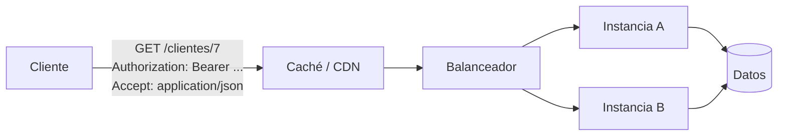

# REST

Parte de: [[02-Fundamentos/03 APIs/_Índice APIs|APIs]]

> [!info] Cómo avanzar
> `progreso`: **pendiente** → **viendo** (estudiando) → **visto** (contestaste la autoevaluación sin abrir las respuestas) → **dominado** (hiciste el laboratorio o lo aplicaste de verdad).

## Contenido

### Qué es
**REST** (Representational State Transfer) es un **estilo arquitectónico** descrito por Roy Fielding en su tesis doctoral del año 2000. No es un protocolo, ni un formato, ni una librería: es un conjunto de **restricciones** que, si un sistema las cumple, le dan propiedades deseables como escalabilidad, simplicidad, capacidad de evolucionar y buen aprovechamiento de cachés. La web misma es el ejemplo principal de un sistema REST, y por eso REST encaja tan bien con HTTP.

### Cómo funciona
Las restricciones de REST:

1. **Cliente-servidor**: interfaz y almacenamiento separados; cada lado evoluciona por su cuenta (ver [[Cliente y servidor]]).
2. **Sin estado (stateless)**: cada petición trae **todo lo necesario** para entenderla (identidad, parámetros, contexto). El servidor no guarda la "conversación" entre peticiones. El *estado de la aplicación* (en qué paso va el usuario) vive en el cliente; el *estado de los recursos* (los datos) vive en el servidor.
3. **Cacheable**: las respuestas indican si se pueden reutilizar (ver [[Caché HTTP (Cache-Control y ETag)]]).
4. **Interfaz uniforme**, la restricción central, con cuatro partes:
   - Los **recursos** se identifican con URIs (`/clientes/7`).
   - Se manipulan mediante **representaciones** (un JSON del cliente 7, no la fila de la base de datos).
   - Los **mensajes son autodescriptivos**: método, media type y códigos de estado dicen cómo interpretarlos.
   - **Hipermedia** como motor del estado (HATEOAS): las respuestas incluyen enlaces a las acciones posibles.
5. **Sistema en capas**: el cliente no sabe si habla con el servidor final o con un proxy, una CDN o un balanceador.
6. **Código bajo demanda** (opcional): el servidor puede enviar código ejecutable (JavaScript).



Como la petición trae el token y todo el contexto, **cualquier instancia** puede atenderla: escalar horizontalmente es agregar instancias, sin sesiones pegajosas.

#### ¿Todo API JSON sobre HTTP es REST?
No. La gran mayoría de las APIs que se llaman "REST" son en realidad **APIs HTTP** o "REST-ish": usan recursos, métodos y códigos correctamente, pero no hipermedia. En el [[Modelo de madurez de Richardson]] están en el nivel 2. Eso **está bien**: el valor práctico está en usar bien recursos, métodos y códigos. Lo que no es REST en ningún sentido es usar HTTP como un simple transporte para llamadas a procedimientos.

### Ejemplo
Comparación con un caso típico de código heredado:

```http
POST /api/obtenerClientes        {"estado":"activo"}
POST /api/borrarCliente          {"id":7}
POST /api/actualizarEmailCliente {"id":7,"email":"a@b.mx"}
```

Esto tiene **verbos en la URL** y un **solo método para todo**: la URL nombra la acción en vez del recurso, nada es cacheable y nada se puede reintentar con confianza. Al estilo REST:

```http
GET    /api/clientes?estado=activo
DELETE /api/clientes/7
PATCH  /api/clientes/7           {"email":"a@b.mx"}
```

En Itzamna.Dionisio con controllers:

```csharp
[ApiController]
[Route("api/clientes")]
[Authorize] // cada petición trae su token: sin estado de sesión en el servidor
public class ClientesController : ControllerBase
{
    [HttpGet] public IActionResult Listar([FromQuery] string? estado) => Ok();
    [HttpGet("{id:int}")] public IActionResult Obtener(int id) => Ok();
    [HttpPatch("{id:int}")] public IActionResult Modificar(int id) => NoContent();
    [HttpDelete("{id:int}")] public IActionResult Eliminar(int id) => NoContent();
}
```

Con un JWT emitido por Xolotl.Hecate en el header `Authorization`, la API no necesita sesión en memoria: cualquier instancia valida el token y responde.

### Cuándo usarlo y cuándo no
- **REST/HTTP API**: APIs públicas o de negocio basadas en recursos (clientes, pedidos, facturas), consumidas por navegadores, móviles y terceros. Aprovecha cachés, herramientas y conocimiento general.
- **[[GraphQL]]**: muchos clientes con necesidades de datos muy distintas sobre un grafo de entidades.
- **[[gRPC]]**: comunicación interna entre servicios con alto rendimiento y contratos estrictos.
- **[[Mensajería y colas (conceptos)|Mensajería]]**: cuando no necesitas respuesta inmediata o quieres desacoplar en el tiempo.

### Errores comunes
- **Verbos en las URLs** y todo por `POST` (estilo RPC disfrazado).
- **Guardar estado de sesión en memoria** del servidor: rompe el escalado horizontal.
- **Exponer la base de datos tal cual**: una representación no es una tabla; diseña el recurso pensando en el consumidor.
- **Ignorar los códigos de estado** (`200` con `{"error":...}`).
- **Discutir "pureza REST" en lugar de consistencia**: es más valioso que toda la API siga las mismas convenciones a que cumpla todas las restricciones de Fielding.

### Para profundizar
- [Roy Fielding: Architectural Styles and the Design of Network-based Software Architectures, capítulo 5 (REST)](https://ics.uci.edu/~fielding/pubs/dissertation/rest_arch_style.htm)
- [Azure Architecture Center: Web API design best practices](https://learn.microsoft.com/en-us/azure/architecture/best-practices/api-design)
- [MDN: REST (glosario)](https://developer.mozilla.org/en-US/docs/Glossary/REST)

## Autoevaluación

Contesta primero en voz alta o en papel; luego despliega la respuesta.

> [!question]- ¿Qué es REST?
> Un estilo arquitectónico (Roy Fielding, 2000) con restricciones: cliente-servidor, **sin estado**, cacheable, interfaz uniforme (recursos identificados por URL, manipulados mediante representaciones, mensajes autodescriptivos, hipermedia), sistema en capas y código bajo demanda opcional.

> [!question]- ¿Qué significa "sin estado" (stateless) en REST?
> Cada petición trae todo lo necesario para procesarla (por ejemplo el token); el servidor no guarda contexto de la conversación entre peticiones. Facilita escalar horizontalmente.

> [!question]- Error común: `POST /obtenerClientes` y `POST /borrarCliente`. ¿Qué tiene de no-REST?
> Usa verbos en la URL y un solo método para todo. En REST la URL nombra el recurso (`/clientes`, `/clientes/7`) y el método expresa la acción (`GET`, `DELETE`).

> [!question]- ¿Todo API JSON sobre HTTP es REST?
> No. La mayoría son "HTTP APIs" o "REST-ish": usan recursos y verbos pero no hipermedia (nivel 2 de Richardson). Está bien, mientras se usen correctamente métodos y códigos.

## Práctica

- [[Lab 1 - Explorar un API REST con OpenAPI]]

