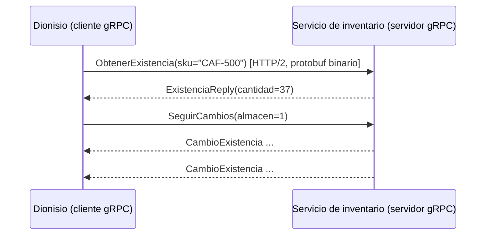

# gRPC

Parte de: [[02-Fundamentos/03 APIs/_Índice APIs|APIs]]

> [!info] Cómo avanzar
> `progreso`: **pendiente** → **viendo** (estudiando) → **visto** (contestaste la autoevaluación sin abrir las respuestas) → **dominado** (hiciste el laboratorio o lo aplicaste de verdad).

## Contenido

### Qué es
**gRPC** es un framework de **llamadas a procedimientos remotos** (RPC) de alto rendimiento, creado por Google y hoy proyecto de la CNCF. Sus dos pilares:

- **Protocol Buffers** (protobuf): el contrato se define en un archivo **`.proto`** (servicios, métodos y mensajes con tipos estrictos), y los mensajes viajan en un **formato binario** compacto, mucho más pequeño y rápido de serializar que JSON.
- **HTTP/2** como transporte: multiplexación, compresión de headers y **streaming** en ambos sentidos (ver [[HTTP 1.1, HTTP 2 y HTTP 3]]).

A partir del `.proto` se **generan** el cliente y el servidor tipados en cada lenguaje (C#, Go, Java, TypeScript…). Llamar a otro servicio se siente como llamar a un método local.

### Cómo funciona
```proto
syntax = "proto3";
option csharp_namespace = "Inventario.Grpc";

service Inventario {
  rpc ObtenerExistencia (ExistenciaRequest) returns (ExistenciaReply);          // unaria
  rpc SeguirCambios (SeguirRequest) returns (stream CambioExistencia);          // streaming del servidor
}

message ExistenciaRequest { string sku = 1; int32 almacen_id = 2; }
message ExistenciaReply   { string sku = 1; int32 cantidad = 2; }
message SeguirRequest     { int32 almacen_id = 1; }
message CambioExistencia  { string sku = 1; int32 cantidad = 2; }
```

Tipos de llamada:
- **Unaria**: una petición, una respuesta (como un `GET` o `POST`).
- **Streaming del servidor**: una petición, muchas respuestas (seguir cambios).
- **Streaming del cliente**: muchas peticiones, una respuesta (subir lecturas).
- **Bidireccional**: ambos envían streams a la vez.



#### Los números de campo son el contrato
En protobuf, en el binario **no viajan los nombres** de los campos, sino sus **números** (`sku = 1`). Por eso la evolución sin romper clientes sigue reglas estrictas:
- **Agregar** campos con **números nuevos**: los clientes viejos los ignoran y los nuevos los leen; si falta, toma su valor por defecto.
- **Nunca reutilizar ni cambiar** el número o el tipo de un campo existente.
- Al **eliminar** un campo, marca su número (y nombre) como **`reserved`** para que nadie lo reutilice por error: `reserved 3; reserved "descuento";`.
- Renombrar un campo es compatible en el binario (el número es el mismo), pero no en JSON transcoding ni en el código generado.

### Ejemplo
En .NET, gRPC está integrado en ASP.NET Core (`Grpc.AspNetCore`). El `.csproj` del servidor referencia el `.proto`:

```xml
<ItemGroup>
  <Protobuf Include="Protos\inventario.proto" GrpcServices="Server" />
</ItemGroup>
```

```csharp
// Servidor: implementa la clase base generada
public class InventarioService(IObtenerExistencia consulta) : Inventario.InventarioBase
{
    public override async Task<ExistenciaReply> ObtenerExistencia(ExistenciaRequest req, ServerCallContext ctx)
    {
        var cantidad = await consulta.EjecutarAsync(req.Sku, req.AlmacenId, ctx.CancellationToken); // Dapper
        return new ExistenciaReply { Sku = req.Sku, Cantidad = cantidad };
    }
}

// Program.cs
builder.Services.AddGrpc();
app.MapGrpcService<InventarioService>();
```

```csharp
// Cliente (en Itzamna.Dionisio), con GrpcServices="Client" en su .csproj
builder.Services.AddGrpcClient<Inventario.InventarioClient>(o => o.Address = new Uri("https://inventario.interno"));

public class ConsultarExistencia(Inventario.InventarioClient cliente)
{
    public async Task<int> EjecutarAsync(string sku, CancellationToken ct)
        => (await cliente.ObtenerExistenciaAsync(new ExistenciaRequest { Sku = sku, AlmacenId = 1 },
                deadline: DateTime.UtcNow.AddSeconds(3), cancellationToken: ct)).Cantidad; // deadline = timeout
}
```

Los errores usan **códigos de estado de gRPC** (`NotFound`, `InvalidArgument`, `Unavailable`, `DeadlineExceeded`), no códigos HTTP.

### Cuándo usarlo y cuándo no
- **Sí**: comunicación **interna entre servicios** con alto volumen o baja latencia, contratos estrictos compartidos entre equipos o lenguajes, y **streaming**.
- **No** para APIs públicas o consumidas desde **navegadores**: el navegador no puede hablar gRPC directo (requiere **gRPC-Web** y un proxy o soporte en el servidor), y la depuración con curl o DevTools es más difícil. Para eso, REST/JSON es más simple. ASP.NET Core ofrece *JSON transcoding* para exponer los mismos servicios también como REST.
- Requiere **HTTP/2 extremo a extremo**: revisa que tu balanceador o proxy lo soporte (Pendiente de confirmar el soporte de cada servicio de Azure que uses, por ejemplo App Service o Container Apps).

### Errores comunes
- **Reutilizar o cambiar números de campo**: corrupción silenciosa de datos entre versiones.
- **No poner deadlines**: llamadas colgadas indefinidamente (ver [[Latencia, ancho de banda y timeouts]]).
- **Usarlo para el front web** sin gRPC-Web.
- **Proxies que degradan a HTTP/1.1** y rompen la conexión.
- **Mensajes gigantes**: hay un tamaño máximo de mensaje configurable; para archivos usa streaming o almacenamiento externo.

### Para profundizar
- [gRPC: Introduction to gRPC](https://grpc.io/docs/what-is-grpc/introduction/)
- [Protocol Buffers: Language Guide (proto3), Updating A Message Type](https://protobuf.dev/programming-guides/proto3/#updating)
- [Microsoft Learn: Overview for gRPC on .NET](https://learn.microsoft.com/en-us/aspnet/core/grpc/)
- [Microsoft Learn: gRPC JSON transcoding in ASP.NET Core](https://learn.microsoft.com/en-us/aspnet/core/grpc/json-transcoding)

## Autoevaluación

Contesta primero en voz alta o en papel; luego despliega la respuesta.

> [!question]- ¿Qué es gRPC?
> Un framework RPC que usa **HTTP/2** y **Protocol Buffers**: el contrato se define en un archivo `.proto` y se generan cliente y servidor tipados. Soporta llamadas unarias y streaming en ambos sentidos.

> [!question]- ¿Cuándo elegirías gRPC sobre REST/JSON?
> Comunicación interna entre servicios con alto volumen o baja latencia, contratos estrictos y streaming. Para APIs públicas o navegadores, REST es más simple (gRPC en el navegador requiere gRPC-Web).

> [!question]- ¿Cómo se evoluciona un mensaje protobuf sin romper clientes?
> Agregando campos con **números nuevos**; nunca reutilizar ni cambiar el número o tipo de un campo existente. Los campos eliminados se marcan `reserved`.

